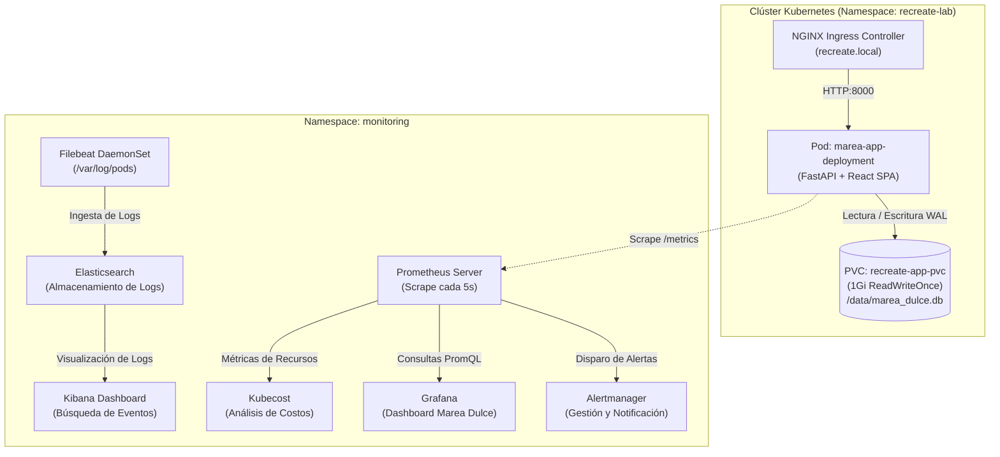

# Arquitectura de Observabilidad y Telemetría — Marea Dulce (Kubernetes Recreate)

**Autores:** Esteban Guarín Valencia, Juan José Arias Gallego  
**Estrategia de Despliegue:** `Recreate` (`spec.strategy.type: Recreate`, `replicas: 1`)  
**Pila de Almacenamiento:** SQLite en modo WAL sobre PersistentVolumeClaim ReadWriteOnce (`recreate-app-pvc`)  
**Ecosistema:** Kubernetes (Minikube), Prometheus, Alertmanager, Grafana, ELK (Elasticsearch + Filebeat + Kibana) y Kubecost.

---

## 1. Misión de la Observabilidad en Despliegues Recreate

En un despliegue de tipo **Recreate**, la aplicación no implementa transiciones continuas sin corte. Por diseño arquitectónico y de coherencia de datos sobre volúmenes con bloqueo exclusivo (como SQLite en PVC `ReadWriteOnce`), **todos los pods de la versión previa deben ser finalizados completamente antes de instanciar la nueva versión**.

Esto genera una **ventana controlada de indisponibilidad (downtime)**. La misión de la observabilidad en este proyecto no es maquillar u ocultar esta interrupción, sino **medirla, aislarla, explicarla y gobernarla con precisión milimétrica**:
1. **Medición exacta del Downtime:** Detectar el instante en que las réplicas disponibles caen a 0 (`kube_deployment_status_replicas_available == 0`) y el momento exacto en que la sonda `/ready` del pod v2.0.0 vuelve a responder HTTP 200.
2. **Monitoreo de Integridad de Persistencia:** Garantizar que las transacciones y pedidos registrados en SQLite sobreviven intactos a la muerte del pod anterior y a la posterior migración de esquema.
3. **Telemetría RED (Rate, Errors, Duration):** Evaluar el impacto en el tráfico cliente durante el corte y el comportamiento de latencia y errores al restablecerse el servicio.
4. **Telemetría USE (Utilization, Saturation, Errors):** Monitorear el consumo de CPU y memoria RAM para evitar caídas imprevistas por OOMKilled o estrangulamiento de CPU.
5. **Auditoría Centralizada de Logs (ELK):** Rastrear la traza de parada ordenada (WAL checkpoint), terminación del proceso y arranque del nuevo contenedor con ejecución de migraciones automáticas.
6. **FinOps y Costos (Kubecost):** Demostrar la eficiencia económica de una arquitectura de réplica única sobre almacenamiento en bloque frente a costos de arquitecturas sobredimensionadas.



---

## 2. Catálogo de Métricas Prometheus

El microservicio expone sus métricas en `/metrics` bajo el estándar de OpenMetrics/Prometheus. Además, el operador Prometheus recolecta métricas nativas del clúster mediante `kube-state-metrics` y `cAdvisor`.

### 2.1 Métricas RED (Tráfico y Rendimiento de la API)

| Métrica | Tipo | Etiquetas | Propósito |
|---|---|---|---|
| `http_requests_total` | Counter | `method`, `endpoint`, `status` | Conteo total de solicitudes HTTP recibidas, clasificadas por código de estado (2xx, 4xx, 5xx). |
| `http_request_duration_seconds` | Histogram | `method`, `endpoint`, `le` | Latencia de atención de solicitudes con buckets desde 5 ms hasta 10 s. Permite calcular P50, P90, P95 y P99. |

### 2.2 Métricas de Dominio y Negocio (E-Commerce Marea Dulce)

| Métrica | Tipo | Etiquetas | Propósito |
|---|---|---|---|
| `marea_orders_total` | Counter | `status` | Total de pedidos registrados en la plataforma (`pending`, `confirmed`, `delivered`, `cancelled`). |
| `marea_revenue_cop_total` | Counter | — | Ingresos acumulados en Pesos Colombianos (COP) generados por pedidos confirmados. |
| `marea_inventory_stock` | Gauge | `product_id`, `product_name` | Nivel actual de unidades disponibles por cada producto del catálogo artesanal. |
| `marea_active_sessions` | Gauge | — | Estimación de clientes navegando concurrentemente la tienda web. |

### 2.3 Métricas de Almacenamiento y Ciclo Recreate

| Métrica | Tipo | Etiquetas | Propósito |
|---|---|---|---|
| `kube_deployment_status_replicas_available` | Gauge | `namespace`, `deployment` | Número de pods activos y listos. Durante el corte de Recreate, su valor cae a `0`. |
| `marea_db_operations_total` | Counter | `operation`, `status` | Conteo de lecturas, escrituras, respaldos y transacciones ejecutadas sobre SQLite en el PVC. |
| `marea_db_storage_errors_total` | Counter | — | Errores de acceso al disco persistente o bloqueos de concurrencia no resueltos. |

---

## 3. Reglas de Alerta y Alertmanager (`PrometheusRule`)

Las reglas están declaradas en [k8s/prometheusrule.yaml](file:///home/guarinve/Documentos/k8s-recreate-deployment/k8s/prometheusrule.yaml). Cada alerta cuenta con etiquetas de severidad y anotaciones que guían la resolución inmediata:

### 3.1 `RecreateDeploymentZeroReplicasWindow`
- **Expresión:** `kube_deployment_status_replicas_available{namespace="recreate-lab", deployment="marea-app-deployment"} == 0`
- **Duración:** `0m` (disparo instantáneo)
- **Severidad:** `warning`
- **Significado:** Alerta pedagógica y operativa. Se dispara durante los 2 a 4 segundos en que Kubernetes termina el pod v1.0.0 y aún no ha inicializado v2.0.0. Permite marcar en la línea de tiempo de Grafana el inicio y fin exacto de la interrupción.

### 3.2 `HighHttp5xxErrorRate`
- **Expresión:** `sum(rate(http_requests_total{namespace="recreate-lab", status=~"5.."}[1m])) > 0.2`
- **Duración:** `10s`
- **Severidad:** `critical`
- **Significado:** Detecta fallos de aplicación internos no controlados que superen 0.2 errores por segundo.

### 3.3 `HighRequestLatencyP95`
- **Expresión:** `histogram_quantile(0.95, sum(rate(http_request_duration_seconds_bucket{namespace="recreate-lab"}[1m])) by (le)) > 1.0`
- **Duración:** `10s`
- **Severidad:** `warning`
- **Significado:** El percentil 95 supera 1 segundo, evidenciando contención de E/S o contención de bloqueos en SQLite.

### 3.4 `HighPodCpuUsageAbove80Percent`
- **Expresión:** `(sum by (pod) (rate(container_cpu_usage_seconds_total{namespace="recreate-lab", pod=~"marea-app-deployment-.*"}[1m])) / sum by (pod) (kube_pod_container_resource_limits{namespace="recreate-lab", container="app", resource="cpu"})) * 100 > 80`
- **Duración:** `15s`
- **Severidad:** `warning`
- **Significado:** Consumo sostenido superior al 80% del límite de CPU asignado (500m).

### 3.5 `PersistentVolumeStorageErrors`
- **Expresión:** `sum(rate(marea_db_storage_errors_total{namespace="recreate-lab"}[1m])) > 0`
- **Duración:** `5s`
- **Severidad:** `critical`
- **Significado:** Fallos de E/S en `/data/marea_dulce.db` montado desde el PersistentVolumeClaim.

---

## 4. Tablero de Grafana (`grafana-dashboard-recreate.json`)

El tablero oficial [monitoring/prometheus/grafana-dashboard-recreate.json](file:///home/guarinve/Documentos/k8s-recreate-deployment/monitoring/prometheus/grafana-dashboard-recreate.json) (UID: `marea-dulce-recreate`) está organizado en 5 secciones visuales:

```
+---------------------------------------------------------------------------------------------------+
| [SECCIÓN 1: ESTADO DEL CICLO RECREATE Y DISPONIBILIDAD EN TIEMPO REAL]                            |
| +--------------------------------------+ +------------------------------------------------------+ |
| | Panel 1: Réplicas Disponibles        | | Panel 2: Ventana de Corte Activa (Downtime)          | |
| | Expr: replicas_available (1 = Sano)  | | Expr: 1 - clamp_max(replicas, 1) (0=Normal, 1=Corte) | |
| +--------------------------------------+ +------------------------------------------------------+ |
+---------------------------------------------------------------------------------------------------+
| [SECCIÓN 2: MODELO RED (RATE, ERRORS, DURATION)]                                                  |
| +--------------------------------------+ +------------------------------------------------------+ |
| | Panel 3: Tasa de Peticiones (RPS)    | | Panel 4: Errores HTTP 4xx y 5xx                      | |
| | rate(http_requests_total[1m])        | | sum(rate(http_requests_total{status=~"[45].."}[1m])) | |
| +--------------------------------------+ +------------------------------------------------------+ |
| +-----------------------------------------------------------------------------------------------+ |
| | Panel 5: Latencia de Respuesta HTTP (Percentiles P50, P95, P99 con Umbral de Alerta a 1.0s)   | |
| +-----------------------------------------------------------------------------------------------+ |
+---------------------------------------------------------------------------------------------------+
| [SECCIÓN 3: PERSISTENCIA SQLITE Y MÉTRICAS DE NEGOCIO E-COMMERCE]                                 |
| +--------------------------------------+ +------------------------------------------------------+ |
| | Panel 6: Pedidos Creados por Estado  | | Panel 7: Ingresos Totales en COP                     | |
| | sum by (status)(marea_orders_total)  | | marea_revenue_cop_total                              | |
| +--------------------------------------+ +------------------------------------------------------+ |
| +-----------------------------------------------------------------------------------------------+ |
| | Panel 8: Operaciones de Disco en PVC SQLite (Lecturas, Escrituras WAL, Respaldos)             | |
| +-----------------------------------------------------------------------------------------------+ |
+---------------------------------------------------------------------------------------------------+
| [SECCIÓN 4: MODELO USE (UTILIZATION, SATURATION, ERRORS)]                                         |
| +--------------------------------------+ +------------------------------------------------------+ |
| | Panel 9: CPU Working Rate (% Límite) | | Panel 10: Memoria RAM Working Set (Bytes vs Límite)  | |
| +--------------------------------------+ +------------------------------------------------------+ |
+---------------------------------------------------------------------------------------------------+
| [SECCIÓN 5: FINOPS Y ANÁLISIS DE COSTOS (KUBECOST)]                                               |
| +-----------------------------------------------------------------------------------------------+ |
| | Costo Mensual Proyectado por Recurso (CPU, RAM, PVC 1Gi) en Namespace recreate-lab            | |
| +-----------------------------------------------------------------------------------------------+ |
+---------------------------------------------------------------------------------------------------+
```

---

## 5. Auditoría y Logs Centralizados con ELK

El despliegue de la pila ELK (Elasticsearch 8.12, Filebeat 8.12, Kibana 8.12) en [monitoring/elk/values-elk.yaml](file:///home/guarinve/Documentos/k8s-recreate-deployment/monitoring/elk/values-elk.yaml) captura los eventos del ciclo de vida del contenedor:

1. **Captura de `SIGTERM`:** El pod v1.0.0 recibe la señal de terminación de Kubernetes (`terminationGracePeriodSeconds: 30`).
2. **Cierre de conexiones SQLite:** FastAPI ejecuta el handler de shutdown, ejecutando `PRAGMA wal_checkpoint(TRUNCATE)` y cerrando los descriptores de archivo.
3. **Muerte del Pod v1:** Kubernetes registra la desasignación del nodo y la liberación del volumen PVC.
4. **Arranque del Pod v2:** El nuevo pod v2.0.0 monta el PVC, el script `database.py` corre `run_migrations()` comprobando `PRAGMA integrity_check` y ejecutando las migraciones incrementales.
5. **Listo para Tráfico:** La sonda `/ready` devuelve 200 y el Ingress reanuda el enrutamiento.

### Búsquedas Clave en Kibana (`http://localhost:5601/app/discover`):
- `kubernetes.container.name: "app" AND "Migración"`: Registros de actualización de esquema de base de datos.
- `kubernetes.container.name: "app" AND "SIGTERM"`: Evidencia de apagado elegante.
- `kubernetes.container.name: "app" AND "order_number"`: Traza de auditoría de pedidos creados con su `Idempotency-Key`.

---

## 6. FinOps y Eficiencia de Costos (Kubecost)

En el marco de la ingeniería de software moderna, la arquitectura Recreate ofrece una ventaja fundamental de costo:

1. **Ahorro en Licenciamiento y Cómputo:** Al no requerir pods redundantes ni réplicas duplicadas durante el despliegue, la huella de memoria y CPU es estrictamente constante (`1 pod = 100m CPU / 128Mi RAM`).
2. **Eficiencia en Almacenamiento:** Un único PersistentVolumeClaim de 1Gib estándar (`ReadWriteOnce`) cubre el 100% de la persistencia transaccional sin requerir servicios gestionados de base de datos distribuidos (RDS, Cloud SQL), que multiplican por 10x el costo de infraestructura.
3. **Cálculo de Costo de Interrupción vs Costo de Infraestructura:**
   - Una ventana de corte de 3 segundos una vez por ciclo de release tiene un costo de negocio prácticamente despreciable en un e-commerce artesanal.
   - En contraste, sostener una infraestructura de base de datos distribuida multi-escritor de alta disponibilidad implica un costo base de decenas de dólares mensuales innecesarios.

---

## 7. Procedimiento de Demostración y Simulación de Alarmas

Para la sustentación ante el jurado, se cuenta con scripts automatizados que disparan los tres escenarios de prueba:

### A. Prueba de Downtime en Rollout Recreate
```bash
# Iniciar generador de tráfico cliente en segundo plano
python3 scripts/traffic_generator.py --url http://recreate.local --interval 0.2 &

# Disparar actualización Recreate a v2.0.0
bash scripts/rollout_v2.sh
```
*Resultado observable:* En Grafana se observa la caída momentánea de RPS a 0 y el panel de "Ventana de Corte" en rojo durante ~3.2 segundos, tras lo cual la versión cambia a 2.0.0 y las ventas acumuladas continúan intactas.

### B. Disparo de Alarma por Tasa de Errores 5xx
```bash
python3 scripts/test_alerts.py --url http://recreate.local --type errors --errors-count 50
```
*Resultado observable:* Alerta `HighHttp5xxErrorRate` cambia a estado `FIRING` en Alertmanager (`http://localhost:9093`) y la gráfica de errores en Grafana muestra el pico rojo.

### C. Disparo de Alarma por Degradación de Latencia P95
```bash
python3 scripts/test_alerts.py --url http://recreate.local --type latency --latency-count 10 --latency-delay 1.5
```
*Resultado observable:* Alerta `HighRequestLatencyP95` pasa de `PENDING` a `FIRING` al superar el umbral de 1.0s.
