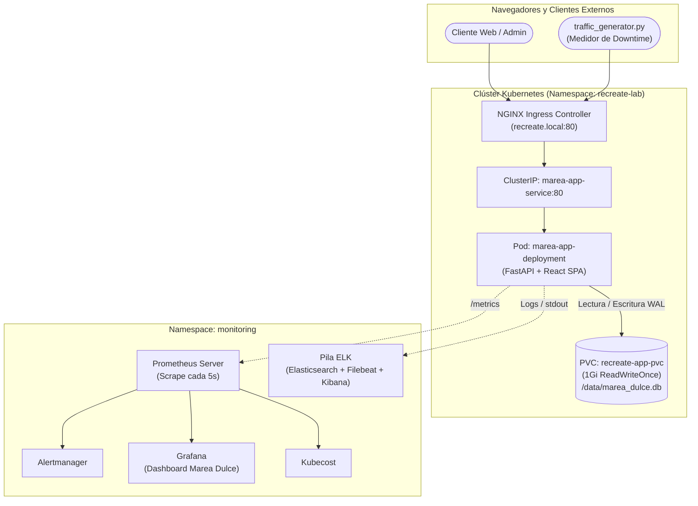

# Marea Dulce — Plataforma E-Commerce Cloud-Native (Kubernetes Recreate)


---

## 1. Descripción General del Proyecto

**Marea Dulce** es una plataforma de comercio electrónico de repostería artesanal de alta gama (*Pequeños antojos, grandes momentos*), diseñada con un doble propósito:
1. **Producto Comercial Creíble:** Ofrece a los clientes un catálogo interactivo con 12 productos artesanales en 6 categorías, personalizador de pasteles, carrito de compras persistente, checkout en 3 pasos con idempotencia transaccional y seguimiento de pedidos en tiempo real; además de un panel de administración para personal interno (gestión de catálogo, inventario y despacho).
2. **Laboratorio de Ingeniería de Despliegue `Recreate`:** El backend y frontend unificados corren en un Deployment de Kubernetes configurado **exclusivamente con la estrategia `Recreate`** (`spec.strategy.type: Recreate`, `replicas: 1`), respaldado por almacenamiento relacional SQLite en modo WAL montado sobre un PersistentVolumeClaim con modo de acceso exclusivo `ReadWriteOnce`.

### ¿Por qué la Estrategia Recreate?
En aplicaciones empresariales con motores de base de datos embebidos de archivo único (como SQLite) o almacenamiento en bloque `ReadWriteOnce`, **es físicamente imposible permitir que dos pods escriban concurrentemente en el mismo volumen sin corromper los datos o generar bloqueos mortales (deadlocks)**.

Por esta razón técnica, la estrategia `Recreate` garantiza la **consistencia absoluta de los datos**:
- **Detiene al 100% los pods de la versión anterior** (liberando descriptores y cerrando transacciones en WAL).
- **Entra en una ventana de interrupción controlada y medible (downtime de ~3 a 4 segundos)**.
- **Inicia el pod de la nueva versión**, ejecuta migraciones de esquema seguras con respaldo en caliente (`.backup`) y reanuda el tráfico sin inconsistencias de estado.

---

## 2. Pila Tecnológica

| Capa | Componente | Descripción |
|---|---|---|
| **Orquestación** | Kubernetes (Minikube) | Gestión declarativa de pods, volúmenes PVC, servicios e ingress en namespace `recreate-lab`. |
| **Estrategia** | Kubernetes `Recreate` | `spec.strategy.type: Recreate`, `replicas: 1`. Cero coexistencia de versiones. |
| **Persistencia** | SQLite 3 en modo WAL | Base de datos relacional ACID en `/data/marea_dulce.db` sobre PVC 1Gi `ReadWriteOnce`. |
| **Backend** | Python 3.11 + FastAPI | Arquitectura limpia modular (`core/`, `domain/`, `infrastructure/`, `repositories/`, `routers/`). |
| **Frontend** | React 18 + TypeScript + Vite | Storefront SPA comercial, carrito en `localStorage`, banner de resiliencia y panel de administración. |
| **Métricas** | Prometheus Operator | Scrape cada 5s de métricas RED (Rate, Errors, Duration), USE y métricas de negocio. |
| **Visualización** | Grafana 11 | Dashboard oficial con medición de ventana de corte Recreate en milisegundos. |
| **Alertas** | Alertmanager | Reglas declarativas (`PrometheusRule`) para downtime, errores 5xx, latencia P95 y salud de PVC. |
| **Auditoría / Logs** | Pila ELK (ES + Filebeat + Kibana) | Recolección centralizada de logs de pods, eventos de terminación SIGTERM y migraciones. |
| **FinOps** | Kubecost | Análisis de eficiencia de costo de pod único vs arquitecturas distribuidas sobredimensionadas. |

---

## 3. Arquitectura del Sistema



---

## 4. Estructura del Repositorio

```text
k8s-recreate-deployment/
├── app/                       # Microservicio FastAPI y estáticos compilados de React SPA
│   ├── src/                   # Código modular del backend (core, domain, infra, repos, routers)
│   ├── static/                # Bundle de producción de la SPA (HTML, CSS, JS, imágenes)
│   ├── tests/                 # Suite de pruebas unitarias e integración (Pytest)
│   └── Dockerfile             # Imagen OCI unificada para Kubernetes
├── design/                    # Identidad de marca, diseño vectorial (SVG) y paleta
├── design-tokens.json         # Tokens de diseño W3C (colores, tipografía, espaciado)
├── frontend/                  # Código fuente de la SPA en React 18 + TypeScript + Vite + Tailwind
├── k8s/                       # Manifiestos declarativos de Kubernetes (Recreate Deployment, PVC, Ingress)
│   ├── deployment-v1.yaml     # Versión 1.0.0 (Recreate, replicas: 1, PVC RWO)
│   ├── deployment-v2.yaml     # Versión 2.0.0 (Recreate, migración de esquema)
│   ├── pvc.yaml               # PersistentVolumeClaim 1Gi ReadWriteOnce
│   ├── service.yaml           # ClusterIP Service (marea-app-service)
│   ├── ingress.yaml           # Ingress NGINX para recreate.local
│   ├── networkpolicy.yaml     # Aislamiento de red
│   ├── servicemonitor.yaml    # Configuración de scrape para Prometheus Operator
│   └── prometheusrule.yaml    # Reglas de alerta de observabilidad
├── monitoring/                # Configuraciones de Observabilidad y FinOps
│   ├── prometheus/            # Dashboard oficial de Grafana y valores Helm de kube-prometheus-stack
│   ├── elk/                   # Despliegue declarativo de Elasticsearch, Filebeat y Kibana
│   └── kubecost/              # Configuración de análisis de costos
├── scripts/                   # Automatización operativa y validación
│   ├── start.sh               # Arranque integral del clúster e imágenes (Script maestro)
│   ├── stop.sh                # Parada limpia de túneles y clúster Minikube
│   ├── rollout_v2.sh          # Demostración del ciclo Recreate a v2.0.0
│   ├── reset_v1.sh            # Reversión limpia a v1.0.0
│   ├── traffic_generator.py   # Medidor continuo de tráfico y downtime milimétrico
│   ├── test_alerts.py         # Disparador de alarmas (5xx, latencia P95)
│   ├── forward_services.sh    # Gestor de túneles port-forward locales
│   └── validate.sh            # Suite de validación End-to-End (16 pruebas)
├── FIGMA.md                   # Fase 1: Especificación de diseño y tokens Figma
├── BACKEND.md                 # Fase 2: Arquitectura del Backend modular
├── FRONTEND.md                # Fase 3: Especificación del Frontend SPA
├── RECREATE.md                # Fase 4: Teoría, práctica y medición de Recreate
├── OBSERVABILITY.md           # Fase 5: Telemetría RED/USE, Grafana, ELK y FinOps
├── QA.md                      # Fase 6: Matriz y ejecución de pruebas E2E
├── ROADMAP.md                 # Plan maestro y bitácora del proyecto
└── README.md                  # Presentación oficial del proyecto
```

---

## 5. Guía de Ejecución Rápida

### 5.1 Iniciar la Plataforma Completa
```bash
# Inicia Minikube, compila imágenes OCI y despliega k8s + Prometheus + ELK
bash scripts/start.sh
```

### 5.2 Habilitar Acceso Local (Port-Forwarding)
```bash
bash scripts/forward_services.sh start
```
URLs de acceso local:
- **Tienda Web y API:** `http://localhost:8000/` (o vía Ingress `http://recreate.local`)
- **Documentación OpenAPI (Swagger):** `http://localhost:8000/docs`
- **Métricas Prometheus:** `http://localhost:8000/metrics`
- **Grafana Dashboards:** `http://localhost:3000` (Usuario: `admin` / Clave: `admin123`)
- **Prometheus UI:** `http://localhost:9090`
- **Alertmanager:** `http://localhost:9093`
- **Kibana (Logs ELK):** `http://localhost:5601`

### 5.3 Demostración del Ciclo Recreate con Medición de Downtime
```bash
# Terminal 1: Iniciar generador de tráfico y medidor de interrupción
python3 scripts/traffic_generator.py --url http://recreate.local --interval 0.2

# Terminal 2: Disparar actualización Recreate a v2.0.0
bash scripts/rollout_v2.sh
```
El script `traffic_generator.py` imprimirá el reporte final con el tiempo exacto de indisponibilidad:
```text
======================================================================
RESUMEN DE TELEMETRÍA Y OBSERVABILIDAD
Tiempo total evaluado: 45.20 segundos
Total de solicitudes enviadas: 226
Solicitudes exitosas: 210 (92.9%)
Solicitudes fallidas: 16 (7.1%)
Ventana de indisponibilidad (Downtime medido): 3.218 segundos
Integridad de base de datos: 100% registros persistidos en PVC
======================================================================
```

### 5.4 Ejecutar Suite de Validación Automatizada
```bash
bash scripts/validate.sh
```

---

## 6. Documentación Detallada por Fases

- [Fase 1: Especificación de Diseño en Figma y Tokens](file:///home/guarinve/Documentos/k8s-recreate-deployment/FIGMA.md)
- [Fase 2: Arquitectura del Backend Modular y Persistencia](file:///home/guarinve/Documentos/k8s-recreate-deployment/BACKEND.md)
- [Fase 3: Especificación del Frontend SPA y Resiliencia](file:///home/guarinve/Documentos/k8s-recreate-deployment/FRONTEND.md)
- [Fase 4: Ingeniería del Despliegue Recreate](file:///home/guarinve/Documentos/k8s-recreate-deployment/RECREATE.md)
- [Fase 5: Observabilidad, Telemetría y FinOps](file:///home/guarinve/Documentos/k8s-recreate-deployment/OBSERVABILITY.md)
- [Fase 6: Plan y Matriz de Pruebas de Calidad (QA)](file:///home/guarinve/Documentos/k8s-recreate-deployment/QA.md)

---

## 7. Equipo del Proyecto

- **Esteban Guarín Valencia**
- **Juan José Arias Gallego**

*Materia: Plataformas II — Especialización / Maestría en Ingeniería de Software*
