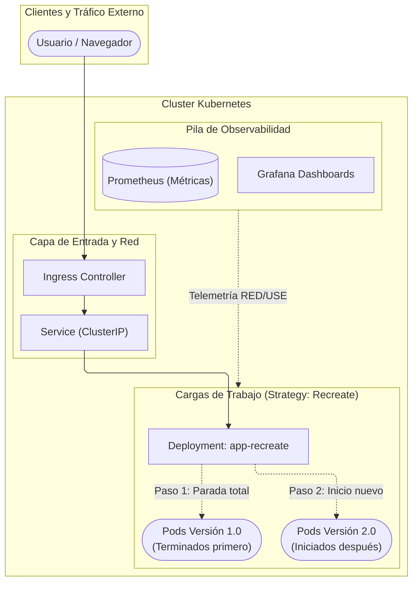

# K8s Recreate Deployment

       

---

## Descripción General
Este proyecto demuestra de forma práctica y reproducible el funcionamiento de la estrategia de despliegue **Recreate** en Kubernetes. A diferencia de las actualizaciones progresivas (*RollingUpdate*), la estrategia `Recreate` detiene de manera controlada y simultánea todas las réplicas en ejecución de la versión anterior antes de iniciar los Pods de la nueva versión.

El propósito principal es analizar el comportamiento del ciclo de vida de los Pods, evaluar el tiempo de interrupción planificada (*downtime*) y capturar la telemetría en tiempo real mediante una pila de observabilidad integrada.

---

## Tabla de Contenidos
- [Estructura del Proyecto](#estructura-del-proyecto)
- [Tecnologías Utilizadas](#tecnologías-utilizadas)
- [Arquitectura de Infraestructura](#arquitectura-de-infraestructura)
- [Requisitos Previos del Sistema](#requisitos-previos-del-sistema)
- [Inicialización Rápida](#inicialización-rápida)
- [Cómo Contribuir](#cómo-contribuir)
- [Equipo](#equipo)

---

## Estructura del Proyecto
```text
k8s-recreate-deployment/
├── docs/                      # Documentación técnica extendida y diagramas exportados
├── k8s/                       # Manifiestos de Kubernetes (Deployment, Service, Ingress)
├── monitoring/                # Configuraciones de observabilidad (Prometheus / Grafana)
├── scripts/                   # Scripts de automatización, pruebas de carga y métricas
├── Recreate Deployment.md     # Notas preliminares de análisis y requerimientos
└── README.md                  # Carta de presentación pública del repositorio
```

---

## Tecnologías Utilizadas

| Tecnología / Herramienta | Tipo / Rol en el Proyecto | Versión / Estándar |
| :--- | :--- | :--- |
| **Kubernetes** | Orquestador principal de contenedores | `v1.28+` |
| **Estrategia Recreate** | Mecanismo de actualización de cargas de trabajo | `spec.strategy.type: Recreate` |
| **Docker Engine** | Motor de contenedores y runtime local | `v24.0+` |
| **Minikube / Kind** | Cluster de Kubernetes local para laboratorio | Minikube `v1.32+` / Kind `v0.20+` |
| **Prometheus** | Servidor de recolección y consulta de métricas | `v2.45+` (TSDB) |
| **Grafana** | Visualización interactiva y tableros de control | `v10.0+` |
| **Python Diagrams** | Diagramación automatizada de infraestructura como código | `v0.25.1` (Graphviz `0.20.3`) |
| **YAML / Bash** | Definición declarativa de infraestructura y automatización | POSIX Shell / YAML 1.2 |

---

## Arquitectura de Infraestructura



---

## Requisitos Previos del Sistema

| Componente / Herramienta | Versión Mínima | Configuración Mínima Requerida |
| :--- | :--- | :--- |
| **Docker Engine** | `24.0.0` o superior | Demonio `docker.service` activo; usuario actual añadido al grupo `docker` (`sudo usermod -aG docker $USER`) para ejecutar comandos sin `sudo` |
| **Minikube** | `v1.32.0` o superior | Driver configurado con Docker (`minikube config set driver docker`); puertos locales `80`, `443` y `8443` libres de conflicto |
| **kubectl CLI** | `v1.28.0` o superior | Contexto activo apuntando al cluster local (`kubectl config current-context` -> `minikube`) |
| **Python** | `3.10` o superior | Entorno virtual disponible para utilidades y generación de diagramas |

---

## Inicialización Rápida

1. **Clonar el repositorio:**
   ```bash
   git clone https://github.com/guarinve/k8s-recreate-deployment.git
   cd k8s-recreate-deployment
   ```

2. **Verificar permisos y estado del demonio Docker:**
   ```bash
   docker info > /dev/null 2>&1 && echo "Docker operativo" || echo "Inicia el demonio de Docker"
   ```

3. **Iniciar el cluster local con Minikube:**
   ```bash
   minikube start --driver=docker
   ```

4. **Aplicar los manifiestos declarativos de Kubernetes:**
   ```bash
   kubectl apply -f k8s/
   ```

5. **Monitorear el ciclo de vida del despliegue Recreate:**
   ```bash
   kubectl get deployments
   kubectl get pods -w
   ```

---

## Cómo Contribuir
1. Crea una rama para tu característica o corrección:
   ```bash
   git checkout -b feature/nueva-funcionalidad
   ```
2. Realiza tus cambios asegurando que no se modifiquen rutas privadas del agente (`.gemini/`).
3. Envía tus cambios mediante un Pull Request con una descripción concisa del impacto técnico.

---

## Equipo
- **Esteban Guarín Valencia**
- **Juan José Arias Gallego**
