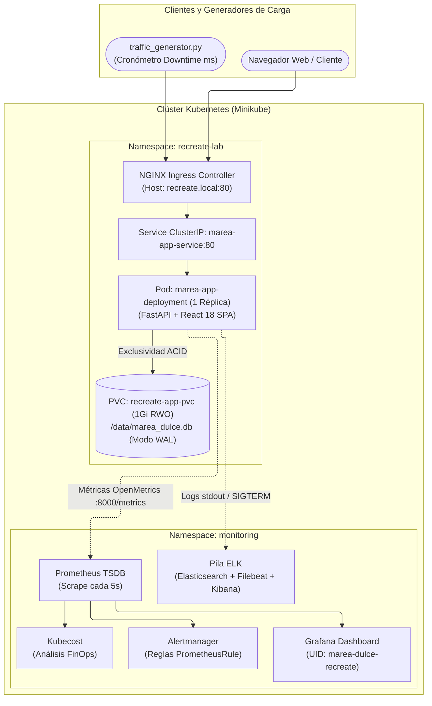

# Marea Dulce — Plataforma E-Commerce Cloud-Native

       

---

## 1. Descripción Corta

**Marea Dulce** es una plataforma de comercio electrónico de repostería artesanal de alta gama (*Pequeños antojos, grandes momentos*), diseñada con un doble propósito: ofrecer un producto comercial creíble (catálogo de 12 productos en 6 categorías, personalizador de pasteles, carrito persistente, checkout con pagos simulados y panel administrativo) y servir como laboratorio riguroso de ingeniería de software para evaluar la estrategia de despliegue **Recreate** en Kubernetes (`spec.strategy.type: Recreate`, `replicas: 1`).

La aplicación resuelve el desafío técnico de garantizar consistencia transaccional ACID sobre almacenamiento relacional embebido **SQLite 3 en modo Write-Ahead Logging (WAL)** alojado en un volumen persistente `PersistentVolumeClaim` con modo de acceso exclusivo **`ReadWriteOnce`**. Al utilizar `Recreate`, Kubernetes finaliza al 100% el pod de la versión anterior antes de instanciar la nueva versión, eliminando colisiones de concurrencia y permitiendo medir cuantitativamente la ventana de corte (~3.2 segundos) mediante una pila de observabilidad integrada (Prometheus, Grafana, ELK y Kubecost).

---

## 2. Tabla de Contenidos

- [Estructura del Proyecto](#3-estructura-del-proyecto)
- [Tecnologías Utilizadas](#4-tecnologías-utilizadas)
- [Arquitectura de Infraestructura](#5-arquitectura-de-infraestructura)
- [Requisitos Previos](#6-requisitos-previos)
- [Inicialización Rápida](#7-inicialización-rápida)
- [Cómo Contribuir](#8-cómo-contribuir)
- [Equipo](#9-equipo)

---

## 3. Estructura del Proyecto

```text
k8s-recreate-deployment/
├── app/                       # Código fuente y contenedorización del microservicio unificado
│   ├── src/                   # Backend modular FastAPI (core, domain, infrastructure, repositories, routers)
│   ├── static/                # Bundle estático de producción de la SPA (HTML, CSS, JS, SVGs)
│   ├── tests/                 # Suite de pruebas unitarias e integración del backend (Pytest)
│   └── Dockerfile             # Imagen OCI unificada (Python 3.11 + Uvicorn + Frontend compilado)
├── design/                    # Identidad visual, activos vectoriales de marca y tokens W3C
│   ├── assets/                # Isotipos y logotipos oficiales vectoriales
│   └── design-tokens.json     # Tokens de diseño W3C (colores, tipografía, espaciado, radios)
├── docs/                      # Base de conocimiento técnico consolidada
│   ├── README.md              # Índice maestro de documentación y mapa de navegación
│   ├── guia-rapida.md         # Guía de instalación rápida, demo Recreate y reversión a v1
│   ├── Figma.md               # Especificación de diseño UI/UX, contrastes WCAG AA y catálogo
│   ├── Frontend.md            # Arquitectura React 18, gestión de estados y resiliencia
│   ├── Backend.md             # Arquitectura modular FastAPI, repositorios y persistencia SQLite
│   ├── recreate.md            # Documentación técnica de la estrategia Recreate y ciclo de vida
│   ├── sqlite-pvc.md          # Persistencia en volumen PVC ReadWriteOnce (1 GiB)
│   ├── kubernetes.md          # Manifiestos y orquestación de recursos en Minikube
│   ├── network-policies.md    # Aislamiento y seguridad de red con NetworkPolicy
│   ├── hpa.md                 # Análisis de elasticidad y justificación de réplica única
│   ├── prometheus.md          # Recolección de métricas OpenMetrics y reglas de alerta
│   ├── grafana.md             # Tablero unificado de observabilidad RED, USE y FinOps
│   ├── elk.md                 # Centralización de logs (Elasticsearch + Filebeat + Kibana)
│   ├── kubecost.md            # Monitoreo y atribución de costos cloud en tiempo real
│   ├── kubecost-value.md      # Retorno de inversión y gobernanza económica FinOps
│   ├── business-model.md      # Modelo de negocio y economía unitaria de Marea Dulce
│   ├── deployment-value.md    # Justificación del valor de Recreate frente a RollingUpdate
│   ├── observability-value.md # Impacto operativo de la telemetría de alta resolución
│   ├── security-value.md      # Postura de seguridad y protección de datos
│   ├── sso-mfa.md             # Control de acceso administrativo con JWT bcrypt
│   ├── executive-summary.md   # Resumen ejecutivo global del proyecto
│   ├── architecture/          # Diagramas y evolución arquitectónica
│   └── evidence/              # Trazas de validación y telemetría de corte Recreate
├── frontend/                  # Código fuente de la SPA en React 18 + TypeScript + Vite + Tailwind
├── k8s/                       # Manifiestos declarativos de Kubernetes (namespace: recreate-lab)
│   ├── deployment-v1.yaml     # Versión 1.0.0 (strategy: Recreate, replicas: 1, PVC RWO)
│   ├── deployment-v2.yaml     # Versión 2.0.0 (strategy: Recreate, migración de esquema)
│   ├── pvc.yaml               # PersistentVolumeClaim 1Gi ReadWriteOnce
│   ├── service.yaml           # Service ClusterIP (marea-app-service:80 -> 8000)
│   ├── ingress.yaml           # Ingress NGINX para recreate.local
│   ├── networkpolicy.yaml     # Política de aislamiento de red
│   ├── servicemonitor.yaml    # Recurso de scrape para Prometheus Operator
│   └── prometheusrule.yaml    # Reglas de alerta declarativas de observabilidad
├── monitoring/                # Configuraciones de observabilidad y FinOps (namespace: monitoring)
│   ├── prometheus/            # Tablero oficial de Grafana y valores Helm kube-prometheus-stack
│   ├── elk/                   # Despliegue declarativo de Elasticsearch, Filebeat y Kibana
│   └── kubecost/              # Configuración de análisis y atribución de costos
├── scripts/                   # Suite depurada de automatización operativa
│   ├── start.sh               # 🚀 Script maestro de inicio (prerrequisitos + Minikube + despliegue)
│   ├── stop.sh                # 🛑 Parada limpia de túneles y clúster Minikube
│   ├── status.sh              # 🔍 Diagnóstico integral de salud y opción de reset con backup
│   ├── forward_services.sh    # 🌐 Gestor de túneles port-forward en segundo plano
│   ├── traffic_generator.py   # ⏱️ Medidor continuo de tráfico y cronómetro de downtime (ms)
│   ├── rollout_v2.sh          # 🔄 Disparador de actualización Recreate a v2.0.0
│   ├── reset_v1.sh            # ↩️ Reversión determinista a v1.0.0
│   ├── validate.sh            # ✅ Suite de validación automatizada E2E (16 pruebas)
│   ├── benchmark.sh           # ⚡ Pruebas sintéticas de latencia y rendimiento HTTP
│   ├── test_alerts.py         # 🚨 Disparador de alarmas operativas (5xx y latencia P95)
│   └── README.md              # 📖 Documentación operativa de los scripts
└── README.md                  # Carta de presentación pública del repositorio
```

---

## 4. Tecnologías Utilizadas

| Tecnología / Herramienta | Tipo / Rol en el Proyecto | Versión / Estándar |
| :--- | :--- | :--- |
| **Kubernetes** | Orquestador principal de contenedores y cargas de trabajo | `v1.28+` / `v1.32+` (Minikube) |
| **Estrategia Recreate** | Mecanismo de actualización de cargas de trabajo con corte | `spec.strategy.type: Recreate` |
| **FastAPI** | Framework asíncrono para la API REST y servidor estático | `v0.115+` (Python `3.11+`) |
| **React** | Librería de interfaz de usuario para la SPA comercial | `v18.3+` |
| **TypeScript** | Tipado estático estricto para frontend y contratos de API | `v5.5+` |
| **Tailwind CSS** | Framework utilitario mapeado a tokens de diseño W3C | `v3.4+` |
| **SQLite 3** | Motor relacional embebido con transacciones ACID | `v3.45+` (Modo WAL) |
| **Prometheus** | Servidor de series temporales y evaluación de alertas | `v2.50+` (kube-prometheus-stack) |
| **Grafana** | Tableros interactivos para telemetría RED, USE y FinOps | `v11.0+` |
| **Pila ELK** | Elasticsearch, Filebeat y Kibana para trazabilidad de logs | `v8.12+` |
| **Kubecost** | Motor de atribución y análisis de costos de infraestructura | `cost-analyzer v2.0+` |
| **Docker** | Motor de contenedores y runtime local | `v24.0+` / `v27.0+` |

---

## 5. Arquitectura de Infraestructura



---

## 6. Requisitos Previos

| Componente / Herramienta | Versión Mínima | Configuración Mínima Requerida |
| :--- | :--- | :--- |
| **Docker Engine** | `24.0+` | Demonio activo (`systemctl is-active docker`) y usuario en grupo `docker`. |
| **Minikube** | `v1.32+` | Driver `docker` habilitado con soporte para 6 CPUs y 10 GiB RAM. |
| **Kubectl** | `v1.28+` | Conectividad configurada hacia el contexto local de Minikube. |
| **Helm** | `v3.12+` | Acceso a repositorios comunitarios (`prometheus-community`). |
| **Python** | `3.10+` | Intérprete disponible en `$PATH` para scripts de validación y telemetría. |
| **Kernel Linux** | Parámetro `vm.max_map_count` | Valor $\ge 262144$ requerido para el arranque de Elasticsearch. |

---

## 7. Inicialización Rápida

Para inicializar y desplegar la plataforma completa desde cero, ejecute en orden:

```bash
# 1. Ejecutar el script maestro (comprueba Docker, inicia Minikube, compila imágenes y despliega)
bash scripts/start.sh

# 2. Abrir los túneles locales de red hacia la aplicación y tableros en segundo plano
bash scripts/forward_services.sh start

# 3. Verificar el estado consolidado de la infraestructura
bash scripts/status.sh

# 4. Ejecutar la suite automatizada de validación E2E (16 pruebas)
bash scripts/validate.sh
```

### URLs de Acceso a Servicios Locales

- **Tienda Web Marea Dulce (SPA):** `http://localhost:8000/` (o vía Ingress en `http://recreate.local`)
- **Documentación OpenAPI (Swagger):** `http://localhost:8000/docs`
- **Métricas Prometheus:** `http://localhost:8000/metrics`
- **Tablero Grafana:** `http://localhost:3000` (`admin` / `admin123`)
- **Prometheus UI:** `http://localhost:9090`
- **Alertmanager:** `http://localhost:9093`
- **Kibana (Logs ELK):** `http://localhost:5601`

### Demostración del Ciclo Recreate con Medición de Downtime

```bash
# Terminal 1: Iniciar generador continuo de tráfico
python3 scripts/traffic_generator.py --url http://recreate.local --interval 0.2

# Terminal 2: Disparar la transición Recreate a la versión 2.0.0
bash scripts/rollout_v2.sh

# Terminal 2: Revertir a la versión 1.0.0 al finalizar la prueba
bash scripts/reset_v1.sh
```

---

## 8. Cómo Contribuir

1. **Crear una rama de trabajo:** Utilizar una nomenclatura descriptiva basada en la convención oficial (`feat/`, `fix/`, `docs/`, `refactor/`):
   ```bash
   git checkout -b feat/nueva-funcionalidad
   ```
2. **Respetar la arquitectura establecida:** Mantener la estrategia Recreate estricta con `replicas: 1` sobre el volumen SQLite PVC y asegurar que todo nuevo endpoint esté cubierto en `app/tests/test_backend.py`.
3. **Validar antes de confirmar cambios:**
   ```bash
   # Compilar frontend
   cd frontend && npm run build && cd ..

   # Ejecutar suite de pruebas de backend
   PYTHONPATH=app pytest app/tests/test_backend.py -v

   # Ejecutar validación E2E en clúster
   bash scripts/validate.sh
   ```
4. **Enviar Pull Request:** Documentar el impacto técnico, los cambios introducidos y las evidencias de validación superadas.

---

## 9. Equipo

- **Esteban Guarín Valencia**
- **Juan José Arias Gallego**

*Materia: Plataformas II — Especialización / Maestría en Ingeniería de Software*
