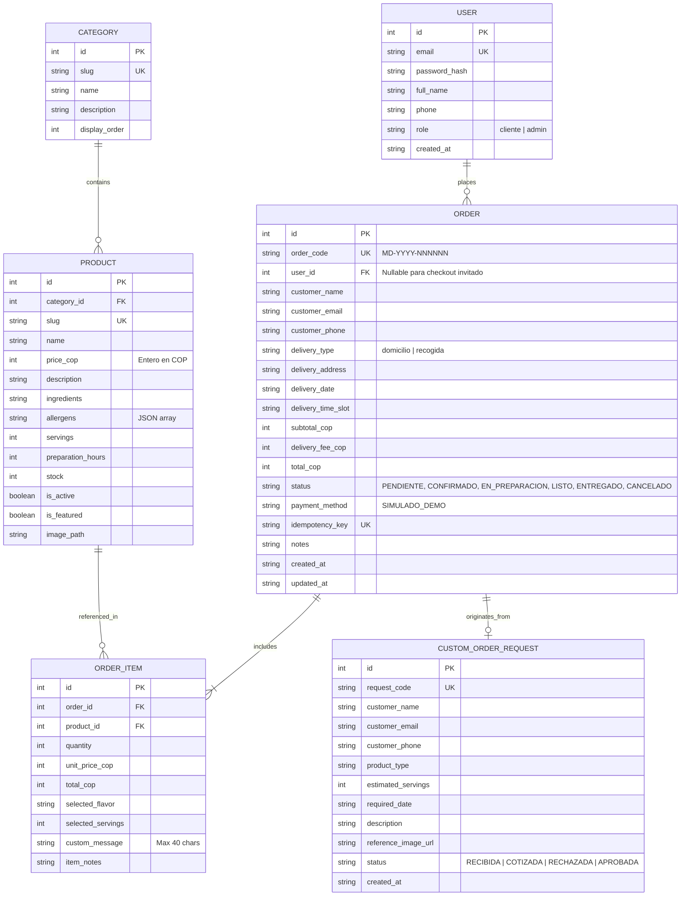

# ROADMAP: Plataforma E-Commerce Marea Dulce sobre Kubernetes (Estrategia Recreate)

## 0. Introducción y Propósito

El proyecto **Marea Dulce** transforma la infraestructura previa de laboratorio (`k8s-recreate-deployment` / CoreLedger) en una plataforma de comercio electrónico artesanal, creíble y comercialmente viable, mientras preserva y perfecciona su núcleo de ingeniería: la demostración rigurosa, reproducible y **medida** de la estrategia de despliegue **Recreate** en Kubernetes con persistencia relacional SQLite sobre volúmenes persistentes (`PVC ReadWriteOnce`).

---

## 1. Análisis del Estado Actual e Inspección de Componentes

### 1.1 Estado Operativo Heredado
- **Namespace:** `recreate-lab`.
- **Backend actual:** Microservicio Python 3.11 con FastAPI (`recreate-app:v1.0.0` y `recreate-app:v2.0.0`), exponiendo sondas `/healthz`, `/ready` y métricas en `/metrics`.
- **Almacenamiento:** PersistentVolumeClaim `recreate-app-pvc` (1 GiB, ReadWriteOnce, `standard` storage class).
- **Red y Políticas:** Ingress NGINX (`recreate.local`), Service ClusterIP en puerto 80/8000, y `NetworkPolicy` aislando ingress/egress.
- **Escalado:** `HorizontalPodAutoscaler` (2 a 6 réplicas al 50% de CPU).
- **Observabilidad:** `kube-prometheus-stack` (Prometheus, Alertmanager, Grafana con dashboard de 12 paneles importado por sidecar) y pila ELK (Elasticsearch, Filebeat con metadatos K8s, Kibana).
- **Automatización:** Scripts operativos (`start-all.sh`, `forward_services.sh`, `validate.sh`, `benchmark.sh`, `traffic_generator.py`).

### 1.2 Matriz de Clasificación de Componentes

| Componente Actual | Clasificación | Justificación y Plan de Acción |
| :--- | :---: | :--- |
| **Infraestructura Minikube (`scripts/start_minikube.sh`, `start-all.sh`)** | **Reutilizable** | La asignación de 6 CPUs, 10 GB de RAM y auto-elevación `newgrp docker` es óptima y estable. |
| **Pila de Observabilidad (`monitoring/`)** | **Modificable** | Se reutiliza `kube-prometheus-stack` y ELK; se adaptan las métricas de dominio (`marea_orders_total`, etc.) y el dashboard de Grafana. |
| **Scripts de Automatización (`validate.sh`, `benchmark.sh`, `traffic_generator.py`)** | **Modificable** | Se adaptan a las rutas y modelos de negocio de Marea Dulce (sondas, pedidos, downtime medido). |
| **Manifiestos de Almacenamiento (`pvc.yaml`, `namespace.yaml`)** | **Reutilizable** | El PVC de 1 GiB RWO sobre `recreate-lab` es la base de persistencia para SQLite. |
| **Deployment del Backend (`k8s/deployment-v*.yaml`)** | **Modificable** | Se ajusta a **1 réplica exacta** (sin réplicas concurrentes), con `strategy.type: Recreate` y `terminationGracePeriodSeconds: 30`. |
| **HorizontalPodAutoscaler (`k8s/hpa.yaml`)** | **Modificable / Reasignable** | **Se elimina del backend.** No es viable escalar horizontalmente una BD SQLite en RWO. Se reasigna exclusivamente al nuevo deployment del Frontend. |
| **Backend de la Aplicación (`app/src/main.py`)** | **Sustituible / Refactorizable** | Se reemplaza la lógica contable financiera por la plataforma modular e-commerce de Marea Dulce (productos, categorías, pedidos, carrito, inventario, auth). |
| **Frontend Web** | **Sustituible** | Se desacopla en un contenedor SPA estático independiente (React + Vite + Tailwind CSS) servido por NGINX, garantizando disponibilidad durante el corte del backend. |

---

## 2. Arquitectura Objetivo

```
[ Cliente Web / Navegador ]
            │
            ▼
   [ Ingress Controller (NGINX) ]
      ├── /api/* ──────────────────────────► [ Service: marea-backend-svc ]
      │                                                   │
      │                                                   ▼
      │                                  [ Pod: marea-backend (Replicas: 1) ]
      │                                       (Strategy: Recreate)
      │                                                   │
      │                                                   ▼ (RWO)
      │                                       [ PVC: /data/marea_dulce.db ]
      │                                             (SQLite en modo WAL)
      │
      └── /* (Rutas SPA) ──────────────────► [ Service: marea-frontend-svc ]
                                                          │
                                                          ▼
                                         [ Pods: marea-frontend (HPA: 2-4) ]
                                              (NGINX estático + Carrito Local)
```

### Principios de Diseño Arquitectónico
1. **Desacoplamiento Estricto Frontend-Backend:** El frontend se despliega como un artefacto web estático independiente. Mientras el backend se apaga durante el `Recreate`, el frontend permanece **100% activo**, mostrando el catálogo desde caché local, reteniendo el carrito y gestionando reintentos exponenciales.
2. **Backend de Instancia Única Exclusiva:** 1 réplica del backend para garantizar exclusividad de acceso sobre el archivo SQLite en el PVC ReadWriteOnce.
3. **Persistencia Transaccional ACID en Disco:** SQLite en modo WAL (`PRAGMA journal_mode=WAL`), con bloqueo exclusivo en escrituras (`BEGIN IMMEDIATE`) para evitar colisiones y transacciones serializadas.

---

## 3. Modelo de Datos Inicial y Entidades

El backend gestiona las siguientes entidades relacionales en SQLite:



### Reglas de Dominio y Negocio
- **Moneda:** Enteros estrictos en Pesos Colombianos (`COP`). Queda prohibido el uso de flotantes para valores monetarios.
- **Máquina de Estados de Pedidos:** 
  `PENDIENTE` ➔ `CONFIRMADO` ➔ `EN_PREPARACION` ➔ `LISTO` ➔ `ENTREGADO`. En cualquier momento antes de `LISTO` puede transicionar a `CANCELADO`.
- **Control de Inventario Atómico:** La deducción de existencias ocurre dentro de la misma transacción `BEGIN IMMEDIATE` de creación del pedido. Si no hay stock suficiente, la transacción se aborta con HTTP 409 Conflict.
- **Idempotencia:** La cabecera HTTP `Idempotency-Key` en `POST /api/orders` previene duplicados ante reintentos de red del cliente.

---

## 4. Contratos entre Componentes (API REST / OpenAPI)

| Endpoint | Método | Autenticación | Propósito |
| :--- | :---: | :---: | :--- |
| `/api/categories` | GET | Pública | Listar categorías activas con conteo de productos. |
| `/api/categories` | POST | Admin | Crear categoría. |
| `/api/products` | GET | Pública | Catálogo con filtros (categoría, precio, disponibilidad, búsqueda). |
| `/api/products/{id_or_slug}` | GET | Pública | Ficha técnica detallada, ingredientes, alérgenos y personalizaciones. |
| `/api/products` | POST / PUT | Admin | Creación y actualización de producto e inventario. |
| `/api/orders` | POST | Pública / Cliente | Creación de pedido con cabecera `Idempotency-Key`. |
| `/api/orders/{order_code}` | GET | Pública / Cliente | Consulta pública de seguimiento de pedido. |
| `/api/orders` | GET | Admin | Listado de pedidos con filtros por estado y fecha. |
| `/api/orders/{id}/status` | PATCH | Admin | Transición validada de estado de pedido. |
| `/api/auth/register` | POST | Pública | Registro de usuario cliente. |
| `/api/auth/login` | POST | Pública | Inicio de sesión, emisión de JWT firmado. |
| `/api/custom-orders` | POST | Pública | Formulario de solicitud de pedido personalizado. |
| `/healthz` | GET | Pública | Sonda Liveness: proceso activo y respondiendo. |
| `/ready` | GET | Pública | Sonda Readiness: conectividad a SQLite y PVC montado. |
| `/metrics` | GET | Pública (K8s) | Telemetría RED y métricas de negocio para Prometheus. |

---

## 5. Estrategia de Persistencia y Concurrencia SQLite

1. **Modo WAL (`Write-Ahead Logging`):** Permite lecturas concurrentes sin bloquear escrituras.
2. **Bloqueo Exclusivo en Escrituras (`BEGIN IMMEDIATE`):** Garantiza que ninguna otra rutina inicie escrituras concurrentes, evitando el error `database is locked` / `SQLITE_BUSY`.
3. **Respaldo Nativo (.backup / VACUUM INTO):** Todo respaldo previo a una actualización o migración utiliza la API nativa de SQLite, asegurando copias consistentes sin corromper transacciones activas.
4. **Verificación de Integridad:** Se ejecuta `PRAGMA integrity_check` antes y después de cada migración de esquema.

---

## 6. Justificación de Recreate y Decisión sobre el HPA

### 6.1 Justificación del Despliegue Recreate en el Backend
SQLite es un motor de base de datos incrustado diseñado para acceso local. Cuando se monta sobre un volumen persistente de Kubernetes mediante un PVC con modo de acceso `ReadWriteOnce (RWO)`:
- Si se utilizara `RollingUpdate`, durante el tiempo de transición coexistirían simultáneamente un Pod de la versión antigua ($v1$) y un Pod de la versión nueva ($v2$) montando el mismo archivo en disco o intentando aplicar migraciones estructurales destructivas.
- Esto dispararía errores de bloqueo irreversible, inconsistencia de esquema o corrupción de la base de datos.
- La estrategia **Recreate** garantiza formalmente que todas las instancias de $v1$ se terminen por completo (`replicas = 0`), liberando todos los descriptores de archivo y bloqueos en el PVC antes de que el Pod $v2$ sea instanciado y ejecute sus migraciones de esquema.

### 6.2 Decisión Documentada sobre el HorizontalPodAutoscaler (HPA)
- **Backend (SQLite):** **Se elimina el HPA del Backend.** Al tener una base de datos local SQLite con bloqueo exclusivo en disco, el backend debe operar estrictamente con `minReplicas = maxReplicas = 1`. Escalar horizontalmente el backend en Kubernetes causaría fallos de montaje de PVC RWO y colisiones de base de datos.
- **Frontend (SPA NGINX):** **Se aplica el HPA al Frontend.** El frontend es totalmente sin estado (*stateless*) y puede escalar elásticamente de 2 a 6 réplicas según la demanda de tráfico de los clientes.

---

## 7. Decisión y Justificación Técnica del Stack del Frontend

### 7.1 Stack Tecnológico Seleccionado
- **Framework:** **React 18 / 19 con TypeScript**.
- **Herramienta de Construcción:** **Vite** (tiempos de arranque y build instantáneos, empaquetado optimizado).
- **Estilos y Sistema de Diseño:** **Tailwind CSS v3/v4** mapeado 1:1 con `design-tokens.json` (colores de marca Marea Dulce, radios, tipografías Fraunces y DM Sans).
- **Iconografía:** **Lucide Icons** (íconos limpios de línea de 1.5 px, sin dependencias pesadas ni emojis).
- **Manejo de Estado y Caché Offline:** Context API / Zustand + `localStorage` / `IndexedDB` para retención del carrito y catálogo en memoria durante la ventana de corte de Recreate.
- **Servidor Web de Producción:** Imagen ligera **NGINX Alpine** para servir los archivos estáticos en Kubernetes.

### 7.2 Justificación
1. **Disponibilidad Durante el Corte:** Al empaquetar el frontend como artefacto estático independiente en NGINX, la tienda jamás desaparece cuando el backend entra en corte Recreate.
2. **Experiencia de Usuario Resiliente:** Permite implementar un banner informativo de actualización ("Estamos horneando novedades... Tu carrito está a salvo") y mantener la navegación del catálogo desde la copia local guardada.
3. **Fidelidad con Figma:** Tailwind CSS permite implementar exactamente las especificaciones de espaciado, tipografía y contraste de la Fase 1.

---

## 8. Riesgos Técnicos y Operativos

| Riesgo | Probabilidad | Impacto | Estrategia de Mitigación |
| :--- | :---: | :---: | :--- |
| **Pérdida de pedidos durante el corte Recreate** | Media | Alto | Clave de idempotencia (`Idempotency-Key`) + bloqueo visual del botón de checkout con reintento automático y cola local en el frontend. |
| **Tiempo excesivo de corte en Recreate** | Media | Medio | Minimizar `terminationGracePeriodSeconds` a 15-20s, optimizar scripts de migración de esquema y medir con `traffic_generator.py`. |
| **Corrupción de SQLite en apagado abrupto** | Baja | Crítico | Manejo de señales `SIGTERM` en FastAPI para cerrar transacciones antes de salir; ejecución de `VACUUM INTO` / `.backup` previo. |
| **Problemas de contraste visual en proyector** | Alta | Medio | Aplicación rigurosa de las reglas de contraste AA (punto 2.2: texto carbón sobre aguamarina, verde petróleo para enlaces/títulos). |

---

## 9. Inventario de Pantallas y Contenido para la Fase 1 (Figma)

| # | Pantalla | Datos Mostrados | Acciones del Usuario | Estados de Interfaz |
|---|---|---|---|---|
| **P1** | **Home / Portada** | Hero con propuesta de valor, grid de 6 categorías, 4 productos destacados, banda promo en coral, sección "Nuestra Historia", testimonios, CTA pedidos personalizados. | Navegar catálogo, clic a categorías, agregar producto destacado al mini-carrito, acceder a pedido personalizado. | Normal, carga con esqueletos, responsive (1440, 768, 390). |
| **P2** | **Catálogo de Productos** | Migas de pan, buscador en tiempo real, filtros (categoría, rango precio, alérgenos, disponibilidad), ordenamiento, cuadrícula de productos con precio en COP. | Filtrar, buscar por texto, ordenar, ver detalle, agregar rápido al carrito, paginación. | Normal, con filtros activos, sin resultados (empty state), carga de catálogo guardado (modo offline). |
| **P3** | **Detalle de Producto** | Galería (imagen principal + 3 miniaturas), título, precio en COP, descripción, ingredientes, alérgenos (chips), opciones de personalización (porciones, sabor, dedicatoria max 40 chars), selector cantidad. | Seleccionar opciones, ingresar mensaje personalizado, cambiar cantidad, botón "Agregar al carrito", acordeón de conservación. | Disponible, bajo stock (<5 unidades), agotado, feedback visual al agregar. |
| **P4** | **Pedido Personalizado** | Formulario detallado: tipo de evento, porciones estimadas, fecha de entrega requerida, sabor deseado, descripción del diseño, campo para URL o subida de foto de referencia, datos de contacto. | Llenar formulario, enviar solicitud de cotización. | Formulario vacío, validación de campos requeridos, enviando, confirmación de solicitud enviada. |
| **P5** | **Carrito y Mini-Carrito** | Lista de ítems (tarjeta horizontal con miniatura, nombre, personalizaciones, selector de cantidad, botón eliminar), notas del pedido, resumen (subtotal, envío estimado, total). | Modificar cantidades, remover ítem, ingresar notas, botón "Proceder al Checkout", vaciar carrito. | Carrito lleno, carrito vacío (con CTA a catálogo), mini-carrito desplegable lateral. |
| **P6** | **Checkout en 3 Pasos** | Paso 1: Datos de contacto. Paso 2: Entrega (domicilio o recogida en tienda con fecha y franja horaria). Paso 3: Pago simulado con leyenda explícita "Modo demostración". Resumen sticky. | Avanzar entre pasos, editar pasos previos, botón "Confirmar Pedido". | Normal, validación de campos, estado "Enviando pedido (no cierre la página)", botón desactivado con reintento si el backend está en corte. |
| **P7** | **Confirmación de Pedido** | Mensaje de éxito, código legible `MD-2026-000123`, resumen detallado de ítems y entrega, instrucciones de seguimiento, botón "Rastrear pedido". | Copiar código de pedido, ir a seguimiento, volver a la tienda. | Estado confirmado, estado pendiente de verificación (si el servidor no ha confirmado). |
| **P8** | **Seguimiento de Pedido** | Buscador por código `MD-YYYY-NNNNNN`, línea de tiempo visual de 5 etapas (`Pendiente` -> `Confirmado` -> `En Preparación` -> `Listo` -> `Entregado`). | Consultar código, refrescar estado. | Encontrado, no encontrado, cancelado. |
| **P9** | **Autenticación (Login/Registro)** | Formulario dual en 2 columnas (con patrón de olas y foto cálida): email, password, nombre, teléfono. | Iniciar sesión, registrarse, recuperar contraseña. | Normal, error de credenciales, validaciones en línea. |
| **P10**| **Admin: Resumen / Dashboard** | 4 KPIs (Ventas del día, Pedidos pendientes, Pedidos mes, Productos bajo stock), gráfica de ventas 7 días, tabla de pedidos recientes, alertas de stock. | Ver métricas, acceder a pedidos, ver alertas, indicador de conexión con el backend en barra superior. | Normal, backend reconectando. |
| **P11**| **Admin: Gestión de Pedidos** | Tabla de pedidos con filtros por estado y fecha, vista de detalle con personalizaciones y selector de cambio de estado. | Filtrar pedidos, abrir detalle, transicionar estado (`CONFIRMAR`, `PREPARAR`, etc.). | Lista filtrada, confirmación de cambio con toast. |
| **P12**| **Admin: Catálogo e Inventario**| Tabla de productos y categorías con miniatura, precio, stock editable y switch de publicación; modal de creación/edición. | Crear producto, editar stock en línea, desactivar producto, crear categoría. | Normal, modal abierto, guardando cambios. |
| **P13**| **Pantalla de Mantenimiento / Modo Recreate** | Banner global o pantalla completa elegante: "Estamos horneando mejoras en nuestra cocina digital. Tu carrito está seguro.", contador de reintento. | Reintentar conexión manual, seguir viendo catálogo guardado en local. | Desconectado con reintento regresivo, reconectado exitosamente. |

---

## 10. Decisiones que Requieren Aprobación del Usuario

1. **Aprobación del Punto de Revisión de Figma (Fase 1):** Tras diseñar el Brand Identity, Design System y la pantalla Home en escritorio, se debe validar la estética antes de desplegar todas las pantallas.
2. **Modelo de Empaquetado de Contenedores:** Aprobación de la separación en 2 imágenes OCI en Minikube (`marea-frontend:v1.0.0` y `marea-backend:v1.0.0`) frente al monolito previo.
3. **Migración de Base de Datos para el Escenario Recreate:** Definición de la migración exacta de $v1 \to v2$ (por ejemplo: agregar soporte para personalización avanzada en pedidos y firma de auditoría).

---

## 11. Roadmap Detallado por Fases y Definition of Done (DoD)

### Fase 0: Análisis, Arquitectura y Planificación
- [x] Inspección del proyecto existente y comprensión de CoreLedger.
- [x] Clasificación de componentes (reutilizar, modificar, sustituir).
- [x] Definición de arquitectura, modelo de datos y persistencia SQLite en PVC.
- [x] Justificación técnica de Recreate y decisión documentada del HPA.
- [x] Elección y justificación del stack frontend (React + Vite + Tailwind CSS).
- [x] Inventario completo de pantallas y contenidos para Figma entregado.
- [x] Hoja de ruta `ROADMAP.md` formalizada.
- [x] Cero líneas de código de implementación prematuras.

### Fase 1: Diseño en Figma
- [ ] Verificación de integración y acceso con herramientas de Figma documentada en `FIGMA.md`.
- [ ] Creación del archivo de Figma con las 10 páginas (0 a 9).
- [ ] Construcción del logotipo vectorial y variantes en página Brand Identity.
- [ ] Colecciones de variables (primitivos, semánticos `Tienda` y `Admin`, espaciado, radios) y estilos de texto (Fraunces + DM Sans).
- [ ] Verificación de contrastes AA en todos los tonos derivados.
- [ ] Inventario de componentes con Auto Layout y variantes.
- [ ] Diseño de las pantallas clave en escritorio (1440 px), tableta (768 px) y móvil (390 px).
- [ ] Diseño específico del modo mantenimiento durante Recreate.
- [ ] 4 flujos de prototipo interactivo funcionales.
- [ ] Exportación de tokens en `design-tokens.json` y cierre de `FIGMA.md`.

### Fase 2: Backend
- [ ] Arquitectura modular en FastAPI implementada en `BACKEND.md`.
- [ ] Entidades de dominio (`Product`, `Category`, `User`, `Order`, `OrderItem`, `CustomOrderRequest`).
- [ ] Manejo de dinero en enteros COP y control de concurrencia `BEGIN IMMEDIATE`.
- [ ] Idempotencia en pedidos vía `Idempotency-Key` y control de inventario transaccional.
- [ ] Sondas K8s `/healthz`, `/ready` y telemetría `/metrics` funcionales.
- [ ] Seed del catálogo inicial de Marea Dulce cargado en SQLite.
- [ ] Pruebas unitarias y de integración pasando.

### Fase 3: Frontend
- [ ] Aplicación SPA React + TypeScript + Vite + Tailwind CSS construida en fidelidad con Figma.
- [ ] Implementación de `design-tokens.json` como base de estilos.
- [ ] Tienda pública completa (Home, Catálogo, Detalle, Pedido personalizado, Carrito, Checkout 3 pasos, Seguimiento).
- [ ] Panel de administración conectado a endpoints reales.
- [ ] Resiliencia durante Recreate: catálogo en caché local, retención de carrito y modo mantenimiento no destructivo.
- [ ] Responsive verificado en 390, 768 y 1440 px.

### Fase 4: Infraestructura y Estrategia Recreate
- [ ] Manifiestos K8s adaptados: Backend con `strategy.type: Recreate`, 1 réplica y sin HPA; Frontend con HPA elástico.
- [ ] Despliegue independiente del frontend en NGINX.
- [ ] Demostración reproducible de actualización $v1 \to v2$ con migración estructural en SQLite.
- [ ] Medición automatizada del tiempo de corte (*downtime*) mediante `traffic_generator.py` documentada en `RECREATE.md`.
- [ ] Verificación de cero pérdida de pedidos y de consistencia de datos en PVC tras la actualización.

### Fase 5: Observabilidad
- [ ] Instrumentación Prometheus adaptada a las métricas de negocio (`marea_orders_total`, etc.).
- [ ] Dashboard de Grafana importable con sidecar reflejando la operación de Marea Dulce y la ventana de corte de Recreate.
- [ ] Reglas de alerta en Alertmanager probadas y validadas.
- [ ] Registros estructurados en Elasticsearch y Kibana.

### Fase 6: Integración y Validación Final
- [ ] Pruebas E2E completas del flujo de compra y gestión administrativa documentadas en `QA.md`.
- [ ] Demostración en vivo de Recreate con medición exacta de corte.
- [ ] Documentación y `README.md` actualizados con la identidad de Marea Dulce.
