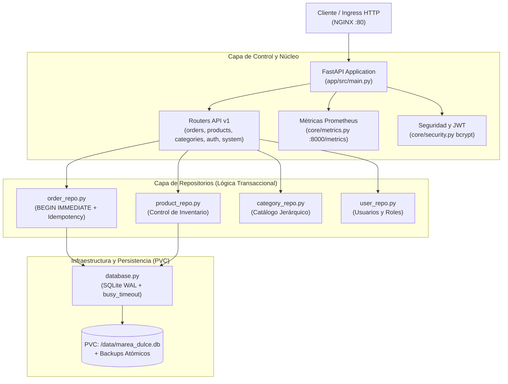

# Backend FastAPI y Persistencia Transaccional — Documentación Técnica

El microservicio backend de **Marea Dulce** está construido sobre **FastAPI (Python 3.11)** y **Uvicorn**, diseñado bajo una arquitectura modular y desacoplada que gestiona la lógica de comercio electrónico, el catálogo artesanal, la máquina de estados de pedidos y la persistencia atómica sobre **SQLite 3 en modo Write-Ahead Logging (WAL)** alojado en un volumen persistente de Kubernetes (`PVC ReadWriteOnce`).

## Para qué sirve

Sirve para exponer la API REST transaccional que procesa las compras de los clientes, gestiona el inventario en tiempo real, autentica usuarios con roles protegidos y garantiza consistencia ACID estricta sin requerir clústeres de bases de datos externas multi-escritor.

**En qué se utilizó en el proyecto:**
- **Control de Concurrencia y Escritor Exclusivo:** Se utilizó para implementar transacciones atómicas con `BEGIN IMMEDIATE` y `PRAGMA busy_timeout = 10000`, previniendo bloqueos o colisiones en SQLite durante la operación diaria y asegurando que durante el ciclo Recreate sólo una instancia opere la base de datos.
- **Idempotencia Transaccional en Checkout:** Se utilizó la cabecera HTTP `Idempotency-Key` en el endpoint `POST /api/v1/orders` para evitar la duplicación accidental de pedidos o cobros ante reintentos de red del cliente.
- **Ciclo de Vida y Migración Segura:** Se implementó en el gestor de ciclo de vida (`lifespan`) de FastAPI la verificación de integridad (`PRAGMA integrity_check`), respaldo nativo (`.backup`) y ejecución de migraciones de esquema previo a la recepción de tráfico.
- **Instrumentación de Telemetría OpenMetrics:** Se utilizó `prometheus_client` para registrar peticiones HTTP (RED: Rate, Errors, Duration), métricas de negocio (`marea_orders_total`, `marea_revenue_cop_total`, `marea_inventory_stock`) y operaciones sobre el PVC.
- **Sondas de Salud de Kubernetes:** Se expusieron los endpoints `/healthz` (liveness) y `/ready` (readiness con verificación de conexión a SQLite).

## Arquitectura

## Configuración

Los módulos que conforman el backend modular se encuentran estructurados en `app/src/`:

- **Punto de Entrada y Lifespan:** `app/src/main.py`
- **Configuración y Variables de Entorno:** `app/src/core/config.py` (Pydantic Settings)
- **Seguridad y Criptografía:** `app/src/core/security.py` (Passlib bcrypt y PyJWT)
- **Métricas Prometheus:** `app/src/core/metrics.py` (Counters, Histograms y Gauges)
- **Esquemas de Dominio:** `app/src/domain/schemas.py` (Modelos Pydantic v2)
- **Constantes y Estados:** `app/src/domain/constants.py` (Máquina de estados de pedidos)
- **Conexión y Transacciones SQLite:** `app/src/infrastructure/database.py`
- **Migraciones y Respaldos:** `app/src/infrastructure/migrations.py`
- **Siembra de Catálogo Inicial:** `app/src/infrastructure/seed.py` (12 productos, 6 categorías)
- **Controladores REST:** `app/src/routers/` (`orders.py`, `products.py`, `categories.py`, `auth.py`, `system.py`, `admin.py`)

## Parámetros usados

| Parámetro / Variable | Valor por Defecto | Propósito en la Plataforma |
| :--- | :--- | :--- |
| `DATABASE_PATH` | `/data/marea_dulce.db` | Ruta del archivo de base de datos en el PVC persistente. |
| `PRAGMA journal_mode` | `WAL` | Modo Write-Ahead Logging para lecturas no bloqueantes. |
| `PRAGMA busy_timeout` | `10000` (10 segundos) | Tiempo de espera antes de arrojar `SQLITE_BUSY`. |
| `PRAGMA synchronous` | `NORMAL` | Rendimiento óptimo en WAL garantizando durabilidad ante caídas. |
| `ACCESS_TOKEN_EXPIRE_MINUTES` | `480` (8 horas) | Tiempo de vida de tokens JWT de sesión para el personal administrativo. |
| `DEMO_MODE` | `True` | Habilita credenciales de semilla y pagos simulados para pruebas. |

## Beneficios

- **Simplicidad Operativa:** Sin dependencias externas pesadas como PostgreSQL o MySQL para entornos monousuario.
- **Rendimiento Excepcional:** Latencias de lectura y escritura sub-milisegundo al operar sobre disco local en bloque.
- **Garantía Transaccional:** El uso de `BEGIN IMMEDIATE` garantiza exclusividad en la deducción de inventario y generación de números de orden (`MD-XXXXXX`).

## Pruebas y Validación

La suite completa de pruebas unitarias e integración se encuentra en `app/tests/test_backend.py` y valida 8 escenarios críticos:
1. Sondas `/healthz` y `/ready` respondiendo HTTP 200.
2. Formato de telemetría OpenMetrics en `/metrics`.
3. Carga correcta de las 6 categorías y 12 productos del catálogo artesanal.
4. Registro y autenticación segura con JWT y roles (cliente / administrador).
5. Creación atómica de pedidos, deducción de stock y deduplicación por `Idempotency-Key`.
6. Transiciones válidas e inválidas en la máquina de estados de pedidos.
7. Manejo y rechazo ordenado ante compras con stock insuficiente.
8. Verificación de copia de seguridad nativa con `.backup` y validación con `PRAGMA integrity_check`.
