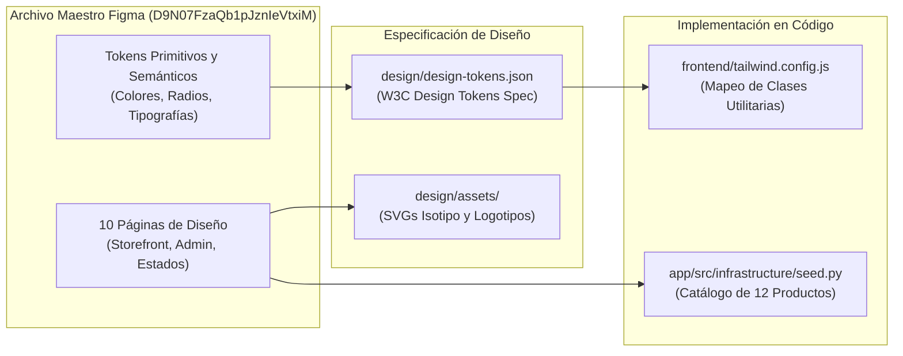

# Sistema de Diseño Figma y Tokens — Documentación Técnica

El sistema de diseño de **Marea Dulce** define la identidad visual, paleta cromática, escala tipográfica, componentes UI y catálogo oficial de la pastelería artesanal (*Pequeños antojos, grandes momentos*), formalizado en el archivo maestro de Figma y exportado como especificación W3C en `design/design-tokens.json`.

## Para qué sirve

Sirve para garantizar coherencia estética, consistencia de marca y accesibilidad visual estricta (**WCAG 2.1 AA**) entre los prototipos de diseño y los componentes de código implementados en la tienda web y el panel de administración.

**En qué se utilizó en el proyecto:**
- **Definición de Identidad de Marca:** Creación del isotipo vectorial de olas y repostería marina, logotipo horizontal y versiones monocromáticas en `design/assets/`.
- **Estructuración del Archivo Maestro en Figma:** Organización de 10 páginas dedicadas: Portada, Brand Identity, Design System, Storefront, Shopping Experience, Authentication, Admin Dashboard, Responsive & States, Prototype y Handoff.
- **Verificación Rigurosa de Contraste WCAG AA:** Corrección de combinaciones no accesibles (ej. texto carbón `#303A3A` sobre botones aguamarina `#56C7B6` con ratio 5.7:1; enlaces verde petróleo `#245B59` sobre fondo crema `#FFF9F0` con ratio 7.4:1).
- **Catálogo Oficial de 12 Productos y 6 Categorías:** Especificación detallada de nombres, descripciones, etiquetas, porciones y precios en Pesos Colombianos (COP) para la siembra de base de datos.
- **Exportación de Tokens Estándar W3C:** Generación de variables de diseño consumidas directamente por Tailwind CSS (`design/design-tokens.json`).

## Arquitectura

## Configuración

Los activos y especificaciones del sistema de diseño se distribuyen en:

- **Archivo Maestro de Figma:** [Marea Dulce - E-Commerce Cloud-Native](https://www.figma.com/design/D9N07FzaQb1pJznIeVtxiM/Marea-Dulce---E-Commerce-Cloud-Native?node-id=0-1) (Clave: `D9N07FzaQb1pJznIeVtxiM`, Nodo: `0:1`)
- **Tokens de Diseño W3C:** `design/design-tokens.json`
- **Activos Vectoriales de Marca:** `design/assets/` (`isotipo.svg`, `logo-horizontal.svg`, `logo-monochrome-petroleo.svg`, `logo-monochrome-crema.svg`, `wave-pattern.svg`)
- **Configuración de Estilos:** `frontend/tailwind.config.js`

## Parámetros usados

| Token / Variable | Valor Hex / Estándar | Ratio Contraste | Uso en la Interfaz |
| :--- | :--- | :---: | :--- |
| `aguamarina` | `#56C7B6` | 5.7:1 (con carbón) | Botones primarios de acción y acentos de marca. |
| `petroleo` | `#245B59` | 7.4:1 (con crema) | Encabezados, títulos de página y enlaces navegables. |
| `menta` | `#E1F3ED` | — | Fondos de secciones secundarias y superficies suaves. |
| `crema` | `#FFF9F0` | — | Fondo principal cálido de la tienda web. |
| `coral` | `#ED978C` | 5.3:1 (con carbón) | Badges de promociones y acentos decorativos. |
| `carbon` | `#303A3A` | 13.8:1 (con crema) | Textos principales de lectura y descripciones de producto. |
| `font-serif` | Fraunces (500, 600) | — | Títulos editoriales y logotipo de marca. |
| `font-sans` | DM Sans (400, 500, 600) | — | Interfaz, campos de texto y precios tabulares. |

## Beneficios

- **Accesibilidad Garantizada:** Cero infracciones de contraste en los flujos principales de compra y administración.
- **Consistencia Visual:** Mapeo 1:1 entre lo aprobado en Figma y los componentes renderizados en el navegador por React.
- **Catálogo Coherente:** Los 12 productos del prototipo coinciden exactamente con la semilla de base de datos (`seed.py`).

## Catálogo Oficial de Productos (Fase 1)

| ID | Nombre del Producto | Categoría | Precio (COP) |
|:---:|:---|:---|:---:|
| 1 | Torta Marea de Chocolate | Tortas y pasteles | $65.000 |
| 2 | Red Velvet Costera | Tortas y pasteles | $70.000 |
| 3 | Torta Zanahoria y Canela | Tortas y pasteles | $58.000 |
| 4 | Cupcakes Marinos de Vainilla | Cupcakes | $28.000 |
| 5 | Cupcakes Doble Avellana | Cupcakes | $32.000 |
| 6 | Galletas Avena y Miel de Azahar | Galletas | $22.000 |
| 7 | Galletas Craqueladas de Cacao | Galletas | $24.000 |
| 8 | Cheesecake de Frutos Rojos | Postres individuales | $18.000 |
| 9 | Mousse de Limón y Albahaca | Postres individuales | $16.000 |
| 10 | Torta Especiada de Calabaza | De temporada | $62.000 |
| 11 | Tronco de Navidad Marea | De temporada | $75.000 |
| 12 | Torta de Boda Floral | Personalizados | $180.000 |
