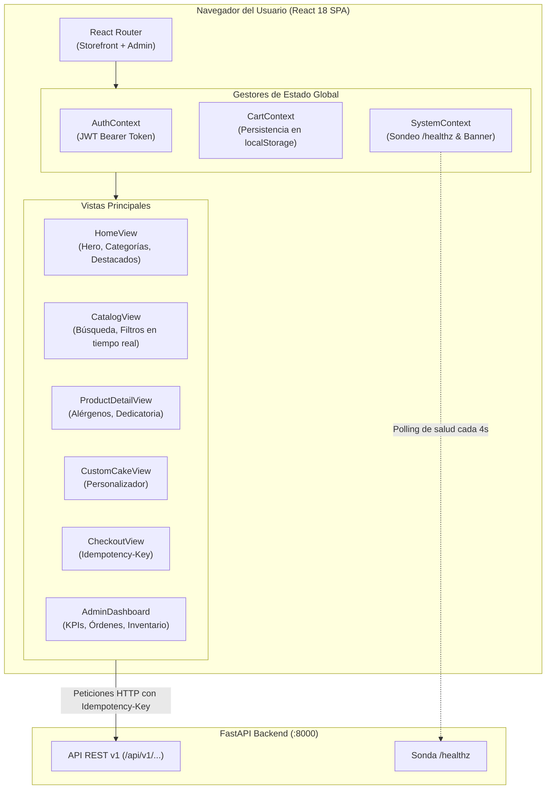

# Frontend SPA en React y Resiliencia de Cliente — Documentación Técnica

El frontend de **Marea Dulce** es una Single Page Application (**SPA**) construida con **React 18**, **TypeScript**, **Vite** y **Tailwind CSS**, diseñada como la tienda web de cara al cliente y el panel de control administrativo, servida de forma estática y optimizada directamente por el microservicio en el contenedor unificado de Kubernetes.

## Para qué sirve

Sirve para proporcionar una experiencia de compra fluida y moderna de repostería artesanal, facilitando la exploración del catálogo, personalización de tortas, persistencia local del carrito y gestión administrativa, incorporando **mecanismos de resiliencia en el navegador para amortiguar la ventana de indisponibilidad de la estrategia Recreate**.

**En qué se utilizó en el proyecto:**
- **Storefront y Experiencia de Compra:** Implementación de vistas comerciales completas: Home (Hero, Categorías, Destacados, Historia), Catálogo con filtros reactivos, Detalle de producto con alérgenos, Personalizador de pasteles y Checkout en 3 pasos con pago simulado.
- **Resiliencia ante el Corte Recreate:** Se implementó un banner suave de mantenimiento (*"Estamos actualizando la tienda. Tu carrito está guardado"*) que se activa cuando la API no responde, evitando mensajes de error 502/503 abruptos y preservando el carrito en `localStorage`.
- **Sondeo Automático de Reconexión:** El frontend consulta periódicamente la sonda `/healthz`; en cuanto el pod v2.0.0 entra en estado `Ready`, la tienda se reconecta de inmediato sin requerir recarga manual del usuario.
- **Panel Administrativo:** Vistas protegidas por autenticación JWT para el personal interno (gestión de catálogo de productos, control de stock y seguimiento de órdenes).
- **Fidelidad al Sistema de Diseño:** Aplicación rigurosa de los tokens de color (`#56C7B6`, `#245B59`, `#E1F3ED`, `#FFF9F0`, `#303A3A`), tipografías (Fraunces y DM Sans) y cumplimiento estricto de contraste WCAG AA.

## Arquitectura

## Configuración

Los módulos y componentes del frontend se encuentran organizados en el directorio `frontend/`:

- **Punto de Entrada:** `frontend/src/main.tsx` y `frontend/src/App.tsx`
- **Configuración de Estilos:** `frontend/tailwind.config.js` (mapeo de tokens de diseño)
- **Gestión de Contexto:** `frontend/src/context/` (`CartContext.tsx`, `AuthContext.tsx`, `SystemContext.tsx`)
- **Componentes de Layout:** `frontend/src/components/layout/` (`Navbar.tsx`, `Footer.tsx`, `CartDrawer.tsx`, `MaintenanceBanner.tsx`, `AdminLayout.tsx`)
- **Vistas Públicas:** `frontend/src/views/` (`HomeView.tsx`, `CatalogView.tsx`, `ProductDetailView.tsx`, `CustomCakeView.tsx`, `CheckoutView.tsx`, `OrderTrackerView.tsx`)
- **Vistas Administrativas:** `frontend/src/views/admin/` (`AdminDashboardView.tsx`, `AdminOrdersView.tsx`, `AdminProductsView.tsx`, `AdminInventoryView.tsx`)
- **Capa de Servicios y Cliente HTTP:** `frontend/src/services/api.ts` (Fetch con inyección automática de Bearer Token e `Idempotency-Key`)

## Parámetros usados

| Parámetro / Variable | Valor Configurado | Propósito en el Frontend |
| :--- | :--- | :--- |
| `HEALTH_POLL_INTERVAL` | `4000` ms (4 segundos) | Intervalo de verificación del estado del pod durante el corte Recreate. |
| `CART_STORAGE_KEY` | `marea_dulce_cart` | Clave de almacenamiento en `localStorage` para garantizar persistencia local. |
| `AUTH_STORAGE_KEY` | `marea_dulce_token` | Almacenamiento seguro del token JWT de sesión para el panel admin. |
| `DEDICATION_MAX_CHARS`| `40` caracteres | Límite interactivo de dedicatoria en chocolate para pasteles. |
| `CURRENCY_LOCALE` | `es-CO` / Integer COP | Formato de moneda en Pesos Colombianos sin decimales redundantes. |

## Beneficios

- **Cero Pérdida de Conversión:** Aunque el contenedor backend se reinicie durante 3.2 segundos por la estrategia Recreate, el usuario no pierde los productos que seleccionó en su carrito.
- **Rendimiento Ultrarrápido:** Bundle estático generado con Vite de apenas ~300 KB gzippeado, con carga instantánea y navegación sin refresco de página.
- **Accesibilidad Verificada:** Todos los textos, enlaces y botones cumplen la relación de contraste WCAG AA, garantizando legibilidad en proyectores o pantallas móviles.

## Buenas prácticas

- Desacoplar el estado del carrito de las respuestas del servidor para que el usuario pueda seguir navegando en modo desconectado.
- Utilizar generadores de UUIDv4 en el cliente para la cabecera `Idempotency-Key` en cada intento de checkout.
- Ejecutar compilación estricta con `tsc -b` antes de generar el paquete de producción con Vite.
