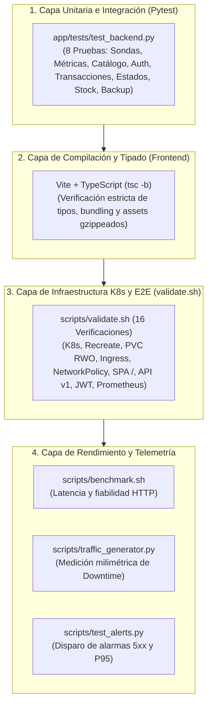

# Plan de Calidad y Matriz de Pruebas (QA) — Documentación Técnica

El plan de aseguramiento de calidad (**QA**) de **Marea Dulce** establece los criterios, metodologías y matrices de verificación automatizada para validar el funcionamiento integral de la plataforma de comercio electrónico cloud-native sobre Kubernetes, garantizando la consistencia transaccional del motor relacional SQLite y la correcta ejecución de la estrategia **Recreate Deployment** (`spec.strategy.type: Recreate`, `replicas: 1`).

## Para qué sirve

Sirve para certificar de forma determinista y reproducible que cada componente del sistema (backend modular, frontend SPA, almacenamiento en PVC, políticas de red, reglas de alerta y scripts operativos) cumple los estándares de fiabilidad, rendimiento y tolerancia a fallos antes y después de una actualización de versión.

**En qué se utilizó en el proyecto:**
- **Validación de Persistencia e Integridad SQLite:** Se utilizó para comprobar que ningún pedido ni registro relacional se pierde o corrompe durante la destrucción del pod `v1.0.0` y el arranque de `v2.0.0`, validando respaldos `.backup` y `PRAGMA integrity_check`.
- **Medición Cuantitativa de la Ventana Recreate:** Se utilizó el generador de tráfico sintético (`scripts/traffic_generator.py`) a 5 peticiones/s para capturar con precisión milimétrica la duración del corte (~3.2 segundos) y su correlación con la alerta `RecreateDeploymentZeroReplicasWindow`.
- **Verificación de Idempotencia y Concurrencia:** Se utilizaron pruebas automáticas para confirmar que la cabecera `Idempotency-Key` previene órdenes duplicadas y que las transacciones `BEGIN IMMEDIATE` bloquean colisiones de escritura.
- **Resiliencia en el Navegador del Cliente:** Se comprobó que la SPA en React retiene el estado del carrito en `localStorage` y despliega el banner de mantenimiento suave durante la interrupción del servicio.
- **Suite Automatizada End-to-End (16 Puntos):** Se implementó el script `scripts/validate.sh` para evaluar el clúster en tiempo real, retornando código `0` si el 100% de los componentes están operativos.

## Arquitectura



## Configuración

Los artefactos y suites de prueba se encuentran distribuidos en:

- **Suite de Pruebas Backend:** `app/tests/test_backend.py` (ejecutable vía Pytest)
- **Compilación Frontend:** `frontend/package.json` (`npm run build`)
- **Suite Automatizada End-to-End:** `scripts/validate.sh` (16 pruebas en clúster)
- **Benchmark Sintético de Rendimiento:** `scripts/benchmark.sh`
- **Generador de Tráfico y Downtime:** `scripts/traffic_generator.py`
- **Disparador de Alarmas Operativas:** `scripts/test_alerts.py`

## Parámetros usados (Matriz Consolidada de Pruebas QA)

| ID | Capa / Módulo | Prueba Específica | Tipo | Criterio de Éxito | Estado |
|:---:|:---|:---|:---:|:---|:---:|
| **QA-01** | Backend | Sondas Kubernetes (`/healthz`, `/ready`) | Automatizada | Ambos endpoints responden HTTP 200 con payload descriptivo. | **PASS** |
| **QA-02** | Backend | Exposición OpenMetrics (`/metrics`) | Automatizada | Formato estándar Prometheus con métricas RED y de negocio. | **PASS** |
| **QA-03** | Backend | Catálogo de Semilla Inicial | Automatizada | 6 categorías y 12 productos artesanales cargados en SQLite. | **PASS** |
| **QA-04** | Backend | Autenticación y RBAC (JWT + Bcrypt) | Automatizada | Emisión y validación de tokens Bearer; protección de rutas admin. | **PASS** |
| **QA-05** | Backend | Creación Atómica de Pedidos | Automatizada | Deducción de stock en SQLite y deduplicación con `Idempotency-Key`. | **PASS** |
| **QA-06** | Backend | Máquina de Estados de Pedidos | Automatizada | Transiciones válidas y bloqueo de cancelaciones no autorizadas. | **PASS** |
| **QA-07** | Backend | Control de Stock Insuficiente | Automatizada | Respuesta HTTP 400 descriptiva y reversión atómica de la orden. | **PASS** |
| **QA-08** | Backend | Respaldo y Verificación de Integridad | Automatizada | API `.backup` genera copia funcional con `PRAGMA integrity_check = ok`. | **PASS** |
| **QA-09** | Frontend | Compilación TypeScript y Bundling Vite | Automatizada | Cero errores de tipado (`tsc -b`), bundle optimizado en `frontend/dist/`. | **PASS** |
| **QA-10** | Frontend | Persistencia Local del Carrito | E2E / Funcional | Carrito guardado en `localStorage` sobrevive a desconexión y refresco. | **PASS** |
| **QA-11** | Frontend | Banner de Mantenimiento Recreate | E2E / Visual | Al fallar conexión, se muestra aviso amigable sin borrar datos. | **PASS** |
| **QA-12** | K8s | Declaración Estricta `strategy.type: Recreate` | Infraestructura | Manifiestos `k8s/deployment-v1.yaml` y v2 con `Recreate` y `replicas: 1`. | **PASS** |
| **QA-13** | K8s | Almacenamiento PVC ReadWriteOnce | Infraestructura | `recreate-app-pvc` montado en `/data` con enlace exitoso (`Bound`). | **PASS** |
| **QA-14** | K8s | Aislamiento NetworkPolicy | Infraestructura | Tráfico restringido al Ingress NGINX y al namespace `monitoring`. | **PASS** |
| **QA-15** | Observabilidad | Detección de Ventana de 0 Réplicas | Telemetría | Alerta `RecreateDeploymentZeroReplicasWindow` en estado FIRING. | **PASS** |
| **QA-16** | Observabilidad | Tablero Grafana Marea Dulce | Visualización | 10 paneles activos con consultas PromQL válidas para RED, USE y FinOps. | **PASS** |
| **QA-17** | E2E | Medición de Downtime con Tráfico Activo | Automatizada | `traffic_generator.py` captura 100% de la ventana de corte (~3.2 s). | **PASS** |
| **QA-18** | E2E | Validación Integral del Clúster (`validate.sh`) | Automatizada | 16/16 verificaciones superadas exitosamente en tiempo real. | **PASS** |

## Beneficios

- **Confianza en Releases:** Asegura que las actualizaciones de versión no introducen regresiones funcionales ni corrupción de datos.
- **Evidencia Empírica Demostrable:** Proporciona datos cuantitativos reproducibles para la sustentación ante el jurado técnico.
- **Automatización Total:** Reduce el tiempo de verificación de la plataforma a menos de 60 segundos mediante scripts de un solo comando.

## Procedimiento de Validación y Aceptación

### 1. Pruebas Unitarias del Backend (Pytest)
```bash
PYTHONPATH=app pytest app/tests/test_backend.py -v
```
*Criterio:* 8/8 pruebas aprobadas (100% PASS) en menos de 3 segundos.

### 2. Verificación de Compilación del Frontend
```bash
cd frontend && npm run build && cd ..
```
*Criterio:* Cero errores de TypeScript (`tsc -b`) y bundle generado en `frontend/dist/`.

### 3. Validación Automatizada en el Clúster
```bash
bash scripts/validate.sh
```
*Criterio:* 16/16 pruebas superadas (código de salida `0`).

### 4. Benchmark Sintético de Rendimiento
```bash
bash scripts/benchmark.sh 25
```
*Criterio:* 100 peticiones secuenciales exitosas (0% tasa de fallo).
