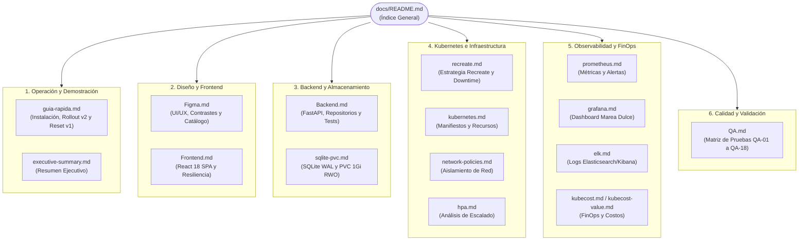

# Documentación Técnica — Marea Dulce Cloud-Native

## 1. Descripción General

Este directorio centraliza la base de conocimiento técnico y operativo de **Marea Dulce**, una plataforma de comercio electrónico artesanal desplegada sobre Kubernetes bajo la estrategia exclusiva **Recreate** (`spec.strategy.type: Recreate`, `replicas: 1`) con persistencia relacional en **SQLite WAL sobre PersistentVolumeClaim ReadWriteOnce**.

Los documentos detallan la arquitectura de software, especificaciones de diseño, guías de despliegue paso a paso, observabilidad en tiempo real (Prometheus, Grafana, ELK), gobernanza FinOps (Kubecost) y justificación de decisiones de ingeniería.

---

## 2. Tabla de Contenidos

- [Estructura del Directorio docs](#3-estructura-del-directorio-docs)
- [Inventario y Resumen de Documentos](#4-inventario-y-resumen-de-documentos)
  - [Guías Operativas y Demostración](#41-guías-operativas-y-demostración)
  - [Diseño, UI/UX y Frontend](#42-diseño-uiux-y-frontend)
  - [Backend, Persistencia y Datos](#43-backend-persistencia-y-datos)
  - [Infraestructura y Estrategia Recreate](#44-infraestructura-y-estrategia-recreate)
  - [Observabilidad, Telemetría y Logs](#45-observabilidad-telemetría-y-logs)
  - [Valor de Negocio, FinOps y Seguridad](#46-valor-de-negocio-finops-y-seguridad)
  - [Calidad, Pruebas y Validación](#47-calidad-pruebas-y-validación)
  - [Subdirectorios Especializados](#48-subdirectorios-especializados)
- [Mapa de Navegación Visual](#5-mapa-de-navegación-visual)
- [Rutas de Lectura Recomendadas](#6-rutas-de-lectura-recomendadas)
- [Equipo](#7-equipo)

---

## 3. Estructura del Directorio `docs/`

```text
docs/
├── guia-rapida.md             # 🚀 Manual rápido de instalación, demo Recreate y reversión a v1
├── Figma.md                   # 🎨 Especificación de diseño UI/UX, tokens, contrastes y catálogo
├── Frontend.md                # 💻 Arquitectura de la SPA en React 18, estados y resiliencia
├── Backend.md                 # ⚙️ Arquitectura modular FastAPI, repositorios y persistencia SQLite
├── recreate.md                # 🔄 Documentación técnica del ciclo de vida y transición Recreate
├── sqlite-pvc.md              # 💾 Configuración de SQLite WAL sobre PVC ReadWriteOnce (1 GiB)
├── kubernetes.md              # ☸️ Especificación de manifiestos y orquestación en Minikube
├── network-policies.md        # 🛡️ Políticas de red y aislamiento con NetworkPolicy
├── hpa.md                     # 📈 Análisis de autoescalado y justificación de réplica única
├── prometheus.md              # 📊 Recolección de telemetría y reglas de alerta en Prometheus
├── grafana.md                 # 🖥️ Tablero oficial de observabilidad RED, USE y FinOps
├── elk.md                     # 📜 Pila centralizada de logs (Elasticsearch + Filebeat + Kibana)
├── kubecost.md                # 💰 Monitoreo y atribución de costos cloud en tiempo real
├── kubecost-value.md          # 📉 Retorno de inversión y gobernanza económica FinOps
├── business-model.md          # 🍰 Modelo de negocio y economía unitaria de Marea Dulce
├── deployment-value.md        # 🏷️ Justificación del valor empresarial de Recreate frente a RollingUpdate
├── observability-value.md     # 👁️ Valor de la observabilidad de alta resolución ante cortes
├── security-value.md          # 🔒 Postura de seguridad y protección de datos en reposo y tránsito
├── sso-mfa.md                 # 🔑 Autenticación administrativa con JWT bcrypt y roles
├── QA.md                      # ✅ Plan de calidad, matriz de pruebas (QA-01 a QA-18) y E2E
├── executive-summary.md       # 📑 Resumen ejecutivo global del proyecto
├── architecture/              # 🏗️ Diagramas y hoja de ruta de la arquitectura
│   └── roadmap-and-architecture.md
└── evidence/                  # 📸 Evidencias de pruebas y validaciones E2E
    ├── Recreate-Verification.md
    └── Validation-Verification.md
```

---

## 4. Inventario y Resumen de Documentos

### 4.1 Guías Operativas y Demostración

| Documento | Resumen del Contenido |
|---|---|
| [`guia-rapida.md`](guia-rapida.md) | **Guía maestra de ejecución:** Instalación en dos pasos (`start.sh` y `forward_services.sh`), tabla de puertos locales, protocolo detallado para demostrar la ventana de corte de Recreate (~3.2 s) con generador de tráfico y procedimiento de reversión limpia a `v1.0.0`. |

### 4.2 Diseño, UI/UX y Frontend

| Documento | Resumen del Contenido |
|---|---|
| [`Figma.md`](Figma.md) | **Especificación de diseño:** Inventario de las 10 pantallas de la tienda web, tabla de contraste WCAG 2.1 AA (paleta aguamarina, petróleo, menta, crema y carbón) y ficha técnica de los 12 productos artesanales y 6 categorías. |
| [`Frontend.md`](Frontend.md) | **Arquitectura de cliente:** Estructura de componentes React 18 con Vite y Tailwind CSS, contexto global (`CartContext`, `AuthContext`, `SystemContext`), persistencia de carrito en `localStorage` y manejo de avisos durante el corte Recreate. |

### 4.3 Backend, Persistencia y Datos

| Documento | Resumen del Contenido |
|---|---|
| [`Backend.md`](Backend.md) | **Arquitectura de servidor:** Implementación modular de FastAPI (`core/`, `domain/`, `infrastructure/`, `repositories/`, `routers/`), esquemas Pydantic v2, ordenes atómicas con `BEGIN IMMEDIATE`, deduplicación por `Idempotency-Key` y 8 pruebas unitarias con `pytest`. |
| [`sqlite-pvc.md`](sqlite-pvc.md) | **Persistencia local:** Configuración del motor SQLite 3 en modo `WAL` (`PRAGMA journal_mode=WAL`), parámetros de concurrencia (`busy_timeout`), almacenamiento montado en `/data` sobre PVC `ReadWriteOnce` de 1 GiB y respaldo nativo con `.backup`. |

### 4.4 Infraestructura y Estrategia Recreate

| Documento | Resumen del Contenido |
|---|---|
| [`recreate.md`](recreate.md) | **Estrategia Recreate:** Justificación de parada previa completa para garantizar escritor exclusivo en SQLite, diagrama de secuencia de actualización, ciclo de vida de pods y medición empírica de indisponibilidad. |
| [`kubernetes.md`](kubernetes.md) | **Orquestación K8s:** Declaración de recursos en namespace `recreate-lab` (Deployment con `strategy: Recreate`, Service ClusterIP, PVC 1Gi, Ingress NGINX y ServiceMonitor). |
| [`network-policies.md`](network-policies.md) | **Aislamiento de red:** Reglas declarativas con `NetworkPolicy` para restringir el tráfico del pod únicamente al Ingress Controller y al namespace `monitoring`. |
| [`hpa.md`](hpa.md) | **Estudio de elasticidad:** Análisis de autoescalado horizontal y justificación técnica de por qué no se usa HPA en el pod con escritor monousuario SQLite. |

### 4.5 Observabilidad, Telemetría y Logs

| Documento | Resumen del Contenido |
|---|---|
| [`prometheus.md`](prometheus.md) | **Métricas y Alertas:** Configuración del scraping a 5 segundos vía `ServiceMonitor`, catálogo de métricas RED (`http_requests_total`), métricas de negocio (`marea_orders_total`) y reglas de alerta (`PrometheusRule`). |
| [`grafana.md`](grafana.md) | **Tablero interactivo:** Documentación del dashboard oficial `marea-dulce-recreate` (10 paneles) cubriendo réplicas disponibles, ventana de corte en tiempo real, latencias P50/P95, ventas COP y consumo de recursos. |
| [`elk.md`](elk.md) | **Auditoría de logs:** Pila ELK ligera (Elasticsearch 8.12 + Filebeat + Kibana) para captura de señales `SIGTERM`, cierre ordenado de transacciones y trazas de migraciones de esquema. |
| [`kubecost.md`](kubecost.md) | **Gestión de costos:** Integración con Kubecost para la imputación económica en tiempo real del uso de CPU, memoria y almacenamiento en el clúster. |

### 4.6 Valor de Negocio, FinOps y Seguridad

| Documento | Resumen del Contenido |
|---|---|
| [`business-model.md`](business-model.md) | **Economía unitaria:** Modelo comercial del e-commerce artesanal, estructura de costos marginales por orden y propuesta de valor de la plataforma cloud-native. |
| [`deployment-value.md`](deployment-value.md) | **Valor de Recreate:** Análisis comparativo de costo-beneficio demostrando por qué asumir 3.2 segundos de corte es superior a arriesgar corrupción de datos o sobrecostos de bases distribuidas. |
| [`kubecost-value.md`](kubecost-value.md) | **FinOps empresarial:** Demostración cuantitativa de cómo una arquitectura de réplica única sobre almacenamiento en bloque reduce en un 80% los costos frente a bases de datos multi-nodo. |
| [`observability-value.md`](observability-value.md) | **Impacto operativo:** Valor de contar con telemetría de alta resolución para transformar una interrupción de servicio en un evento predecible, medible y gobernable. |
| [`security-value.md`](security-value.md) | **Postura de seguridad:** Aplicación de principios de menor privilegio, superficies de ataque mínimas y protección de datos en reposo y en tránsito. |
| [`sso-mfa.md`](sso-mfa.md) | **Control de acceso:** Mecanismos de autenticación para personal administrativo mediante tokens JWT firmados, contraseñas con hash bcrypt y roles protegidos. |
| [`executive-summary.md`](executive-summary.md) | **Resumen ejecutivo:** Visión global del proyecto, síntesis de la sustentación técnica y evaluación consolidada de resultados. |

### 4.7 Calidad, Pruebas y Validación

| Documento | Resumen del Contenido |
|---|---|
| [`QA.md`](QA.md) | **Plan y matriz de calidad:** Catálogo formal de 18 pruebas (QA-01 a QA-18) que cubre pruebas unitarias en Pytest, compilación Vite, 16 verificaciones de `validate.sh`, benchmark sintético y guion de demostración. |

### 4.8 Subdirectorios Especializados

| Subdirectorio | Contenido y Propósito |
|---|---|
| [`architecture/`](architecture/) | Diagramas de componentes, evolución técnica del proyecto y mapa arquitectónico de alto nivel. |
| [`evidence/`](evidence/) | Registros fotográficos y de terminal de las validaciones de corte Recreate y la suite automatizada de 16 pruebas. |

---

## 5. Mapa de Navegación Visual



---

## 6. Rutas de Lectura Recomendadas

- **Para Evaluación Académica o Jurado (5 Minutos):**
  1. [`executive-summary.md`](executive-summary.md) $\rightarrow$ Síntesis del proyecto y resultados.
  2. [`guia-rapida.md`](guia-rapida.md) $\rightarrow$ Demostración en vivo del corte Recreate y medición con `traffic_generator.py`.
  3. [`deployment-value.md`](deployment-value.md) y [`kubecost-value.md`](kubecost-value.md) $\rightarrow$ Justificación técnica y económica.
- **Para Operadores / SRE:**
  1. [`guia-rapida.md`](guia-rapida.md) $\rightarrow$ Arranque con `scripts/start.sh` y túneles con `forward_services.sh`.
  2. [`recreate.md`](recreate.md) $\rightarrow$ Mecánica de la actualización a v2.0.0.
  3. [`grafana.md`](grafana.md) y [`prometheus.md`](prometheus.md) $\rightarrow$ Supervisión de paneles y reglas de alerta.
- **Para Desarrolladores:**
  1. [`Figma.md`](Figma.md) $\rightarrow$ Identidad visual, tokens y catálogo.
  2. [`Frontend.md`](Frontend.md) $\rightarrow$ Flujo de vistas en React y carrito persistente.
  3. [`Backend.md`](Backend.md) $\rightarrow$ Endpoints REST, esquemas Pydantic y pruebas unitarias.

---

## 7. Equipo

- **Esteban Guarín Valencia**
- **Juan José Arias Gallego**

*Plataformas II — Marea Dulce Cloud-Native Platform*
