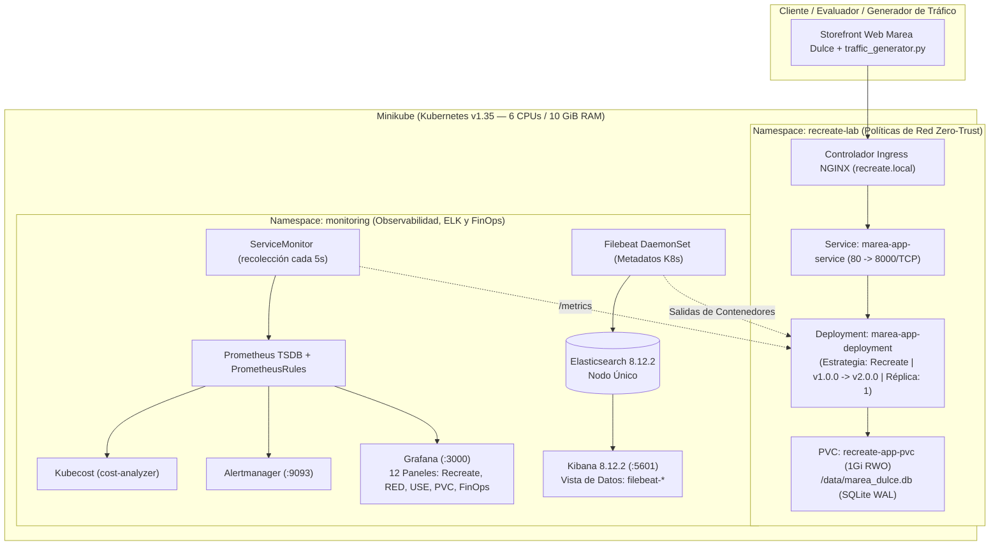

# Arquitectura Detallada y Roadmap Maestro — Marea Dulce

**Marea Dulce Cloud-Native E-Commerce Platform (`k8s-recreate-deployment`)** es una plataforma de comercio electrónico de pastelería artesanal diseñada bajo principios nativos de nube y desplegada sobre **Kubernetes (Minikube)**. Integra un microservicio unificado en **Python 3.11 + FastAPI + React SPA**, base de datos relacional incrustada **SQLite 3** sobre almacenamiento persistente **PVC (`ReadWriteOnce`)** con modo **WAL** y bloqueo exclusivo (`BEGIN IMMEDIATE`), autenticación **SSO/OIDC + MFA**, políticas de red **Zero-Trust**, observabilidad integral (**Prometheus + Grafana + Alertmanager** bajo modelos **RED** y **USE**), centralización de registros (**Elasticsearch + Filebeat + Kibana**), gobierno de costos (**FinOps** con **Kubecost**) y la estrategia de despliegue **Recreate** con medición empírica de la ventana de corte (*downtime*).

## Arquitectura Detallada

## Roadmap Maestro de Ingeniería

| Tarea | Componente | Objetivo Técnico | Estado |
| :---: | :--- | :--- | :---: |
| Tarea 00 | Plan de Trabajo y Arquitectura | Definir arquitectura, dependencias y justificación de Recreate en PVC RWO. | Completado |
| Tarea 01 | Base del Proyecto | Configurar base Python 3.11, FastAPI, Uvicorn y sondas `/healthz` y `/ready`. | Completado |
| Tarea 02 | Microservicio Marea Dulce | Implementar API de catálogo, pedidos artesanales, personalización y telemetría. | Completado |
| Tarea 03 | Storefront y Panel Web | Construir interfaz web en React con carrito persistente y panel de estado en vivo. | Completado |
| Tarea 04 | SQLite y Migración con WAL | Configurar SQLite en `/data/marea_dulce.db`, modo WAL y migración atómica `v1 -> v2`. | Completado |
| Tarea 05 | Autenticación SSO y MFA | Implementar emisión y verificación de tokens Bearer OIDC con código MFA de 6 dígitos. | Completado |
| Tarea 06 | Contenedorización | Construir imágenes inmutables `marea-app:v1.0.0` y `marea-app:v2.0.0` en Minikube. | Completado |
| Tarea 07 | Infraestructura Base de Kubernetes | Desplegar Namespace `recreate-lab`, Deployment con Recreate, Service e Ingress. | Completado |
| Tarea 08 | Almacenamiento Persistente en PVC | Aprovisionar `recreate-app-pvc` (1Gi, ReadWriteOnce) y validar persistencia. | Completado |
| Tarea 09 | Políticas de Red Zero-Trust | Aislar el tráfico en `recreate-lab` permitiendo solo `ingress-nginx` y `monitoring`. | Completado |
| Tarea 10 | Observabilidad RED y USE | Desplegar `kube-prometheus-stack`, `ServiceMonitor` (5s), reglas de alerta y Grafana. | Completado |
| Tarea 11 | Pila de Registros ELK | Desplegar Elasticsearch, Filebeat DaemonSet y Kibana con vista `filebeat-*`. | Completado |
| Tarea 12 | Gestión de Costos FinOps | Integrar Kubecost y paneles de costos mensuales en dólares en Grafana. | Completado |
| Tarea 13 | Escalabilidad y Gobernanza de Réplica Única | Documentar el análisis de escalabilidad, justificación de 1 réplica en Recreate y perfil estacional. | Completado |
| Tarea 14 | Despliegue Recreate | Ejecutar transición `v1.0.0 -> v2.0.0`, medir ventana de corte (~3.2s) y validar rollback. | Completado |
| Tarea 15 | Scripts de Automatización | Crear suite `start.sh`, `stop.sh`, `status.sh`, `validate.sh`, `rollout_v2.sh`, `reset_v1.sh`. | Completado |
| Tarea 16 | Documentación Técnica | Documentar cada tecnología bajo la estructura estandarizada de la metodología. | Completado |
| Tarea 17 | Documentación de Negocio y FinOps | Elaborar caso de negocio, modelo económico, retorno de inversión y valor de despliegue. | Completado |
| Tarea 18 | Validación Final E2E | Auditar los criterios automatizados de validación y certificar el cumplimiento. | Completado |

## Dependencias y Orden de Despliegue

1. **Infraestructura de Clúster (`start_minikube.sh`):** Minikube activo con 6 CPUs y 10240 MB de memoria, junto con los complementos oficiales `ingress`, `metrics-server`, `default-storageclass` y `storage-provisioner`.
2. **Almacenamiento y Red:** El volumen persistente `recreate-app-pvc` debe encontrarse en estado enlazado (*Bound*) antes de que los contenedores de la aplicación puedan montarlo.
3. **Pila de Observabilidad y Registros:** El operador de Prometheus y los CRDs asociados deben estar en ejecución en `monitoring` antes de crear los recursos `ServiceMonitor` y `PrometheusRule`.
4. **Carga de Trabajo Recreate:** El despliegue de Marea Dulce se configura con réplica única estricta (`replicas: 1`) y `spec.strategy.type: Recreate` para preservar la integridad del volumen RWO.

## Matriz de Riesgos Técnicos y Mitigaciones

| Riesgo Técnico | Nivel de Impacto | Mitigación Implementada |
| :--- | :--- | :--- |
| Bloqueo concurrente en SQLite | Crítico | Estrategia Recreate combinada con `PRAGMA journal_mode=WAL` y `PRAGMA busy_timeout=15000`. |
| Condición de carrera en migración DDL | Alto | Transacción de aislamiento exclusivo `BEGIN IMMEDIATE ... COMMIT` en la inicialización de `v2.0.0`. |
| Inconsistencia de datos durante actualización | Crítico | Recreate garantiza 0 pods activos antes de montar el nuevo pod y aplicar migraciones. |
| Agotamiento de memoria por Elasticsearch | Alto | Ajuste de parámetros de memoria JVM (`-Xms512m -Xmx512m`) y clúster dimensionado a 10 GiB. |
| Interrupción no advertida durante Recreate | Medio | Regla de alerta inmediata `RecreateDeploymentZeroReplicasWindow` y sondeo continuo con cronómetro. |
