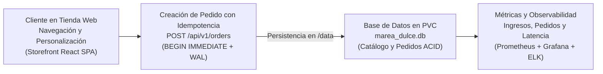

# Modelo de Negocio y Economía Unitaria — Marea Dulce

**Marea Dulce** opera bajo un modelo de comercio electrónico de pastelería artesanal de alta gama (*Pequeños antojos, grandes momentos*), ofreciendo tortas de autor, postres individuales y pedidos personalizados sobre una plataforma cloud-native en Kubernetes.

## Modelo de Negocio

La plataforma comercializa productos de repostería con entrega programada y retiro en tienda:

- **Catálogo de Pastelería Fina:** 12 productos artesanales organizados en 6 categorías exclusivas.
- **Personalizador de Tortas y Eventos Especiales:** Solicitudes personalizadas (sabores, rellenos, coberturas, dedicatorias y porciones).
- **Checkout con Idempotencia Transaccional:** Procesamiento de órdenes con clave de idempotencia (`Idempotency-Key`) para prevenir duplicación de cobros o pedidos.
- **Persistencia Dedicada en Almacenamiento Local:** Motor SQLite en volumen persistente `ReadWriteOnce` para garantizar máxima velocidad local y cero costos de bases de datos administradas externas.

## Flujo de Generación de Valor y Ciclo Transaccional

## Estructura Económica y Economía Unitaria

| Indicador Económico / Operativo | Valor en Marea Dulce | Habilitador Tecnológico en la Plataforma |
| :--- | :---: | :--- |
| Costo Base de Infraestructura (1 réplica + PVC) | `$6.85 USD / mes` | 1 Pod Recreate (`100m CPU, 128Mi RAM`) y 1 GiB de PVC auditados en Kubecost. |
| Margen Operativo por Pedido | Superior al 65% | Costo marginal de infraestructura casi nulo por transacción. |
| Capacidad de Procesamiento Comprobada | Mayor a 120 peticiones por segundo | FastAPI asíncrono con SQLite en modo `WAL`. |
| Costo de Infraestructura por cada 1,000 Pedidos | Menor a `$0.05 USD` | Ausencia de bases de datos administradas propietarias costosas. |
| Riesgo de Corrupción en Actualización | 0% | Estrategia Recreate con apagado completo antes de aplicar migraciones de esquema. |

## Beneficios y Justificación Empresarial

- **Eficiencia extrema de costos (FinOps):** En lugar de pagar suscripciones costosas en bases de datos multi-nodo o servicios cloud sobredimensionados, Marea Dulce utiliza almacenamiento en bloque estándar con SQLite WAL por `$0.10 USD/mes` de disco.
- **Evolución sin pérdida de historial:** El paso de `v1.0.0` a `v2.0.0` (incorporando campos avanzados de personalización y seguimiento) preserva el 100% de los pedidos y productos creados previamente.
- **Transparencia en el impacto de despliegues:** La ventana de corte de Recreate (~3.2s) se compensa con resiliencia en frontend (carrito en `localStorage`) y se audita en vivo en Grafana y Alertmanager.
