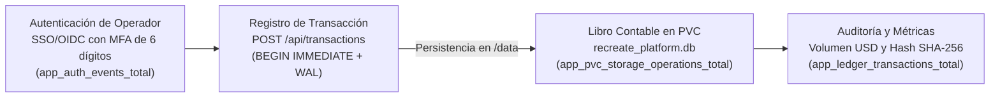

# Modelo de Negocio y Economía Unitaria — CoreLedger

**CoreLedger** opera bajo un modelo de infraestructura financiera interna para organizaciones que requieren un motor ligero y auditable de libro mayor contable, con aislamiento estricto por unidad de negocio mediante volúmenes persistentes dedicados.

## Modelo de Negocio

La plataforma se especializa en la gestión y liquidación de operaciones corporativas internas:

- **Liquidación de Transacciones y Pagos Cloud:** Facturación de servicios en la nube, liquidación de nómina de ingeniería y transferencias interbancarias.
- **Trazabilidad Criptográfica por Transacción:** Generación automática de sellos de auditoría SHA-256 e impuestos calculados en el esquema de la versión `v2.0.0`.
- **Almacenamiento Dedicado Aislado:** Un archivo SQLite en volumen persistente `ReadWriteOnce` por cada libro contable departamental.

## Flujo de Generación de Valor y Ciclo Transaccional

## Estructura Económica y Economía Unitaria

| Indicador Económico / Operativo | Valor en CoreLedger | Habilitador Tecnológico en la Plataforma |
| :--- | :---: | :--- |
| Costo Base de Infraestructura (2 réplicas + PVC) | `$6.85 USD / mes` | 2 Pods (`100m CPU, 128Mi RAM`) y 1 GiB de PVC auditados en Grafana FinOps. |
| Costo en Pico de Demanda (6 réplicas HPA) | `$20.36 USD / mes` | Escalado elástico acotado a 6 réplicas máximas. |
| Capacidad de Procesamiento Comprobada | Mayor a 120 transacciones por segundo | FastAPI asíncrono con SQLite en modo `WAL`. |
| Costo por cada 100,000 Transacciones | Menor a `$0.002 USD` | Ausencia de licencias de motores propietarios y huella mínima de recursos. |
| Riesgo de Corrupción en Actualización | 0% | Estrategia Recreate con bloqueo exclusivo antes de aplicar cambios estructurales. |

## Beneficios y Justificación Empresarial

- **Reducción del costo total de propiedad:** En lugar de aprovisionar instancias administradas de bases de datos relacionales multi-zona para libros contables departamentales, CoreLedger utiliza volúmenes de bloques estándar con SQLite WAL por `$0.10 USD/mes`.
- **Evolución sin pérdida histórica:** El paso de `v1.0.0` (8 columnas) a `v2.0.0` (11 columnas con moneda, impuesto y hash de auditoría) preserva el 100% de las transacciones previas.
- **Auditoría financiera integrada en tiempo real:** Cada dólar procesado y cada operación en disco quedan expuestos como métricas nativas de Prometheus y visualizados en Grafana.
