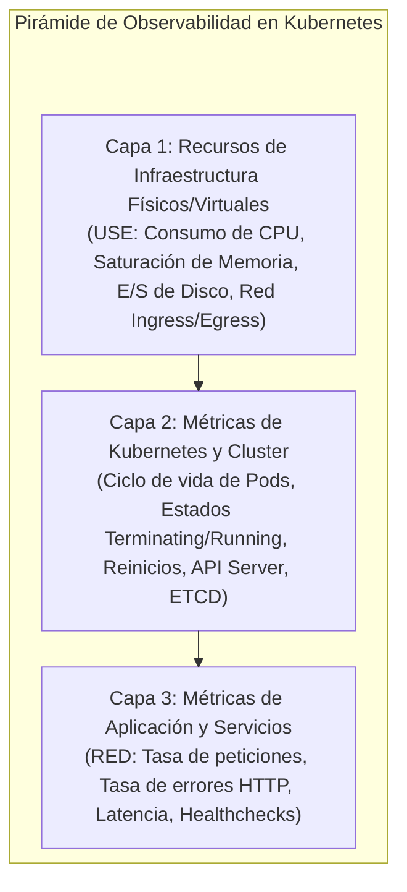
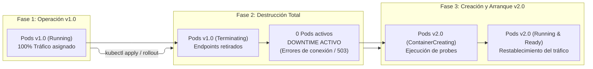

# Definición y Especificación del Proyecto: Estrategia Recreate y Observabilidad en Kubernetes

---

## 1. Información General y Equipo de Trabajo

| Parámetro | Detalle |
| :--- | :--- |
| **Asignatura** | Plataformas II |
| **Proyecto** | Implementación y Observabilidad de Estrategia de Despliegue Recreate en Kubernetes |
| **Integrantes** | Esteban Guarín Valencia   Juan José Arias Gallego |
| **Formato de Entrega** | Demostración práctica en vivo (tiempo estimado: 5 minutos) y repositorio técnico documentado |
| **Entorno de Ejecución** | Minikube local (driver Docker) |
| **Aplicación Base** | Microservicio ligero en Python con métricas nativas y vistas de versión |
| **Pila de Observabilidad** | Helm (`kube-prometheus-stack` con Prometheus y Grafana) |

---

## 2. Justificación y Planteamiento del Problema

En los entornos de orquestación de contenedores basados en Kubernetes, las estrategias de despliegue determinan cómo se transita de una versión existente a una versión actualizada de una carga de trabajo. 

Mientras que la estrategia predeterminada (*RollingUpdate*) prioriza la alta disponibilidad reemplazando réplicas de forma escalonada, la estrategia **`Recreate`** (`spec.strategy.type: Recreate`) adopta un enfoque radical: termina simultáneamente la totalidad de los Pods de la versión anterior antes de crear y poner en marcha los Pods de la nueva versión.

### Justificación de Uso de la Estrategia Recreate
- **Incompatibilidad de Esquemas o Estado:** Casos de uso donde dos versiones coexistentes de una aplicación corromperían bases de datos relacionales, colas de mensajería o esquemas compartidos.
- **Acceso Exclusivo a Volúmenes:** Aplicaciones que utilizan almacenamiento persistente no compartido (`ReadWriteOnce` o bloque físico).
- **Cargas de Trabajo Batch / Procesamiento Interno:** Entornos donde la coherencia estricta de versión prima sobre la disponibilidad continua.

### El Reto Técnico: Medición del Impacto Operativo
El principal costo de la estrategia Recreate es la **indisponibilidad temporal planificada (*downtime*)**. El objetivo medular de este proyecto no es únicamente ejecutar el despliegue, sino dotar a la plataforma de una **pila de observabilidad integral** que capture, cuantifique y visualice con precisión matemática el impacto de este corte de servicio sobre la infraestructura, el orquestador y la experiencia de usuario.

---

## 3. Objetivos del Proyecto

### Objetivo General
Implementar un entorno reproducible en Kubernetes que ejecute un ciclo de actualización de aplicaciones mediante la estrategia **Recreate**, integrando un sistema de observabilidad integral (Prometheus y Grafana) para medir, correlacionar y analizar el comportamiento del ciclo de vida de los Pods y el tiempo de indisponibilidad.

### Objetivos Específicos
1. Configurar los manifiestos declarativos de Kubernetes (`Deployment`, `Service`, `Ingress`, sondas de salud `livenessProbe` y `readinessProbe`) aplicando la estrategia de actualización `Recreate`.
2. Desplegar y configurar una pila de observabilidad basada en Prometheus y Grafana, enfocada en la recolección de métricas de infraestructura, cluster, pods y aplicación.
3. Instrumentar la captura de métricas bajo los modelos estándar **RED** (*Rate*, *Errors*, *Duration*) y **USE** (*Utilization*, *Saturation*, *Errors*).
4. Automatizar la generación de tráfico continuo para evidenciar y registrar el lapso exacto de indisponibilidad y los errores de conexión resultantes durante el relevo de versiones.
5. Estructurar un guion y panel de control para la demostración en vivo de cinco minutos.

---

## 4. Marco de Observabilidad y Telemetría

La observabilidad es la piedra angular del proyecto. Las métricas recolectadas deben cumplir con cinco atributos fundamentales:
- **Específicas:** Orientadas a un componente o comportamiento puntual.
- **Accionables:** Permiten tomar decisiones operativas inmediatas o alertar desvíos.
- **Relevantes:** Con impacto real en la estabilidad del sistema o en el negocio.
- **Oportunas:** Transmitidas con baja latencia para visualización en tiempo real.
- **Medibles:** Cuantificables mediante series temporales de Prometheus.

### 4.1. Modelos de Monitoreo Aplicados
1. **Modelo RED (Enfoque en Servicios y Usuario Final):**
   - **Rate (Tasa):** Número de solicitudes por segundo procesadas por el servicio.
   - **Errors (Errores):** Número y porcentaje de solicitudes fallidas (códigos HTTP 502 Bad Gateway, 503 Service Unavailable o fallos de conexión por ausencia de endpoints activos).
   - **Duration (Duración / Latencia):** Tiempo que toma procesar las solicitudes exitosas antes y después del relevo de versión.
2. **Modelo USE (Enfoque en Recursos de Infraestructura y Nodos):**
   - **Utilization (Utilización):** Porcentaje promedio de CPU y memoria consumido por los nodos y contenedores.
   - **Saturation (Saturación):** Encolamiento de tareas, estrangulamiento de CPU (*CPU throttling*) o límites de Pods alcanzados.
   - **Errors (Errores):** Fallos a nivel de red, caídas de interfaz o fallos de hardware/virtualización.

### 4.2. Niveles de Métricas Recolectadas

| Nivel de Métrica | Métricas Clave a Capturar | Fuente / Instrumentación |
| :--- | :--- | :--- |
| **Infraestructura** | Capacidad total de CPU/Memoria vs. Utilizada; E/S de Red | `node-exporter` / Métricas de nodo de Kubernetes |
| **Cluster** | Capacidad del cluster; latencia del API Server; estado de controladores | Métricas internas de Kubernetes |
| **Cargas / Pods** | Estado de réplicas (`replicas_desired` vs. `replicas_ready`); Pods en terminación; tasa de reinicios | `kube-state-metrics` |
| **Red y Enrutamiento** | Flujo Ingress/Egress; pérdida de endpoints en el `Service` | Ingress Controller / Endpoints Controller |
| **Aplicación y Negocio** | Tiempo de indisponibilidad total (*downtime* en segundos); códigos HTTP devueltos; latencia de sondas de salud | Métricas de aplicación (`/metrics`) y pruebas de tráfico |

---

## 5. Arquitectura del Ciclo de Despliegue Recreate

El ciclo operativo de una actualización mediante la estrategia `Recreate` ocurre de forma estrictamente secuencial:

### Fases del Proceso y Señales de Telemetría
1. **Operación Nominal ($v1$):**
   - Tráfico constante y tasa de errores en cero.
   - Pods en estado `Running` y superando satisfactoriamente las sondas de liveness y readiness.
2. **Disparo de Actualización ($v1 \rightarrow v2$):**
   - El Deployment detecta un cambio en el `PodTemplateSpec` (nueva versión de imagen o variable).
   - Debido a `spec.strategy.type: Recreate`, Kubernetes reduce inmediatamente el ReplicaSet anterior a cero.
   - Los Pods $v1$ entran en estado `Terminating` y son purgados de los Endpoints del Servicio.
3. **Ventana de Indisponibilidad (*Downtime Window*):**
   - Durante este lapso no existe ningún Pod disponible para atender solicitudes.
   - El cliente externo experimenta fallos de conexión inmediata o respuestas HTTP 503 generadas por el controlador de entrada.
   - Prometheus registra el desplome de la tasa de peticiones exitosas y un pico en la tasa de errores.
4. **Convergencia y Levantamiento ($v2$):**
   - Se programa el nuevo ReplicaSet $v2$.
   - Los contenedores se descargan (si no están cacheados), arrancan y ejecutan las sondas de salud.
   - Tan pronto como la sonda de preparación (*readinessProbe*) responde positivamente, los nuevos Pods se publican en el Servicio.
   - El tráfico se restablece de forma instantánea al 100% en la nueva versión.

---

## 6. Sondas de Salud y Control de Ciclo de Vida

Para evidenciar el comportamiento realista de la aplicación durante la ventana de transición, se implementan dos sondas mandatorias en la especificación del Pod:
1. **Sonda de Actividad (`livenessProbe`):**
   - Supervisa si el proceso del contenedor sigue vivo y en ejecución.
   - Si falla de forma consecutiva, Kubernetes reinicia el contenedor afectado.
2. **Sonda de Preparación (`readinessProbe`):**
   - Supervisa si la aplicación completó sus rutinas de inicialización y está en condiciones técnicas de atender tráfico externo.
   - Hasta que esta sonda no devuelva un código HTTP de éxito (rango 200-399), el Pod no recibe tráfico del balanceador ni se contabiliza como listo (`Ready`), permitiendo observar con precisión el tiempo que le toma a la nueva versión entrar en régimen operativo.

---

## 7. Plan de Demostración en Vivo (5 Minutos)

Para la sustentación oral de la asignatura Plataformas II, el equipo estructurará la presentación con el siguiente orden cronológico:

| Minuto | Actividad | Herramienta de Demostración | Resultado Esperado |
| :---: | :--- | :--- | :--- |
| **0:00 - 1:00** | Introducción, contexto del problema y justificación técnica del uso de la estrategia Recreate frente a RollingUpdate. | Diapositiva / Esquema de arquitectura | Comprensión del caso de negocio y justificación técnica. |
| **1:00 - 2:00** | Estado inicial de la plataforma con tráfico activo en régimen nominal sobre la versión 1. | Grafana (Dashboard RED) / Lens | Visualización de tráfico estable, réplicas saludables y latencia baja. |
| **2:00 - 3:30** | Ejecución en vivo de la orden de actualización (`kubectl set image` o `kubectl apply`) a la versión 2. | Terminal (`kubectl get pods -w`), Lens y Grafana | Observación simultánea de la terminación de pods, caída de réplicas a cero y registro del pico de indisponibilidad. |
| **3:30 - 4:30** | Recuperación del servicio con la versión 2 en producción y cálculo del tiempo de corte registrado. | Grafana (Panel de Downtime y Tasa de Errores) | Confirmación cuantitativa del downtime exacto (en segundos) y restauración a cero errores. |
| **4:30 - 5:00** | Conclusiones sobre trade-offs operativos, costos de negocio y cierre. | Documentación del proyecto | Síntesis ejecutiva y ronda de preguntas. |

---

## 8. Herramientas Auxiliares y Decisiones Técnicas

1. **Lens (Kubernetes IDE):**
   - Utilidad: Interfaz visual en tiempo real para observar el cambio de estado de los Pods (de verde a gris/rojo durante la terminación y de amarillo a verde durante la creación de la nueva versión).
2. **Pila de Observabilidad con Helm:**
   - Despliegue de `kube-prometheus-stack` mediante Helm para aprovisionar Prometheus Operator, Grafana, `kube-state-metrics` y `node-exporter` de forma modular y estandarizada.
3. **Aprovisionamiento con Terraform (Estado: Por confirmar):**
   - Pendiente de validación con el docente para determinar si se requiere como requisito de evaluación o si el despliegue directo con Helm y manifiestos de Kubernetes es suficiente.
4. **Ampliación de Observabilidad (Opcional / Valor Agregado):**
   - Exploración de centralización de logs (Loki / EFK) para correlacionar el momento exacto del cese de peticiones en los registros de acceso.

