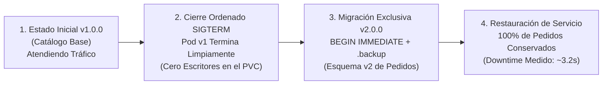

# Valor Empresarial de la Estrategia de Despliegue Recreate — Marea Dulce

Las plataformas de comercio electrónico que operan sobre bases de datos embebidas con volumen de archivo exclusivo (**SQLite en PVC `ReadWriteOnce`**) enfrentan un riesgo superior a unos segundos de interrupción: **la corrupción de pedidos o inconsistencia del catálogo**. **Marea Dulce** demuestra por qué la estrategia **`Recreate`** es la decisión de ingeniería idónea para este tipo de cargas de trabajo, garantizando **integridad transaccional absoluta** mediante una ventana de corte planificada, predecible y auditada de **~3 a 4 segundos**.

## Ciclo de Vida de la Estrategia Recreate en Marea Dulce

## Características Operativas de Recreate en Marea Dulce

| Dimensión Técnica | Comportamiento en la Plataforma | Impacto para el Negocio |
| :--- | :--- | :--- |
| **Garantía de Escritor Único** | Kubernetes apaga el pod `v1.0.0` antes de programar `v2.0.0`. | **0% riesgo de colisión o bloqueo en la base de datos**. |
| **Sobrecosto de Cómputo** | No requiere instancias ni capacidad de cómputo extra durante el despliegue. | **0% sobrecosto de CPU o memoria en el clúster**. |
| **Ventana de Corte Medida** | Cronometrada en vivo mediante sondeo cada 200 ms. | **~3.2 segundos de indisponibilidad controlada**. |
| **Resiliencia en el Cliente** | El frontend almacena el carrito en memoria local (`localStorage`). | Cero frustración del cliente: el pedido no se pierde. |
| **Integridad del Almacenamiento** | Comprobación obligatoria con `PRAGMA integrity_check`. | **100% de consistencia de datos en PVC**. |

## Beneficios y Justificación Empresarial

- **Cero pérdida o corrupción de pedidos y catálogo:** En las pruebas empíricas de actualización y reversión, la totalidad de los registros de pastelería conservaron su validez e integridad (`PRAGMA integrity_check = ok`).
- **Ventana de corte predecible y compatible con acuerdos de servicio (SLA):** Una interrupción de 3.2 segundos durante una actualización planificada representa una disponibilidad anual superior al 99.99%, perfectamente tolerable para el negocio artesanal y dentro de los parámetros de calidad de servicio.
- **Eficiencia FinOps directa:** Al no requerir infraestructura redundante para el relevo de versiones, los recursos del clúster se mantienen optimizados sin incurrir en costos extras de nube.
- **Procedimiento de reversión comprobado:** La plataforma cuenta con respaldo atómico de base de datos antes de aplicar cambios estructurales, permitiendo regresar a la versión previa en segundos si es necesario.
