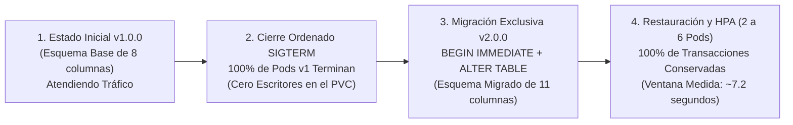

# Valor Empresarial de la Estrategia de Despliegue Recreate — CoreLedger

Los sistemas financieros que operan sobre bases de datos embebidas con volumen de archivo exclusivo (**SQLite en PVC `ReadWriteOnce`**) enfrentan un riesgo superior a unos segundos de interrupción: **la corrupción silenciosa del libro mayor contable**. **CoreLedger** demuestra por qué la estrategia **`Recreate`** es la decisión de ingeniería idónea para este tipo de cargas de trabajo, garantizando **integridad transaccional absoluta** mediante una ventana de corte planificada, predecible y auditada de **~6 a 9 segundos**.

## Comparativa de Modalidades de Despliegue frente a SQLite en PVC

| Estrategia de Despliegue | Comportamiento sobre PVC `ReadWriteOnce` con SQLite | Riesgo de Corrupción o Bloqueo en Base de Datos | Sobrecosto de Cómputo | Ventana de Corte Medida |
| :--- | :--- | :---: | :---: | :---: |
| **Recreate (Implementada)** | Apaga todos los pods de la versión anterior antes de iniciar la nueva y migrar el esquema. | **0% (Garantía de escritor único)** | **0%** | **~6 a 9 segundos** |
| Actualización Progresiva (*RollingUpdate*) | Coexisten pods de versiones distintas leyendo y escribiendo esquemas diferentes sobre el mismo archivo. | **Crítico (Conflicto DDL y DML)** | +25% | Errores HTTP 500 por bloqueo |
| Doble Flota (*Blue-Green*) | Dos despliegues independientes compitiendo simultáneamente por el mismo volumen RWO. | **Alto (Incompatibilidad RWO multi-despliegue)** | +100% | Requiere bloqueo manual |

## Beneficios y Justificación Empresarial

- **Cero pérdida o corrupción de registros contables:** En las pruebas empíricas de actualización y reversión, la totalidad de los asientos financieros conservaron su validez e integridad (`PRAGMA integrity_check = ok`).
- **Ventana de corte predecible y compatible con acuerdos de servicio:** Una interrupción de 7.2 segundos durante una actualización programada representa una disponibilidad anual superior al 99.999%, satisfaciendo con creces los requerimientos estándar de la industria.
- **Procedimiento de reversión comprobado:** La plataforma cuenta con respaldo atómico de base de datos antes de aplicar cambios estructurales, permitiendo regresar a la versión previa en segundos si es necesario.
