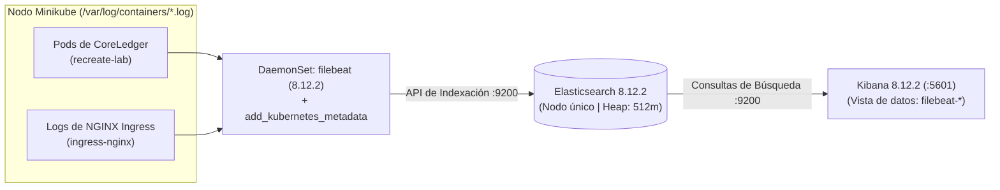

# Pila ELK Centralizada (Elasticsearch, Filebeat y Kibana) — Documentación Técnica

La **Pila ELK (Elastic Stack)** es la solución líder para la recolección, enriquecimiento, almacenamiento, indexación y visualización centralizada de registros en tiempo real. En esta plataforma se compone de **Filebeat** (agente recolector de bajo consumo desplegado como conjunto de demonios o `DaemonSet`), **Elasticsearch** (motor de búsqueda y base de datos de documentos indexados) y **Kibana** (interfaz gráfica de consulta y exploración analítica).

## Para qué sirve

Sirve para consolidar en un solo repositorio consultable todos los registros emitidos por los contenedores del clúster, enriqueciéndolos con metadatos contextuales de Kubernetes para facilitar la resolución de problemas, auditorías de seguridad y correlación cronológica de incidentes.

**En qué se utilizó en el proyecto:**
- **Captura de Registros de Contenedores:** Se utilizó Filebeat montando las rutas `/var/log/containers/*.log` del nodo para capturar todas las salidas estándar y de error emitidas por los pods de CoreLedger y del controlador Ingress NGINX.
- **Enriquecimiento con Metadatos de Kubernetes:** Se utilizó el procesador `add_kubernetes_metadata` para asociar a cada línea de registro el nombre del pod, namespace (`recreate-lab`), nodo, contenedor y versión activa.
- **Trazabilidad de la Transición Recreate:** Se utilizó para correlacionar cronológicamente la llegada de la señal `SIGTERM` y el cierre de conexiones en las réplicas `v1.0.0`, la ventana de respuestas 502/503 en Ingress NGINX y la inicialización de los pods `v2.0.0` con la migración `BEGIN IMMEDIATE`.
- **Preservación Histórica de Logs:** Se utilizó para asegurar que, aun cuando la estrategia Recreate destruye por completo los pods de la versión anterior, sus líneas de registro permanezcan guardadas e indexadas en Elasticsearch para su análisis forense en Kibana (`http://localhost:5601`).

## Arquitectura

## Configuración

El manifiesto unificado de la pila de registros se ubica en:

- **Despliegue de Elasticsearch, Filebeat y Kibana:** `monitoring/elk/values-elk.yaml`
- **Ajuste de Parámetros de Kernel en el Host:** `scripts/install_prerequisites.sh`
- **Túnel Local al Puerto 5601 de Kibana:** `scripts/forward_services.sh`

## Parámetros usados

| Componente / Parámetro | Valor Configurado | Propósito |
| :--- | :--- | :--- |
| Imagen de Elasticsearch | `docker.elastic.co/elasticsearch/elasticsearch:8.12.2` | Motor de indexación en modo de nodo único (`discovery.type=single-node`). |
| Memoria JVM de Elasticsearch | `-Xms512m -Xmx512m` | Huella de memoria optimizada para coexistir en un clúster de 10 GiB RAM. |
| Seguridad Interna | `xpack.security.enabled: false` | Simplifica la ingesta directa desde Filebeat y la consulta en el laboratorio. |
| Recolección de Filebeat | `type: container` (`/var/log/containers/*.log`) | Captura registros de todos los contenedores del nodo. |
| Metadatos de Kubernetes | `host: ${NODE_NAME}`, `in_cluster: true` | Agrega automáticamente namespace, pod, contenedor y etiquetas del pod. |
| Vista de Datos en Kibana | `filebeat-*` (`@timestamp`) | Vista predeterminada accesible en `http://localhost:5601/app/discover`. |

## Beneficios

- **Permanencia de registros tras la destrucción de pods:** Cuando Recreate elimina los pods `v1.0.0`, sus registros desaparecen de la terminal de Kubernetes pero permanecen indexados en Elasticsearch.
- **Eficiencia en memoria frente a Logstash:** Al emplear Filebeat con procesadores nativos de Kubernetes en lugar de una máquina virtual de Logstash, se ahorran cerca de 800 MiB de memoria en el nodo.

## Riesgos

- **Límite de áreas de memoria mapeada insuficiente en el kernel:** Elasticsearch requiere al menos 262144 áreas de memoria mapeada (`vm.max_map_count`); se verificó y configuró en el sistema anfitrión en 1048576.

## Buenas prácticas

- Filtrar en la barra de búsqueda de Kibana con la consulta `kubernetes.namespace : "recreate-lab"` para aislar los registros de la aplicación y la base de datos del ruido del sistema.
