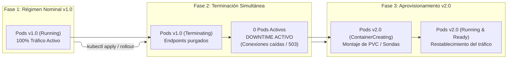

# Estrategia de Despliegue Recreate en Kubernetes

---

## 1. Definición y Principio Operativo

En Kubernetes, la especificación de un `Deployment` admite diversas estrategias de actualización mediante el campo `spec.strategy.type`. La estrategia **Recreate** representa un mecanismo determinista y no concurrente:

$$\text{Pods Versión 1} \xrightarrow{\text{Terminación total}} 0 \text{ Réplicas Activas} \xrightarrow{\text{Arranque limpio}} \text{Pods Versión 2}$$

A diferencia del comportamiento gradual de *RollingUpdate*, donde conviven réplicas de ambas versiones para mantener el servicio activo, la estrategia Recreate detiene y desmantela **simultáneamente todas las réplicas** de la versión anterior antes de programar la creación de los nuevos Pods.

---

## 2. Justificación Técnica y Casos de Uso

La estrategia Recreate se selecciona cuando la arquitectura impone restricciones estrictas:

1. **Incompatibilidad de Esquemas de Base de Datos:**
   - Modificaciones destructivas en el esquema de la base de datos (e.g., eliminación de columnas, renombrado de tablas o transformaciones irreversibles) impiden que la versión antigua procese transacciones bajo el nuevo esquema.
2. **Acceso Exclusivo a Volúmenes Persistentes (ReadWriteOnce):**
   - Cuando la carga de trabajo requiere acceso exclusivo de lectura/escritura a un disco persistente (PVC en modo `ReadWriteOnce`), un segundo Pod no puede montar el volumen hasta que el Pod anterior lo libere por completo.
3. **Cargas de Trabajo Batch y Procesamiento Único:**
   - Aplicaciones que consumen particiones de mensajería (Kafka, RabbitMQ) donde la duplicidad de versiones generaría inconsistencias de protocolo o doble consumo.

---

## 3. Descomposición del Ciclo de Vida y Ventana de Downtime

El ciclo de despliegue atraviesa cuatro fases temporales secuenciales:

### Fenómeno de Indisponibilidad (*Downtime Window*)
Durante la ventana comprendida entre la purga de los endpoints de la versión 1 y la respuesta exitosa de la sonda de preparación (*readinessProbe*) de la versión 2:
- Los clientes externos experimentan fallos de conexión inmediata o respuestas HTTP 502/503 devueltas por el Ingress Controller.
- La duración del downtime depende de:
  - Tiempo de gracia de terminación de los Pods v1 (`terminationGracePeriodSeconds`).
  - Tiempo de descarga de imágenes en el nodo (`imagePullPolicy`).
  - Tiempo de inicialización interna de la aplicación y retardo de la sonda `readinessProbe`.

---

## 4. Manifiestos Declarativos

Los manifiestos asociados se encuentran desacoplados en el directorio `k8s/`:
- [`k8s/deployment-v1.yaml`](file:///home/guarinve/Documentos/k8s-recreate-deployment/k8s/deployment-v1.yaml): Despliegue de la versión 1.0.0 con `spec.strategy.type: Recreate`.
- [`k8s/deployment-v2.yaml`](file:///home/guarinve/Documentos/k8s-recreate-deployment/k8s/deployment-v2.yaml): Manifiesto de actualización con nueva versión de imagen (`v2.0.0`) y configuración visual verde.
- [`k8s/service.yaml`](file:///home/guarinve/Documentos/k8s-recreate-deployment/k8s/service.yaml): Balanceador interno `ClusterIP` que gestiona el conjunto de endpoints.

