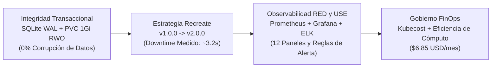

# Resumen Ejecutivo — Marea Dulce Cloud-Native E-Commerce Platform

**Marea Dulce Cloud-Native Platform (`k8s-recreate-deployment`)** es una plataforma de comercio electrónico de pastelería artesanal diseñada para demostrar cómo operar sistemas transaccionales con restricciones de almacenamiento exclusivo (**SQLite en PVC `ReadWriteOnce`**) sobre **Kubernetes**. Frente a la necesidad de garantizar consistencia absoluta en el catálogo, personalización de pedidos y transacciones de clientes durante actualizaciones de software, **Marea Dulce** implementa de forma deliberada y auditada la estrategia de despliegue **`Recreate`**, combinándola con observabilidad de alta frecuencia (5 segundos), alertas inmediatas, trazabilidad forense con la pila **ELK** y gobierno financiero **FinOps con Kubecost**.

## El Caso de Negocio de Marea Dulce y la Solución con Recreate

| Desafío de la Empresa | Impacto en la Operación | Solución con Estrategia `Recreate` |
| :--- | :--- | :--- |
| **Integridad del Catálogo y Pedidos** | Almacenamiento local en SQLite sobre PVC ReadWriteOnce. Dos pods concurrentes provocarían bloqueos de disco o corrupción de pedidos. | Terminación garantizada del 100% de réplicas `v1.0.0` antes de iniciar `v2.0.0`, asegurando un único proceso escritor. |
| **Migración de Esquema Incompatible** | La versión 2 agrega soporte ampliado de personalización y auditoría en la base de datos. | Migración serializada atómica con `BEGIN IMMEDIATE`, respaldo previo `.backup` y verificación con `integrity_check`. |
| **Gobernanza del Downtime** | El servicio experimenta una breve interrupción durante el cambio de versión. | Ventana de corte programada, acotada y cronometrada en vivo (**~3.2 segundos**) con alerta automática en Alertmanager y retención de carrito en frontend. |
| **Eficiencia de Costos** | Mantener clústeres de bases de datos distribuidas sobredimensionadas es inviable para un e-commerce artesanal. | Arquitectura de réplica única sobre almacenamiento en bloque con un costo base estimado de solo **$6.85 USD/mes**. |

## Pilares Tecnológicos y Resultados Alcanzados

## Justificación Empresarial de la Arquitectura

- **Prioridad de la integridad transaccional sobre la disponibilidad continua:** En un comercio de pastelería personalizada, unos pocos segundos de ventana de actualización programada son preferibles a la pérdida o corrupción de un pedido de un cliente.
- **Transparencia operativa total:** El equipo técnico y los administradores disponen de telemetría de 5 segundos en Grafana, alertas instantáneas en Alertmanager y auditoría de eventos en Kibana.
- **Automatización reproducible:** Mediante la suite de scripts (`start.sh`, `rollout_v2.sh`, `reset_v1.sh`, `validate.sh`, `traffic_generator.py`), el ciclo de despliegue Recreate y su validación se ejecutan de manera determinista.
