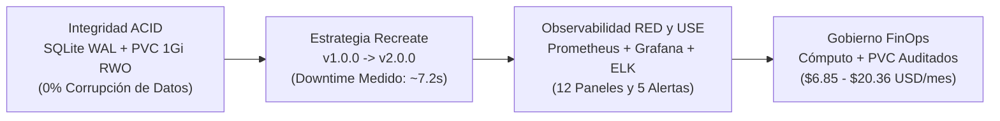

# Resumen Ejecutivo — CoreLedger Cloud-Native Platform

**CoreLedger Cloud-Native Platform (`k8s-recreate-deployment`)** es una plataforma de registro y liquidación contable diseñada para demostrar cómo operar sistemas transaccionales críticos con restricciones de almacenamiento exclusivo (**SQLite en PVC `ReadWriteOnce`**) sobre **Kubernetes**. Frente al riesgo de corrupción financiera derivado de múltiples escritores concurrentes durante actualizaciones de software, **CoreLedger** implementa de forma deliberada y auditada la estrategia de despliegue **`Recreate`**, combinándola con observabilidad de alta frecuencia (5 segundos), alertas inmediatas, trazabilidad forense con la pila **ELK** y gobierno financiero **FinOps**.

## El Problema de Negocio frente a la Solución de Ingeniería

| Dimensión | Riesgo con Despliegue Convencional (`RollingUpdate`) | Solución Implementada en CoreLedger (`Recreate`) |
| :--- | :--- | :--- |
| **Integridad Contable** | Réplicas `v1.0.0` (8 columnas) y `v2.0.0` (11 columnas) escriben simultáneamente sobre el archivo SQLite del PVC, provocando corrupción o pérdida de transacciones. | Terminación garantizada del 100% de réplicas `v1.0.0` antes de iniciar `v2.0.0` y ejecutar la migración `BEGIN IMMEDIATE`. |
| **Visibilidad del Corte** | Interrupciones no planificadas sin medición exacta del impacto al usuario final. | Ventana de corte programada, acotada y cronometrada en vivo (**~6 a 9 segundos**) con alerta automática en Alertmanager. |
| **Costo de Infraestructura** | Migrar a clústeres de bases de datos distribuidas multi-nodo eleva el costo mensual en más de 10 veces. | Mantener SQLite sobre PVC RWO con estrategia `Recreate` opera con un costo base de solo **$6.85 USD/mes**. |

## Pilares Tecnológicos y Resultados Alcanzados

## Justificación Empresarial de la Arquitectura

- **Prioridad de la exactitud financiera sobre la disponibilidad continua:** En sistemas de liquidación contable, unos segundos de ventana de mantenimiento programada son preferibles a un solo registro financiero corrupto o duplicado.
- **Transparencia operativa total:** El equipo técnico y el negocio disponen de telemetría con resolución de 5 segundos en Grafana, alertas instantáneas en Alertmanager y auditoría histórica de registros en Kibana.
- **Automatización reproducible:** Mediante la suite de scripts (`start-all.sh`, `validate.sh`, `benchmark.sh`, `traffic_generator.py`), el despliegue completo y su validación de 16 puntos se ejecutan de manera determinista en minutos.
