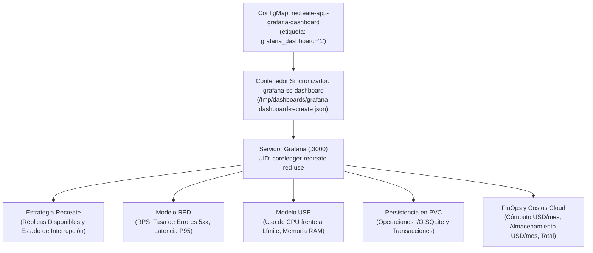

# Grafana — Visualización y Tableros de Control — Documentación Técnica

**Grafana** es la plataforma líder de visualización y análisis de observabilidad en entornos de nube y contenedores. En esta plataforma se despliega en el namespace `monitoring` con aprovisionamiento declarativo (*Configuration as Code*) mediante un contenedor de sincronización lateral (*sidecar*) que detecta automáticamente cualquier mapa de configuración (`ConfigMap`) etiquetado con `grafana_dashboard: "1"`.

## Para qué sirve

Sirve para transformar métricas crudas de series temporales en paneles interactivos visuales organizados por categorías, permitiendo a los operadores e ingenieros correlacionar eventos de infraestructura, rendimiento de aplicaciones y costos de nube en tiempo real.

**En qué se utilizó en el proyecto:**
- **Tablero Maestro Unificado de 12 Paneles:** Se utilizó para crear y aprovisionar el tablero `CoreLedger - Estrategia Recreate & Observabilidad RED/USE` (identificador `coreledger-recreate-red-use`), accesible en `http://localhost:3000/d/coreledger-recreate-red-use`.
- **Visualización de la Estrategia Recreate:** Se utilizó en los Paneles 1 y 2 para graficar en vivo la caída de réplicas a `0` y la conmutación de la tarjeta "Estado de Ventana de Interrupción" de verde (`0`) a rojo (`1`) durante la actualización de versión.
- **Seguimiento de Modelos RED y USE:** Se utilizaron los Paneles 3 al 8 para auditar en tiempo real la tasa de solicitudes (RPS), tasa de fallos 5xx, latencia P95 y consumo de CPU/RAM frente a los límites establecidos.
- **Monitoreo de Base de Datos en PVC:** Se utilizó en el Panel 9 para visualizar las operaciones de lectura, escritura e inserción sobre el archivo SQLite en el volumen persistente.
- **Cálculo de Costos Cloud (FinOps):** Se utilizó en los Paneles 10, 11 y 12 para computar en vivo la proyección monetaria mensual de infraestructura (`USD/mes`) para cómputo, almacenamiento de PVC y costo total.

## Arquitectura

## Configuración

Los artefactos de configuración de Grafana se ubican en:

- **Definición Declarativa de los 12 Paneles JSON:** `monitoring/prometheus/grafana-dashboard-recreate.json`
- **Configuración de Acceso y Sidecar en Helm:** `monitoring/prometheus/values-kube-prometheus-stack.yaml`
- **Aprovisionamiento Automático en el Script Maestro:** `scripts/start-all.sh`

## Parámetros usados

| Panel / Parámetro | Expresión PromQL / Valor | Propósito |
| :--- | :--- | :--- |
| Identificador de Tablero | `coreledger-recreate-red-use` | Enlace permanente directo: `http://localhost:3000/d/coreledger-recreate-red-use` (`admin` / `admin123`). |
| Panel 1: Réplicas Disponibles | `kube_deployment_status_replicas_available{namespace="recreate-lab"}` | Muestra 2 réplicas en operación normal y cae a 0 durante la transición Recreate. |
| Panel 2: Estado de Interrupción | `clamp_max(1 - kube_deployment_status_replicas_available, 1)` | Conmuta visualmente de verde a rojo cuando la disponibilidad de réplicas es nula. |
| Panel 3: Transición de Versión | `sum(app_version_info{namespace="recreate-lab"}) by (version, schema_version)` | Muestra la desconexión total de `v1.0.0` antes de la elevación de `v2.0.0`. |
| Paneles 4 y 5: Rendimiento y Errores | `sum(rate(http_requests_total[1m])) by (status_code)` | Mide peticiones por segundo y porcentaje de respuestas HTTP 5xx. |
| Panel 6: Latencia P95 | `histogram_quantile(0.95, sum(rate(http_request_duration_seconds_bucket[1m])) by (le, endpoint))` | Evalúa el percentil 95 de tiempo de respuesta frente al umbral de 1.0 segundo. |
| Paneles 7 y 8: CPU y Memoria | `rate(container_cpu_usage_seconds_total[1m])` / `container_memory_working_set_bytes` | Mide la utilización real de recursos frente a las cuotas de 300m y 256Mi. |
| Panel 9: Operaciones en PVC | `sum(rate(app_pvc_storage_operations_total[1m])) by (operation, status)` | Audita operaciones de lectura, escritura e inserción en `/data/recreate_platform.db`. |
| Paneles 10 a 12: Costos FinOps | Fórmulas de tarificación de vCPU, memoria y almacenamiento | Proyecta el costo mensual de infraestructura en dólares (`USD/mes`). |

## Beneficios

- **Demostración visual inmediata del corte Recreate:** Permite observar en una sola pantalla cómo las réplicas caen a cero, el indicador de corte cambia a rojo y segundos después emerge la versión `v2.0.0`.
- **Inmutabilidad del tablero:** Al estar declarado en un `ConfigMap`, el tablero no se pierde ante reinicios del pod de Grafana.

## Riesgos

- **Desalineación de credenciales en el sincronizador:** Si la contraseña de administración configurada en Helm no coincide con el secreto montado por el contenedor sincronizador, este fallará con error 401; se estandarizó en `admin123`.

## Buenas prácticas

- Asignar siempre un identificador único fijo (`uid`) en el archivo JSON del tablero para que los accesos directos desde la interfaz web o documentación se mantengan estables.
