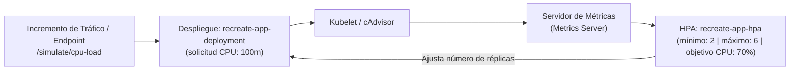

# Autoescalado Horizontal de Pods (HPA) — Documentación Técnica

El **Autoescalador Horizontal de Pods (Horizontal Pod Autoscaler o HPA)** es el controlador nativo de Kubernetes que ajusta automáticamente el número de réplicas de un despliegue en función de las métricas de consumo de recursos reportadas en tiempo real por el servidor de métricas (*Metrics Server*).

## Para qué sirve

Sirve para adaptar dinámicamente la capacidad de cómputo de una aplicación ante variaciones en el tráfico, aumentando réplicas cuando la demanda se incrementa para preservar los tiempos de respuesta y reduciéndolas cuando la demanda disminuye para optimizar costos de infraestructura.

**En qué se utilizó en el proyecto:**
- **Elasticidad Automática de CoreLedger:** Se utilizó para gobernar el despliegue `recreate-app-deployment`, configurando un rango de escalado entre un mínimo de 2 réplicas (para mantener alta disponibilidad básica en el nodo) y un máximo de 6 réplicas.
- **Métrica de Disparo por CPU:** Se utilizó un umbral de utilización promedio del `70%` de CPU respecto a la cuota solicitada por contenedor (`requests.cpu: 100m`), lo que significa que el autoescalador añade réplicas cuando el promedio supera los 70 milinúcleos por pod.
- **Simulación y Prueba de Carga:** Se utilizó el endpoint `/simulate/cpu-load` de la aplicación y el botón interactivo de la interfaz web para generar estrés de cálculo controlado y comprobar la reacción del escalador en tiempo real.
- **Compatibilidad con Manifiestos Recreate:** Se utilizó eliminando el atributo `spec.replicas` estático de los archivos de despliegue (`k8s/deployment-v1.yaml` y `k8s/deployment-v2.yaml`), permitiendo que el número de réplicas activas sea gobernado exclusivamente por el HPA sin ser reiniciado al aplicar cambios de versión.

## Arquitectura

## Configuración

Los manifiestos relacionados con el autoescalado horizontal son:

- **Manifiesto Declarativo del HPA:** `k8s/hpa.yaml`
- **Despliegues sin Atributo de Réplicas Fijas:** `k8s/deployment-v1.yaml` y `k8s/deployment-v2.yaml`
- **Ruta de Simulación de Carga:** `app/src/main.py` (`/simulate/cpu-load`)
- **Validación Automatizada del HPA:** `scripts/validate.sh` (Prueba 10)

## Parámetros usados

| Parámetro | Valor Configurado | Descripción |
| :--- | :--- | :--- |
| Carga de Trabajo Objetivo | `Deployment / recreate-app-deployment` | Despliegue gobernado por el autoescalador. |
| Mínimo de Réplicas | `2` | Mínimo de instancias activas en condiciones normales. |
| Máximo de Réplicas | `6` | Techo máximo de instancias para proteger la memoria del clúster y la concurrencia a SQLite. |
| Métrica de CPU | `Promedio de Utilización: 70%` | Escala hacia arriba cuando el promedio supera 70 milinúcleos por contenedor. |
| Ventana de Estabilización de Subida | `0s` | Reacción inmediata sin espera ante incrementos repentinos de peticiones. |
| Ventana de Estabilización de Bajada | `60s` | Periodo de enfriamiento de un minuto antes de destruir réplicas para evitar oscilaciones rápidas. |

## Beneficios

- **Compatibilidad con la estrategia Recreate:** Permite aplicar actualizaciones de versión conservando el conteo dinámico de réplicas del HPA sin conflictos de configuración.
- **Convivencia segura con SQLite en PVC:** Como las réplicas operan sobre el mismo nodo y utilizan el modo `WAL`, hasta 6 réplicas pueden realizar lecturas simultáneas y serializar sus escrituras ordenadamente.

## Riesgos

- **Saturación de cola en SQLite con demasiadas réplicas:** Dado que SQLite canaliza las escrituras mediante un bloqueo único, un techo excesivo de réplicas aumentaría los tiempos de espera; por ello el límite máximo se fijó en 6 réplicas.

## Buenas prácticas

- Comprobar que el complemento `metrics-server` esté habilitado en Minikube antes de evaluar el comportamiento del autoescalador.
