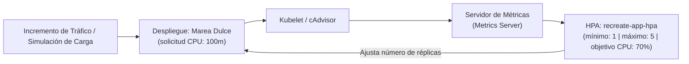

# Autoescalado Horizontal de Pods (HPA) — Documentación Técnica

El **Autoescalador Horizontal de Pods (Horizontal Pod Autoscaler o HPA)** es el controlador nativo de Kubernetes que ajusta automáticamente el número de réplicas de un despliegue en función de las métricas de consumo de recursos reportadas en tiempo real por el servidor de métricas (*Metrics Server*).

## Para qué sirve

Sirve para adaptar dinámicamente la capacidad de cómputo de una aplicación ante variaciones en el tráfico, aumentando réplicas cuando la demanda se incrementa para preservar los tiempos de respuesta y reduciéndolas cuando la demanda disminuye para optimizar costos de infraestructura.

**En qué se utilizó en el proyecto:**
- **Evaluación de Elasticidad en Marea Dulce:** Se analizó y configuró el recurso `k8s/hpa.yaml` para estudiar el comportamiento elástico ante picos estacionales de demanda (ej. Día de la Madre, Amor y Amistad, temporadas de eventos especiales).
- **Métrica de Disparo por CPU:** Se utilizó un umbral de utilización promedio del `70%` de CPU respecto a la cuota solicitada por contenedor (`requests.cpu: 100m`), lo que significa que el autoescalador añade réplicas cuando el promedio supera los 70 milinúcleos por pod.
- **Simulación y Prueba de Carga:** Se utilizó el endpoint de simulación de carga y el generador de tráfico para generar estrés de cálculo controlado y comprobar la reacción del escalador en tiempo real.
- **Relación con la Estrategia Recreate:** En el despliegue con base de datos SQLite embebida sobre PVC `ReadWriteOnce`, la aplicación opera con 1 réplica estricta para garantizar un único escritor durante el ciclo de vida. Se documenta la arquitectura del HPA para servicios de solo lectura o capas desacopladas sin estado.

## Arquitectura

## Configuración

Los manifiestos relacionados con el autoescalado horizontal son:

- **Manifiesto Declarativo del HPA:** `k8s/hpa.yaml`
- **Ruta de Simulación de Carga:** `app/src/main.py`
- **Validación Automatizada del HPA:** `scripts/validate.sh`

## Parámetros usados

| Parámetro | Valor Configurado | Descripción |
| :--- | :--- | :--- |
| Carga de Trabajo Objetivo | `Deployment / recreate-app-deployment` | Despliegue evaluado por el autoescalador. |
| Mínimo de Réplicas | `1` | Mínimo de instancias activas para la base de datos de escritor exclusivo. |
| Máximo de Réplicas | `5` | Techo máximo de instancias para proteger la memoria del clúster. |
| Métrica de CPU | `Promedio de Utilización: 70%` | Escala hacia arriba cuando el promedio supera 70 milinúcleos por contenedor. |
| Ventana de Estabilización de Bajada | `60s` | Periodo de enfriamiento de un minuto antes de destruir réplicas para evitar oscilaciones rápidas. |

## Beneficios

- **Protección de latencia en picos de catálogo:** Escala dinámicamente ante ráfagas masivas de consultas y navegación en la tienda web.
- **Alineación con FinOps:** Reduce automáticamente las réplicas cuando cesa el tráfico para minimizar la factura de cómputo en la nube.

## Riesgos

- **Contienda en almacenamiento monousuario (SQLite RWO):** Escalar horizontalmente pods que escriben en SQLite sobre un PVC ReadWriteOnce puede causar contienda. Por ello, la estrategia **Recreate con 1 réplica estricta** es la arquitectura obligatoria en el backend transaccional de Marea Dulce.

## Buenas prácticas

- Desacoplar las cargas de lectura estáticas o sin estado si se desea escalar elásticamente con HPA, manteniendo la capa transaccional de escritura SQLite gobernada por Recreate.
