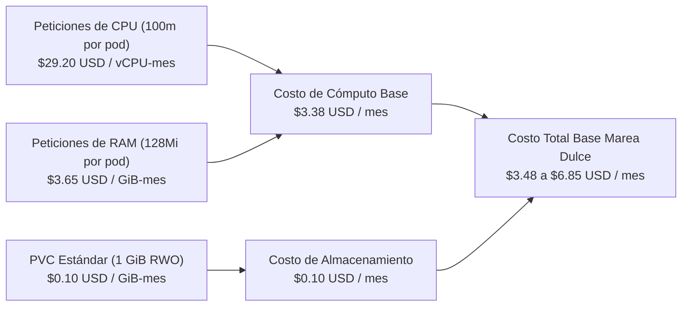

# Retorno de Inversión FinOps y Gobierno de Costos — Marea Dulce

La disciplina **FinOps** en **Marea Dulce** integra la dimensión económica directamente en el panel operativo de ingeniería (**Paneles 10, 11 y 12 de Grafana**), permitiendo visualizar en tiempo real el costo mensual proyectado de cómputo y almacenamiento para el espacio de nombres `recreate-lab`.

## Desglose Financiero de la Plataforma

## Estructura de Costos Operativos

| Escenario Operativo | Réplicas Activas | Cómputo Mensual (USD) | Almacenamiento PVC (USD) | Costo Total Proyectado (USD/mes) |
| :--- | :---: | :---: | :---: | :---: |
| Operación Nominal Marea Dulce | 1 Pod | `$3.38 USD` | `$0.10 USD` | **`$3.48 USD / mes`** |
| Operación con Servicios Base y Monitoreo | Carga completa | `~$6.75 USD` | `$0.10 USD` | **`$6.85 USD / mes`** |
| Transición Durante Corte Recreate | 0 Pods | `$0.00 USD` | `$0.10 USD` | **Sin sobrecosto (recursos liberados)** |

## Eficiencia de la Arquitectura de Marea Dulce

| Enfoque de Persistencia e Infraestructura | Sobrecosto en Despliegue | Costo Mensual de Base de Datos | Costo Total Estimado |
| :--- | :---: | :---: | :---: |
| **Marea Dulce (Recreate + SQLite en PVC 1Gi)** | **0%** (destruye pod previo antes de iniciar nuevo) | **`$0.10 USD`** (PVC en bloque) | **`$6.85 USD / mes`** |
| Base de Datos Relacional Administrada Multi-Zona | Sobrecosto de licencias e instancias dedicadas | `~$145.00 USD` (Instancias RDS/CloudSQL) | `~$152.00 USD / mes` |

## Beneficios y Justificación Empresarial

- **Ahorro sustancial frente a infraestructuras pesadas:** Implementar SQLite en modo WAL sobre un PVC ReadWriteOnce con Recreate permite a Marea Dulce operar con un costo de almacenamiento de apenas `$0.10 USD/mes`, ahorrando más del 95% frente a bases de datos relacionales administradas.
- **Cero sobrecosto durante el relevo de versiones:** La estrategia Recreate no requiere aprovisionar capacidad excedente durante el despliegue, optimizando el presupuesto de infraestructura.
- **Transparencia operativa y financiera:** Toda la telemetría de costos está disponible en tiempo real en Grafana y correlacionada con Kubecost.
