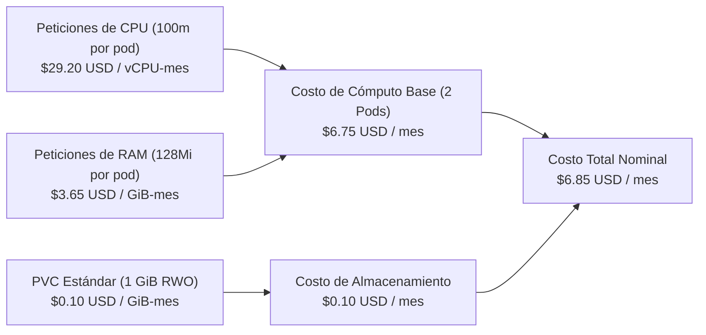

# Retorno de Inversión FinOps y Gobierno de Costos — CoreLedger

La disciplina **FinOps** en **CoreLedger** integra la dimensión económica directamente en el panel operativo de ingeniería (**Paneles 10, 11 y 12 de Grafana**), permitiendo visualizar en tiempo real el costo mensual proyectado de cómputo y almacenamiento para el espacio de nombres `recreate-lab`.

## Desglose Financiero de la Plataforma

| Escenario Operativo | Réplicas Activas | Cómputo Mensual (USD) | Almacenamiento PVC (USD) | Costo Total Proyectado (USD/mes) |
| :--- | :---: | :---: | :---: | :---: |
| Operación Nominal (Base) | 2 Pods | `$6.75 USD` | `$0.10 USD` | **`$6.85 USD / mes`** |
| Transición Durante Corte Recreate | 0 a 2 Pods | `$0.00 a $6.75 USD` | `$0.10 USD` | **`$6.85 USD / mes` (sin sobrecosto)** |
| Escalado Máximo por Pico HPA | 6 Pods | `$20.26 USD` | `$0.10 USD` | **`$20.36 USD / mes`** |

## Comparativa Financiera: Recreate frente a Otras Arquitecturas

| Arquitectura de Despliegue y Persistencia | Sobrecosto de Cómputo en Despliegue | Costo Mensual de Base de Datos | Costo Mensual Total Estimado |
| :--- | :---: | :---: | :---: |
| **CoreLedger (Recreate + SQLite en PVC 1Gi)** | **0%** (termina réplicas antes de crear nuevas) | **`$0.10 USD`** (PVC en bloque) | **`$6.85 USD / mes`** |
| **Despliegue Blue-Green (Doble flota permanente)** | **+100%** (duplica réplicas activas) | `$0.20 USD` (Doble volumen) | `$13.70 USD / mes` |
| **Clúster Relacional Distribuido (Alta Disponibilidad Multi-Zona)** | +25% (concurrencia temporal en actualización) | `~$145.00 USD` (Instancias dedicadas) | `~$152.00 USD / mes` |

## Beneficios y Justificación Empresarial

- **Ahorro frente a Blue-Green:** La estrategia Recreate no requiere mantener una flota duplicada encendida permanentemente para realizar actualizaciones.
- **Transparencia en el autoescalado:** Permite auditar en tiempo real cómo el costo mensual varía entre el piso de `$6.85 USD/mes` y el techo de `$20.36 USD/mes` únicamente durante las horas de alta demanda.
- **Eficiencia en recursos:** El cálculo de costos se ejecuta directamente sobre las métricas de Prometheus, evitando el consumo de memoria adicional que requerirían agentes externos.
