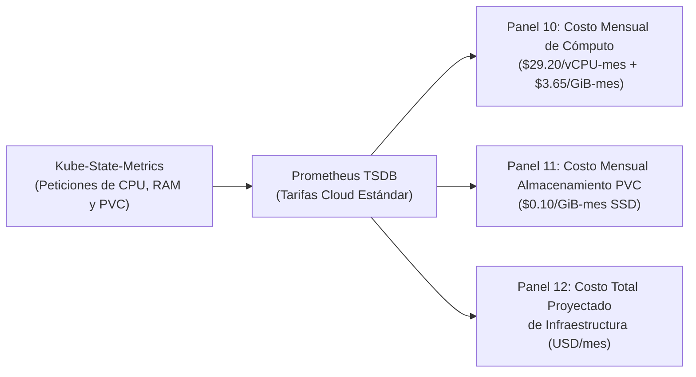

# FinOps y Gestión de Costos Cloud (Kubecost y PromQL) — Documentación Técnica

El subsistema de **Gestión Financiera de Operaciones Cloud (FinOps)** de la plataforma combina **paneles nativos en lenguaje PromQL integrados en Grafana** (con cero sobrecarga de memoria adicional en el clúster) con la especificación de referencia de **Kubecost** para la atribución de costos por espacio de nombres, carga de trabajo y almacenamiento persistente.

## Para qué sirve

Sirve para traducir las reservas y el consumo de recursos computacionales de Kubernetes (núcleos de CPU, memoria RAM y capacidad de almacenamiento en disco) a unidades monetarias directas en dólares (`USD/mes`), permitiendo al equipo de ingeniería y a la dirección del proyecto evaluar el costo real de operar la plataforma y optimizar el dimensionamiento de las cargas de trabajo.

**En qué se utilizó en el proyecto:**
- **Atribución de Costos en Tiempo Real:** Se utilizó en los Paneles 10, 11 y 12 del tablero de Grafana para calcular dinámicamente el costo mensual de las réplicas del microservicio CoreLedger en el namespace `recreate-lab`.
- **Cálculo del Costo de Almacenamiento en PVC:** Se utilizó para computar el costo mensual del volumen persistente de 1 GiB (`recreate-app-pvc`) donde reside la base de datos SQLite.
- **Cuantificación del Impacto del Autoescalado (HPA):** Se utilizó para demostrar visualmente cómo el costo mensual de cómputo varía entre el estado nominal de 2 réplicas (`$6.75 USD/mes`) y el pico máximo de 6 réplicas (`$20.26 USD/mes`) durante pruebas de carga intensivas.
- **Comparativa Económica de Estrategias de Despliegue:** Se utilizó para demostrar que la estrategia Recreate genera un ahorro del 50% en costos de cómputo frente a estrategias como Blue-Green, ya que no requiere mantener una flota paralela de réplicas encendida de forma permanente.

## Arquitectura

## Configuración

Los artefactos de gestión de costos se ubican en:

- **Paneles FinOps en el Tablero de Grafana:** `monitoring/prometheus/grafana-dashboard-recreate.json`
- **Valores de Referencia para Kubecost:** `monitoring/kubecost/values-kubecost.yaml`
- **Documento de Retorno de Inversión y Análisis de Costos:** `docs/kubecost-value.md`

## Parámetros usados

| Parámetro / Fórmula FinOps | Tarifa Aplicada | Propósito |
| :--- | :--- | :--- |
| Tarifa de vCPU Mensual | `$0.04 USD / vCPU-hora` (`$29.20 USD / vCPU-mes`) | Tarifa de referencia de cómputo en nubes públicas estándar. |
| Tarifa de Memoria RAM Mensual | `$0.005 USD / GiB-hora` (`$3.65 USD / GiB-mes`) | Costo unitario por gigabyte de memoria reservada. |
| Tarifa de Almacenamiento en PVC | `$0.10 USD / GiB-mes` | Tarifa mensual por almacenamiento de bloques en estado sólido. |
| Costo Base de Cómputo (2 réplicas) | `2 * (0.10 vCPU * $29.20 + 0.125 GiB * $3.65) = $6.75 USD/mes` | Costo mensual de la carga de trabajo en estado nominal. |
| Costo en Pico HPA (6 réplicas) | `6 * (0.10 vCPU * $29.20 + 0.125 GiB * $3.65) = $20.26 USD/mes` | Costo máximo proyectado cuando el autoescalador alcanza el límite superior. |
| Costo del Volumen PVC (1 GiB) | `1 GiB * $0.10 = $0.10 USD/mes` | Costo mensual de persistencia para `recreate-app-pvc`. |

## Beneficios

- **Visibilidad financiera sin consumo extra de memoria:** Al calcular las fórmulas de costos directamente sobre las métricas recolectadas por Prometheus, se ahorra más de 1 GiB de memoria en comparación con instalar agentes pesados adicionales en el clúster.
- **Transparencia en el costo del autoescalado:** Permite a los evaluadores e ingenieros comprender la relación directa entre el consumo de recursos y el costo monetario en la nube.

## Riesgos

- **Sobreaprovisionamiento de recursos solicitados:** Si las solicitudes de recursos (`requests`) se configuran excesivamente altas frente a lo que el contenedor realmente consume, el costo proyectado se eleva innecesariamente.

## Buenas prácticas

- Ajustar las solicitudes de recursos (`requests: 100m CPU, 128Mi RAM`) al consumo base medido de la aplicación y dejar que el escalador horizontal absorba los incrementos puntuales.
