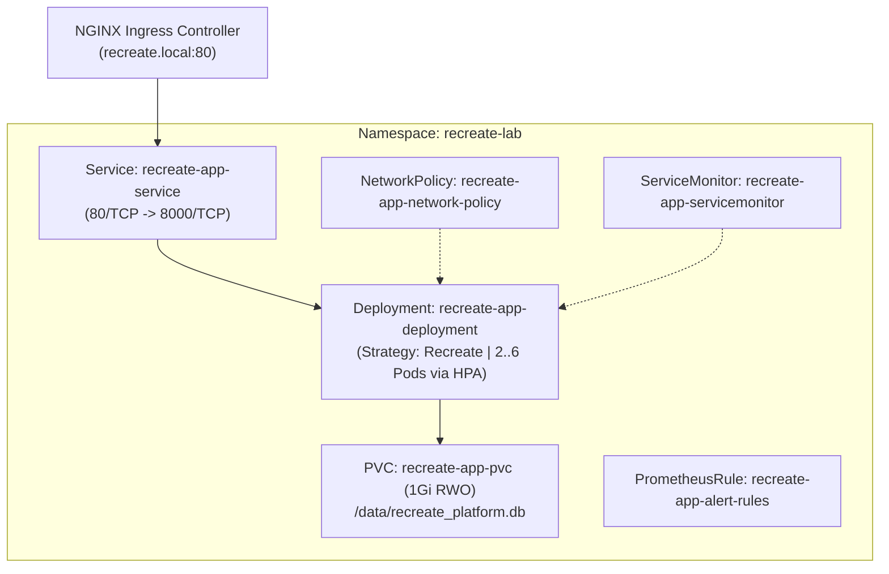

# Kubernetes (Minikube / K8s) — Documentación Técnica

**Kubernetes (K8s)** es la plataforma estándar de código abierto graduada por la Cloud Native Computing Foundation (CNCF) para la orquestación declarativa de cargas de trabajo en contenedores. En esta plataforma se ejecuta sobre **Minikube (`Kubernetes v1.35` / driver `docker`)** proporcionando reconciliación continua de estado deseado, descubrimiento de servicios DNS (`CoreDNS`), enrutamiento L7 (`ingress-nginx`), almacenamiento persistente (`PVC ReadWriteOnce`) y aislamiento de red (`NetworkPolicy`).

## Para qué sirve

Sirve para automatizar el ciclo de vida de los contenedores, garantizando autorrecuperación (*self-healing*) mediante sondas de salud, balanceo de carga interno, escalamiento horizontal de réplicas y gestión centralizada de configuración.

**En qué se utilizó en el proyecto:**
- **Orquestación del Microservicio CoreLedger:** Se utilizó para gestionar el ciclo de vida de `recreate-app-deployment` dentro del namespace aislado `recreate-lab`, ejecutando de forma estricta la estrategia de despliegue `Recreate` (`spec.strategy.type: Recreate`).
- **Enrutamiento y Exposición Externa:** Se utilizó el controlador Ingress NGINX para enrutar el tráfico HTTP entrante del host hacia el Service `recreate-app-service` a través del dominio `recreate.local`.
- **Aislamiento Multi-Namespace:** Se utilizó para separar las cargas de trabajo de la aplicación (`recreate-lab`) de la infraestructura de telemetría y registros (`monitoring`).
- **Autoescalado Elástico:** Se utilizó junto con `Metrics Server` y el controlador `HorizontalPodAutoscaler` para escalar automáticamente entre 2 y 6 réplicas ante incrementos en el uso de CPU.

## Arquitectura

## Configuración

Los manifiestos declarativos se organizan dentro de `k8s/`:

- **Namespace:** `k8s/namespace.yaml`
- **Almacenamiento Persistente (PVC):** `k8s/pvc.yaml`
- **Despliegues (Recreate v1 y v2):** `k8s/deployment-v1.yaml` y `k8s/deployment-v2.yaml`
- **Servicio e Ingress:** `k8s/service.yaml` y `k8s/ingress.yaml`
- **Seguridad de Red:** `k8s/networkpolicy.yaml`
- **Autoescalado HPA:** `k8s/hpa.yaml`
- **Observabilidad:** `k8s/servicemonitor.yaml` y `k8s/prometheusrule.yaml`

## Parámetros usados

| Recurso / Componente | Parámetro | Valor Configurado | Propósito |
| :--- | :--- | :--- | :--- |
| Clúster Minikube | `--cpus` / `--memory` | `6 CPUs` / `10240 MB` | Capacidad dimensionada para alojar CoreLedger, Prometheus/Grafana y la pila ELK concurrentemente. |
| `recreate-app-deployment` | `strategy.type` | `Recreate` | Garantiza que el 100% de los pods anteriores terminen antes de iniciar la nueva versión sobre el PVC. |
| `recreate-app-deployment` | `requests` / `limits` | `100m CPU, 128Mi` / `300m CPU, 256Mi` | Garantiza clase QoS `Burstable` y permite el cálculo exacto de utilización en HPA y FinOps. |
| Sonda de vida (`livenessProbe`) | `httpGet /healthz` | `initialDelay: 5s, period: 10s` | Reinicia el contenedor automáticamente si el proceso FastAPI/Uvicorn deja de responder. |
| Sonda de preparación (`readinessProbe`) | `httpGet /ready` | `initialDelay: 3s, period: 5s` | Retira el pod de los endpoints del Service hasta que el esquema SQLite en el PVC esté verificado. |
| Ingress | `host` / `ingressClassName` | `recreate.local` / `nginx` | Enrutamiento HTTP L7 hacia `recreate-app-service` en el puerto `80`. |

## Beneficios

- **Reconciliación declarativa e idempotencia:** Todo el estado de la infraestructura se versiona en Git y se aplica mediante `bash scripts/start-all.sh`.
- **Coordinación exacta con el ciclo de vida de datos:** Las sondas de preparación aseguran que ningún cliente reciba tráfico hasta que la migración de SQLite haya finalizado.

## Riesgos

- **Conflicto de conteo de réplicas con HPA:** Si un `Deployment` define `spec.replicas: 2` de forma estática, cada ejecución de `kubectl apply` sobrescribe el escalado dinámico del HPA; se mitigó omitiendo `spec.replicas` en los manifiestos de despliegue.

## Buenas prácticas

- Definir siempre `requests` y `limits` de CPU y memoria en cada contenedor para habilitar el cálculo del HPA y evitar que un proceso consuma todos los recursos del nodo.
- Separar las sondas `/healthz` (salud del proceso web) y `/ready` (disponibilidad de la base de datos en el volumen persistente).
