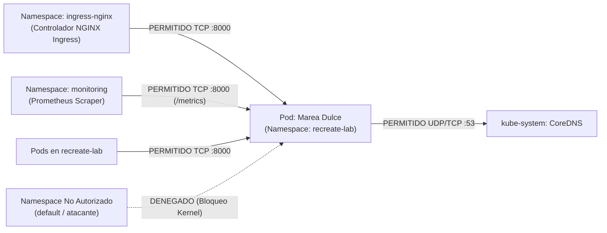

# Seguridad Zero-Trust y Políticas de Red (NetworkPolicies) — Documentación Técnica

Una **Kubernetes NetworkPolicy (`networking.k8s.io/v1`)** es un conjunto declarativo de reglas de filtrado de paquetes a nivel de capa 3 y capa 4 (direcciones IP y puertos TCP/UDP) que restringe qué Pods, Namespaces o bloques de red pueden comunicarse con los contenedores seleccionados dentro del clúster.

## Para qué sirve

Sirve para aplicar el principio de mínimo privilegio y micro-segmentación de red, bloqueando por defecto cualquier tráfico no explícitamente autorizado y previniendo el movimiento lateral de posibles atacantes dentro del clúster.

**En qué se utilizó en el proyecto:**
- **Aislamiento Perimetral de Marea Dulce:** Se utilizó para proteger el namespace `recreate-lab`, aplicando la política `recreate-app-network-policy` sobre los pods de la aplicación etiquetados con `app: recreate-app` (o `app: marea-app`).
- **Restricción Estricta de Tráfico Entrante (*Ingress*):** Se utilizó para permitir únicamente tráfico entrante en el puerto TCP `8000` proveniente de dos fuentes autorizadas: el controlador Ingress NGINX (`ingress-nginx`) para peticiones de clientes a la tienda y el namespace de monitoreo (`monitoring`) para la recolección de métricas de Prometheus.
- **Bloqueo de Namespaces Ajenos:** Se utilizó para impedir que pods en otros namespaces (como `default` u otros servicios no relacionados) puedan conectarse directamente a la API de Marea Dulce o inspeccionar la base de datos local.
- **Control de Salida (*Egress*) para DNS:** Se utilizó para permitir que los pods resuelvan nombres únicamente hacia el servicio `CoreDNS` en el puerto `53` (UDP/TCP) de `kube-system`.

## Arquitectura

## Configuración

El manifiesto declarativo de seguridad de red se encuentra en:

- **Política de Red Zero-Trust:** `k8s/networkpolicy.yaml`
- **Validación Automatizada de Política Activa:** `scripts/validate.sh`

## Parámetros usados

| Parámetro / Regla | Valor Configurado | Propósito |
| :--- | :--- | :--- |
| Selector de Pods (`podSelector.matchLabels`) | `app: recreate-app` | Aplica la restricción de firewall a los pods de la aplicación Marea Dulce. |
| Tipos de Política (`policyTypes`) | `["Ingress", "Egress"]` | Activa el control bidireccional tanto de tráfico entrante como de tráfico saliente. |
| Origen Permitido 1 | `namespaceSelector: kubernetes.io/metadata.name=ingress-nginx` | Autoriza peticiones HTTP provenientes del controlador Ingress NGINX hacia el puerto `8000`. |
| Origen Permitido 2 | `namespaceSelector: kubernetes.io/metadata.name=monitoring` | Autoriza a Prometheus para recolectar métricas en `/metrics` sobre el puerto `8000`. |
| Origen Permitido 3 | `podSelector: {}` (mismo namespace) | Permite comunicación interna entre componentes autorizados dentro de `recreate-lab`. |
| Destino de Salida Permitido | `ports: 53/UDP, 53/TCP` | Permite resolución de nombres de dominio hacia `CoreDNS`. |

## Beneficios

- **Contención de movimiento lateral:** Si un contenedor en otro namespace del clúster fuese vulnerado, no puede conectarse directamente al puerto `8000` de Marea Dulce ni acceder a los datos de pedidos.
- **Micro-segmentación nativa:** Aplica reglas a nivel del subsistema de red del kernel Linux mediante CNI/iptables sin sobrecargar la aplicación.

## Riesgos

- **Bloqueo accidental del scraping de métricas:** Si se omite la regla para el namespace `monitoring`, Prometheus dejará de alcanzar el endpoint `/metrics` y reportará el target como caído (*DOWN*).

## Buenas prácticas

- Utilizar la etiqueta nativa `kubernetes.io/metadata.name` en los selectores de namespace para garantizar compatibilidad automática en Kubernetes moderno.
