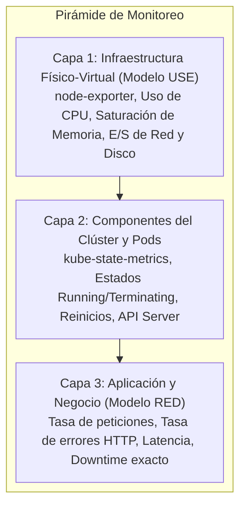

# Observabilidad, Telemetría y Gestión de Costos

---

## 1. La Pirámide de Observabilidad en Kubernetes

El sistema implementa una arquitectura de monitoreo estratificada en tres capas funcionales:

---

## 2. Modelos de Telemetría Aplicados

### 2.1. Modelo RED (Centrado en la Experiencia de Usuario)
- **Rate (Tasa):** Solicitudes procesadas por segundo (`sum(rate(http_requests_total[1m]))`).
- **Errors (Errores):** Solicitudes fallidas (`http_requests_total{status_code=~"5.."}`) y cálculo porcentual sobre el total.
- **Duration (Duración):** Tiempo de respuesta por percentiles p50, p95 y p99 medido con `http_request_duration_seconds_bucket`.

### 2.2. Modelo USE (Centrado en la Infraestructura y Nodos)
- **Utilization (Utilización):** Porcentaje de cómputo y memoria activa (`container_cpu_usage_seconds_total`, `container_memory_working_set_bytes`).
- **Saturation (Saturación):** Throttling de CPU (`container_cpu_cfs_throttled_periods_total`) y encolamiento de E/S.
- **Errors (Errores):** Caídas de paquetes de red o errores de disco.

---

## 3. Pila Tecnológica de Observabilidad

| Herramienta | Rol en la Plataforma | Configuración y Despliegue |
| :--- | :--- | :--- |
| **Prometheus** | TSDB de almacenamiento y motor de scraping | Desplegado vía `kube-prometheus-stack` con retención de 2 días |
| **Grafana** | Dashboards visuales interactivos | Acceso web integrado con paneles RED y correlación de downtime |
| **Alertmanager** | Motor de enrutamiento y disparo de alertas | Reglas ante errores 5xx sostenidos, latencia >1s y CPU >80% |
| **Kubecost** | FinOps y auditoría de costos en tiempo real | Monitoreo del costo monetario de Pods y almacenamiento PVC |
| **Pila ELK** | Elasticsearch + Kibana | Almacenamiento y consulta de grandes volúmenes de logs en tiempo real |

---

## 4. Recolección Declarativa con ServiceMonitor

La extracción de métricas desde el microservicio se gestiona mediante el recurso [`k8s/servicemonitor.yaml`](file:///home/guarinve/Documentos/k8s-recreate-deployment/k8s/servicemonitor.yaml), configurado para consultar el endpoint `/metrics` cada 5 segundos con un timeout de 3 segundos.

