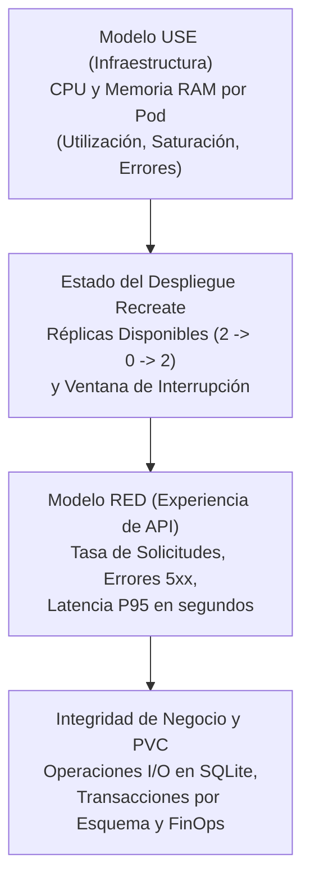

# Valor Empresarial de la Observabilidad — CoreLedger

En una arquitectura que utiliza la estrategia **`Recreate`**, donde existe una ventana de interrupción planificada durante cada actualización de versión, la observabilidad es el instrumento indispensable de control, certificación del nivel de servicio y reducción del tiempo medio de detección.

## Correlación entre Modelos de Telemetría y Negocio

## Beneficios Cuantificables por Dominio de Observabilidad

| Dominio de Observabilidad | Herramienta / Componente | Métricas y Reglas Clave | Valor Directo para el Negocio |
| :--- | :--- | :--- | :--- |
| Control de Ventana Recreate | Prometheus y Grafana (Paneles 1 a 3) | `kube_deployment_status_replicas_available`, `app_version_info` | Certifica la duración exacta de la ventana de mantenimiento (~7 segundos). |
| Calidad de Servicio (RED) | Grafana (Paneles 4 a 6) y Alertmanager | `http_requests_total`, `HighHttp5xxErrorRate`, `HighRequestLatencyP95` | Detecta degradaciones en la API en menos de 10 segundos antes de afectar operaciones. |
| Salud de Recursos (USE) | Grafana (Paneles 7 y 8) y Alertmanager | `container_cpu_usage_seconds_total`, `HighPodCpuUsageAbove80Percent` | Previene estrangulamiento de cómputo y caídas por memoria. |
| Integridad de Disco (PVC) | Grafana (Panel 9) y Alertmanager | `app_pvc_storage_operations_total`, `PersistentVolumeStorageErrors` | Garantiza cero fallos silenciosos de escritura en `/data/recreate_platform.db`. |
| Auditoría de Registros | Filebeat, Elasticsearch y Kibana | Registros filtrados por `recreate-lab`, señales `SIGTERM` y migración DDL | Conserva la evidencia histórica completa incluso tras la destrucción de pods. |

## Justificación del Retorno de Inversión Operacional

- **Reducción del tiempo de diagnóstico:** Al correlacionar en una sola vista la caída de réplicas, la tasa de errores y las operaciones de disco en el volumen persistente, el equipo técnico identifica en segundos si un corte corresponde a un despliegue Recreate programado o a una anomalía inesperada.
- **Eliminación de puntos ciegos en migraciones:** Los registros indexados en Elasticsearch permiten auditar con precisión qué réplica ejecutó la migración estructural y en qué instante quedó disponible el esquema migrado.
