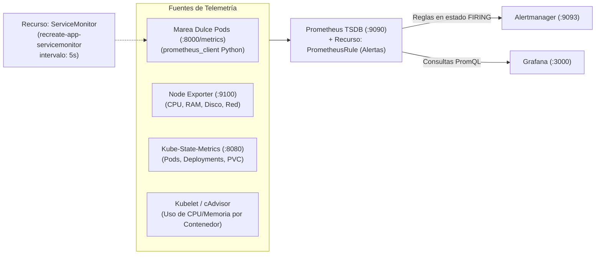

# Prometheus y Alertmanager — Documentación Técnica

**Prometheus** es el sistema líder de monitoreo y base de datos de series temporales (**TSDB**) graduado por la Cloud Native Computing Foundation (CNCF), complementado por **Alertmanager** para la deduplicación, agrupación y enrutamiento de alarmas operativas. En esta plataforma se despliega mediante el operador **`kube-prometheus-stack`** en el namespace `monitoring`.

## Para qué sirve

Sirve para recolectar continuamente métricas numéricas mediante sondeos HTTP periódicos (*scraping*), evaluar reglas de alerta expresadas en lenguaje PromQL y despachar notificaciones cuando los umbrales de salud o rendimiento se ven comprometidos.

**En qué se utilizó en el proyecto:**
- **Recolección de Alta Frecuencia (5 segundos):** Se utilizó un recurso declarativo `ServiceMonitor` (`k8s/servicemonitor.yaml`) configurado con un intervalo de `5s` para raspar las métricas de **Marea Dulce** en el puerto `8000`, permitiendo registrar la ventana de corte de Recreate con precisión.
- **Implementación de Modelos RED y USE:** Se utilizó para medir la tasa de peticiones, porcentaje de errores HTTP 5xx y latencia P95 (modelo RED), así como la utilización y saturación de CPU y memoria de los contenedores (modelo USE).
- **Detección Inmediata de la Ventana Recreate:** Se utilizó la regla de alerta `RecreateDeploymentZeroReplicasWindow` con evaluación sin retraso (`for: 0m`) para activar una alarma en Alertmanager tan pronto como el número de réplicas disponibles cae a `0`.
- **Monitoreo de Integridad de Almacenamiento en PVC:** Se utilizó para vigilar errores de lectura y escritura en la base de datos mediante la regla `PersistentVolumeStorageErrors` sobre la métrica `app_pvc_storage_operations_total`.
- **Generación de Pruebas de Alarma:** Se utilizó el script `scripts/test_alerts.py` para inyectar fallos controlados y comprobar en tiempo real la transición de las reglas desde estado inactivo hasta estado de disparo (*FIRING*).

## Arquitectura

## Configuración

Los manifiestos declarativos y valores de configuración se ubican en:

- **Valores del Despliegue de Observabilidad:** `monitoring/prometheus/values-kube-prometheus-stack.yaml`
- **Recurso de Recolección ServiceMonitor:** `k8s/servicemonitor.yaml`
- **Reglas de Alerta PrometheusRule:** `k8s/prometheusrule.yaml`
- **Instrumentación en la Aplicación:** `app/src/main.py`
- **Script de Pruebas de Alertas:** `scripts/test_alerts.py`

## Parámetros usados

| Parámetro / Regla | Valor Configurado | Descripción |
| :--- | :--- | :--- |
| Intervalo de Recolección | `5s` (tiempo de espera: `3s`) | Alta frecuencia para registrar la ventana de corte de Recreate (~3 a 4 segundos). |
| Preservación de Etiquetas | `honorLabels: true` | Mantiene las etiquetas originales emitidas por la aplicación (`version`, `schema_version`, etc.). |
| Regla 1: Ventana de Cero Réplicas Recreate | `kube_deployment_status_replicas_available == 0` (`for: 0m`) | Disparo inmediato en cuanto el despliegue Recreate detiene el pod activo. |
| Regla 2: Alta Tasa de Errores HTTP 5xx | `sum(rate(http_requests_total{status_code=~"5.."}[1m])) > 0.2` (`for: 10s`) | Alerta crítica ante ráfagas de errores en la API de la aplicación. |
| Regla 3: Alta Latencia P95 | `histogram_quantile(0.95, ...) > 1.0` (`for: 30s`) | Alerta preventiva ante degradación de tiempos de respuesta por encima de 1.0 s. |
| Regla 4: Errores en PVC | `increase(app_pvc_storage_operations_total{status="error"}[1m]) > 0` | Alerta inmediata si falla una operación de entrada/salida en el volumen. |

## Beneficios

- **Resolución de alta frecuencia:** El intervalo de sondeo de 5 segundos permite registrar la ventana de transición Recreate que ocurre en ~3.2 segundos.
- **Detección desasistida de incidentes:** Alertmanager despacha alertas categorizadas por severidad (`warning`, `critical`).

## Riesgos

- **Fatiga de alertas por ventanas de mantenimiento programadas:** Si una alerta de réplicas en cero no se correlaciona con eventos de release, puede confundirse con una caída no programada; se documenta el comportamiento de `RecreateDeploymentZeroReplicasWindow` como esperada durante despliegues Recreate.

## Buenas prácticas

- Configurar `for: 0m` únicamente para alertas que requieren detección inmediata como el corte Recreate, y `for: 30s` o más para evitar falsos positivos por picos transitorios.
