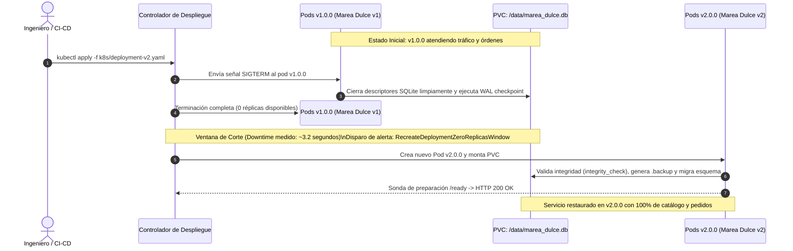

# Estrategia de Despliegue Recreate — Documentación Técnica

La estrategia **Recreate (`spec.strategy.type: Recreate`)** es un mecanismo nativo de despliegue en Kubernetes mediante el cual el controlador `Deployment` **termina y destruye la totalidad de los Pods de la versión activa anterior antes de crear e iniciar los Pods de la nueva versión candidata**. Durante la transición, existe una ventana controlada donde no coexisten pods de ambas versiones en ejecución.

## Para qué sirve

Sirve para garantizar aislamiento temporal completo entre versiones cuando las cargas de trabajo exigen acceso exclusivo a recursos compartidos o no admiten concurrencia multi-versión.

**En qué se utilizó en el proyecto:**
- **Prevención de Bloqueos en SQLite:** Se utilizó como la estrategia mandatoria para gestionar el despliegue de la plataforma **Marea Dulce** sobre un volumen persistente `PVC (ReadWriteOnce)`. Debido a que SQLite es una base de datos relacional incrustada en un archivo local en disco (`/data/marea_dulce.db`), la estrategia Recreate garantiza un único escritor en todo momento, evitando colisiones de descriptores de archivo o errores de contienda (`database is locked`).
- **Migración Serializada y Segura de Esquema:** Se utilizó para permitir que la versión `v2.0.0` ejecute la migración estructural del catálogo y pedidos artesanales de manera estrictamente atómica mediante `BEGIN IMMEDIATE`, respaldada con `.backup` previo y validación con `PRAGMA integrity_check`.
- **Medición Cuantitativa de Indisponibilidad (*Downtime*):** Se utilizó para demostrar y cronometrar empíricamente en vivo el intervalo exacto de corte (~3 a 4 segundos) durante la actualización, correlacionándolo con la alerta `RecreateDeploymentZeroReplicasWindow` en Alertmanager y los paneles de Grafana.
- **Rollback Determinista:** Se utilizó para regresar de forma segura a la versión `v1.0.0` mediante `bash scripts/reset_v1.sh` preservando el 100% de los pedidos y productos históricos en el PVC.

## Arquitectura

## Configuración

Los artefactos asociados a la estrategia Recreate se encuentran en:

- **Manifiesto Versión Base (v1.0.0):** `k8s/deployment-v1.yaml`
- **Manifiesto Versión Migrada (v2.0.0):** `k8s/deployment-v2.yaml`
- **Lógica de Ciclo de Vida y Captura SIGTERM:** `app/src/main.py`
- **Cronómetro de Ventana de Corte en Vivo:** `scripts/traffic_generator.py`
- **Transición y Reinicio a v1.0.0:** `scripts/rollout_v2.sh` y `scripts/reset_v1.sh`

## Parámetros usados

| Parámetro / Configuración | Valor Configurado | Descripción |
| :--- | :--- | :--- |
| `spec.strategy.type` | `Recreate` | Fuerza el ciclo secuencial de terminación completa antes de programar la nueva versión. |
| `replicas` | `1` | Réplica estricta para garantizar un único escritor en SQLite sobre PVC ReadWriteOnce. |
| `terminationGracePeriodSeconds` | `30` | Ventana de gracia para completar peticiones en vuelo y volcar el WAL a disco. |
| `APP_VERSION` (v1 / v2) | `v1.0.0` / `v2.0.0` | Define la versión de la aplicación y catálogo expuesto. |
| Regla de Alerta de Ventana de Corte | `kube_deployment_status_replicas_available == 0` (`for: 0m`) | Regla en Prometheus que detecta instantáneamente el inicio de la ventana de interrupción. |
| Frecuencia de Sondeo | `0.2s` (200 ms) | Frecuencia de peticiones en `traffic_generator.py` para medir con precisión milimétrica el corte. |

## Beneficios

- **Cero corrupción de datos en PVC compartido:** Elimina de raíz las colisiones de escritura entre versiones concurrentes en la base de datos.
- **Menor huella de recursos durante el despliegue:** Libera los recursos de cómputo y memoria del pod anterior antes de alojar el nuevo, manteniendo un consumo plano y predecible.
- **Aislamiento absoluto en migraciones de esquema:** La versión nueva no compite con lectores ni escritores residuales de la versión anterior.

## Riesgos

- **Ventana de indisponibilidad obligatoria (*Downtime*):** Durante el intervalo entre la muerte del pod de `v1.0.0` y el estado listo del pod de `v2.0.0` (~3 a 4 segundos), el servicio no procesa solicitudes HTTP. Este comportamiento se mitiga y gobierna mediante avisos en el frontend y persistencia local del carrito en el cliente.

## Buenas prácticas

- Precargar las imágenes de contenedor en los nodos del clúster antes de aplicar el cambio para minimizar el tiempo de descarga durante la ventana de corte.
- Capturar la señal `SIGTERM` en la aplicación para cerrar transacciones en curso antes de que el contenedor se detenga.
- Ejecutar un respaldo nativo de la base de datos (`.backup`) antes de iniciar modificaciones de estructura en la base de datos.
