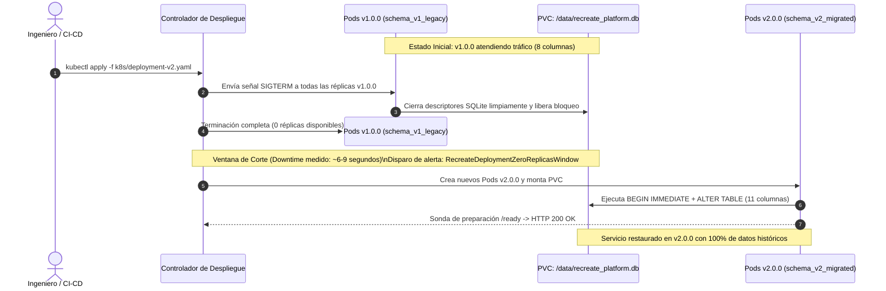

# Estrategia de Despliegue Recreate — Documentación Técnica

La estrategia **Recreate (`spec.strategy.type: Recreate`)** es un mecanismo nativo de despliegue en Kubernetes mediante el cual el controlador `Deployment` **termina y destruye la totalidad de los Pods de la versión activa anterior antes de crear e iniciar los Pods de la nueva versión candidata**. A diferencia de una actualización progresiva (*RollingUpdate*), en ningún momento coexisten pods de ambas versiones en ejecución.

## Para qué sirve

Sirve para garantizar aislamiento temporal completo entre versiones cuando las cargas de trabajo no admiten concurrencia multi-versión o comparten recursos que exigen acceso exclusivo.

**En qué se utilizó en el proyecto:**
- **Prevención de Bloqueos en SQLite:** Se utilizó como la estrategia mandatoria para gestionar el despliegue del microservicio CoreLedger sobre un volumen persistente `PVC (ReadWriteOnce)`. Debido a que SQLite es una base de datos embebida basada en un archivo local en disco (`/data/recreate_platform.db`), la estrategia Recreate previene que dos versiones compitan por descriptores de archivo o generen colisiones de bloqueo (`database is locked`).
- **Migración Serializada de Esquema:** Se utilizó para permitir que la versión `v2.0.0` ejecute la migración estructural (`schema_v1_legacy` de 8 columnas hacia `schema_v2_migrated` de 11 columnas con `currency`, `tax_rate` y `audit_hash`) de manera estrictamente serializada mediante `BEGIN IMMEDIATE`, sin lectores ni escritores residuales de `v1.0.0`.
- **Medición Cuantitativa de Indisponibilidad (*Downtime*):** Se utilizó para demostrar y cronometrar empíricamente en vivo el intervalo exacto de corte (~6 a 9 segundos) durante la actualización, correlacionándolo con la alerta `RecreateDeploymentZeroReplicasWindow` en Alertmanager.
- **Rollback Determinista:** Se utilizó para regresar de forma segura a la versión `v1.0.0` mediante `bash scripts/status.sh --reset-v1` preservando el 100% de las transacciones históricas en el PVC.

## Arquitectura

## Configuración

Los artefactos asociados a la estrategia Recreate se encuentran en:

- **Manifiesto Versión Base (v1.0.0):** `k8s/deployment-v1.yaml`
- **Manifiesto Versión Migrada (v2.0.0):** `k8s/deployment-v2.yaml`
- **Lógica de Migración Serializada y Captura SIGTERM:** `app/src/main.py`
- **Cronómetro de Ventana de Corte en Vivo:** `scripts/traffic_generator.py`
- **Restauración Automática a Estado v1:** `scripts/status.sh` (`--reset-v1`)

## Parámetros usados

| Parámetro / Configuración | Valor Configurado | Descripción |
| :--- | :--- | :--- |
| `spec.strategy.type` | `Recreate` | Desactiva `RollingUpdate` y fuerza el ciclo secuencial de parada total antes de iniciar la nueva versión. |
| `APP_VERSION` (v1 / v2) | `v1.0.0` / `v2.0.0` | Define el comportamiento del esquema contable y la identidad visual (Azul vs Verde Esmeralda). |
| Esquema Activo (v1 / v2) | `schema_v1_legacy` (8 cols) / `schema_v2_migrated` (11 cols) | Evolución estructural agregando `currency`, `tax_rate` y `audit_hash` SHA-256. |
| Regla de Alerta de Ventana de Corte | `kube_deployment_status_replicas_available == 0` (`for: 0m`) | Regla de Prometheus que detecta instantáneamente el inicio de la ventana de interrupción. |
| Frecuencia de Sondeo | `0.2s` (200 ms) | Frecuencia de peticiones en `traffic_generator.py` para medir con precisión el tiempo de corte. |

## Beneficios

- **Cero corrupción de datos en PVC compartido:** Elimina de raíz las colisiones de escritura entre versiones y los errores de concurrencia en la base de datos.
- **Menor huella de recursos durante el despliegue:** A diferencia de `Blue-Green` (que duplica al 200% el consumo de RAM y CPU), Recreate libera los recursos de la versión anterior antes de alojar la nueva.
- **Simplicidad en migraciones de base de datos:** No requiere mantener vistas de compatibilidad duales (*expand-and-contract*) para soportar dos versiones del código al mismo tiempo.

## Riesgos

- **Ventana de indisponibilidad obligatoria (*Downtime*):** Durante el intervalo entre la muerte del último pod de `v1.0.0` y el estado listo del primer pod de `v2.0.0` (~6 a 9 segundos), el servicio retorna `HTTP 502/503` o rechaza conexiones.

## Buenas prácticas

- Precargar las imágenes de contenedor en los nodos del clúster antes de aplicar el cambio para evitar que el tiempo de descarga prolongue la ventana de corte.
- Capturar la señal `SIGTERM` en la aplicación para cerrar transacciones en curso antes de que el contenedor se detenga.
- Ejecutar un respaldo nativo de la base de datos (`.backup`) antes de iniciar la transición hacia una nueva versión con cambios de esquema.
