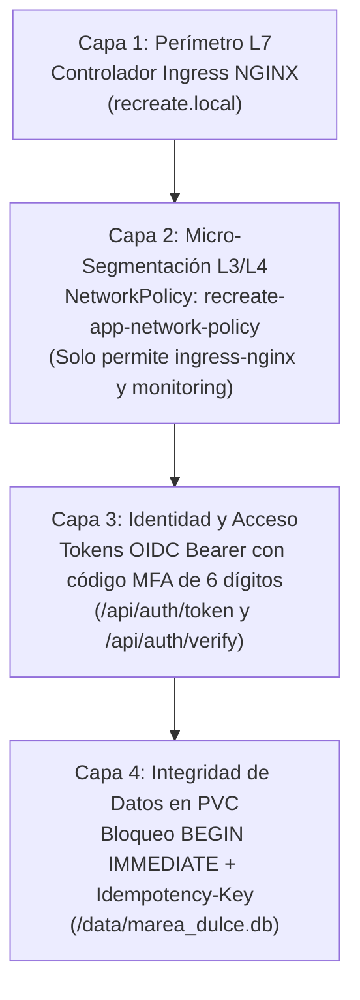

# Valor Empresarial de la Seguridad Zero-Trust — Marea Dulce

En una plataforma de comercio electrónico que procesa pedidos, pagos y almacena información en un volumen persistente (`recreate-app-pvc`), la seguridad en profundidad (*Defense-in-Depth*) es indispensable para proteger los datos de clientes y la operación de la tienda. **Marea Dulce** integra micro-segmentación **Zero-Trust con NetworkPolicies de Kubernetes**, autenticación **SSO/OIDC con verificación de segundo factor (MFA)** para administradores e idempotencia transaccional en cada pedido.

## Capas de Defensa en Profundidad

## Matriz de Controles de Seguridad y Mitigación de Riesgos

| Control de Seguridad | Amenaza Mitigada | Implementación en Marea Dulce | Impacto de Negocio |
| :--- | :--- | :--- | :--- |
| Políticas de Red (`NetworkPolicy`) | Movimiento lateral desde contenedores vulnerados en otros namespaces. | Bloqueo por defecto en `recreate-lab`; solo se aceptan conexiones en el puerto `8000` desde `ingress-nginx` y `monitoring`. | Cumplimiento de aislamiento estricto perimetral de la tienda. |
| Autenticación Multifactor (MFA) | Uso de credenciales administrativas comprometidas. | Validación obligatoria de código numérico de 6 dígitos antes de emitir credenciales Bearer administrativas. | Protección absoluta del catálogo y datos privados de clientes. |
| Idempotencia en Pedidos | Duplicación accidental de pedidos por reintentos de red durante el corte Recreate. | Validación de cabecera `Idempotency-Key` antes de insertar órdenes en SQLite. | Cero cobros dobles o duplicación de comandas de cocina. |
| Telemetría de Intentos de Acceso | Ataques de fuerza bruta contra los puntos de entrada de autenticación. | Métrica `app_auth_events_total` monitoreada en Prometheus por resultado (`success`, `valid`, `invalid`). | Detección inmediata de anomalías en el flujo de inicio de sesión. |

## Beneficios y Justificación Empresarial

- **Reducción de la superficie de ataque:** La aplicación de Marea Dulce es inaccesible para cualquier carga de trabajo ajena a Ingress NGINX y a la infraestructura de observabilidad.
- **Trazabilidad por pedido:** Cada orden guardada en `/data/marea_dulce.db` conserva el identificador exacto de idempotencia, fecha UTC y estado de despacho.
