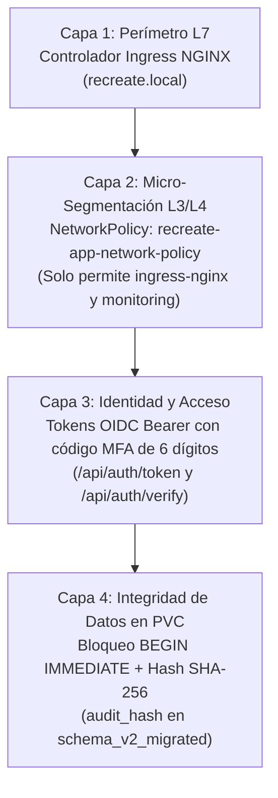

# Valor Empresarial de la Seguridad Zero-Trust — CoreLedger

En una plataforma financiera que procesa y almacena asientos contables en un volumen persistente (`recreate-app-pvc`), la seguridad en profundidad (*Defense-in-Depth*) es indispensable para proteger la integridad del libro mayor contable y cumplir con las exigencias de auditoría corporativa. **CoreLedger** integra micro-segmentación **Zero-Trust con NetworkPolicies de Kubernetes**, autenticación **SSO/OIDC con verificación de segundo factor (MFA)** y sellado criptográfico **SHA-256** por cada transacción.

## Capas de Defensa en Profundidad

## Matriz de Controles de Seguridad y Mitigación de Riesgos

| Control de Seguridad | Amenaza Mitigada | Implementación en CoreLedger | Impacto de Negocio |
| :--- | :--- | :--- | :--- |
| Políticas de Red (`NetworkPolicy`) | Movimiento lateral desde contenedores vulnerados en otros namespaces. | Bloqueo por defecto en `recreate-lab`; solo se aceptan conexiones en el puerto `8000` desde `ingress-nginx` y `monitoring`. | Cumplimiento de aislamiento de red exigido por estándares de seguridad financiera. |
| Autenticación Multifactor (MFA) | Uso de credenciales estáticas robadas o accesos no autorizados. | Validación obligatoria de código numérico de 6 dígitos antes de emitir credenciales Bearer. | Reducción del riesgo de intrusión por credenciales comprometidas. |
| Sello de Auditoría Criptográfico | Alteración accidental o maliciosa de registros contables históricos. | Cada transacción en la versión `v2.0.0` almacena un hash SHA-256 derivado de los datos de la operación. | Garantía de integridad e inmutabilidad contable ante auditorías externas. |
| Telemetría de Intentos de Acceso | Ataques de fuerza bruta contra los puntos de entrada de autenticación. | Métrica `app_auth_events_total` monitoreada en Prometheus por resultado (`success`, `valid`, `invalid`). | Detección inmediata de anomalías en el flujo de inicio de sesión. |

## Beneficios y Justificación Empresarial

- **Reducción de la superficie de ataque:** El microservicio contable es inaccesible para cualquier carga de trabajo ajena a Ingress NGINX y a la infraestructura de observabilidad.
- **Trazabilidad por transacción:** Cada operación guardada en `/data/recreate_platform.db` conserva el identificador exacto del pod de origen, la marca de tiempo UTC, la versión del esquema y el sello criptográfico.
