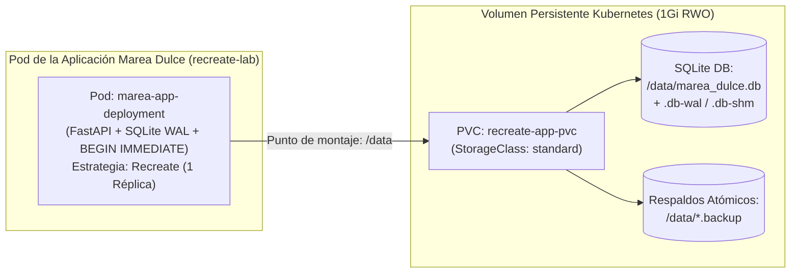

# SQLite 3 y Almacenamiento Persistente en PVC (RWO) — Documentación Técnica

El subsistema de persistencia de **Marea Dulce** combina el motor relacional **SQLite 3** en modo **Write-Ahead Logging (`WAL`)** con un **PersistentVolumeClaim (`PVC`)** de Kubernetes aprovisionado dinámicamente en modo de acceso **`ReadWriteOnce` (`RWO`)**.

## Para qué sirve

Sirve para garantizar persistencia de datos durable, aislamiento transaccional ACID y supervivencia del catálogo de repostería, pedidos y usuarios ante la destrucción, reinicio o reprogramación de los pods de la aplicación durante el ciclo Recreate.

**En qué se utilizó en el proyecto:**
- **Almacenamiento de Catálogo y Pedidos Transaccionales:** Se utilizó para persistir productos, categorías, solicitudes de pedidos y personalización de pasteles en el archivo `/data/marea_dulce.db` dentro del volumen persistente `recreate-app-pvc`.
- **Persistencia de Estado entre Versiones:** Se utilizó para asegurar que tras la terminación completa del pod `v1.0.0` y el arranque de `v2.0.0`, el 100% de los pedidos y productos creados permanezcan intactos.
- **Validación de Concurrencia con WAL:** Se utilizó `PRAGMA journal_mode=WAL` junto con `PRAGMA busy_timeout = 15000` para optimizar lecturas locales sin bloquear las transacciones de escritura.
- **Comprobación de Integridad tras el Relevo Recreate:** Se utilizó para demostrar que el pod `v2.0.0` valida la base de datos con `PRAGMA integrity_check = ok`, genera un respaldo preventivo (`.backup`) y aplica de forma segura las migraciones de esquema sin colisión de procesos.

## Arquitectura

## Configuración

La configuración declarativa y el motor de persistencia se encuentran en:

- **Manifiesto de Reclamo de Volumen Persistente (PVC):** `k8s/pvc.yaml`
- **Montaje de Volumen en Despliegues Recreate:** `k8s/deployment-v1.yaml` y `k8s/deployment-v2.yaml`
- **Inicialización SQLite, WAL y Migración:** `app/src/infrastructure/database.py` y `app/src/main.py`
- **Respaldo Nativo Atómico (.backup):** Implementado en el ciclo de vida del backend y en `scripts/`

## Parámetros usados

| Parámetro / Configuración | Valor Configurado | Propósito |
| :--- | :--- | :--- |
| Modo de Acceso (`accessModes`) | `ReadWriteOnce` (`RWO`) | Permite el montaje de lectura y escritura por parte de un único nodo de Kubernetes a la vez. |
| Capacidad Solicitada | `1Gi` | Espacio asignado en disco para la base de datos de pastelería, respaldos y archivos de registro WAL. |
| Clase de Almacenamiento | `standard` | Aprovisionador dinámico `k8s.io/minikube-hostpath` nativo del clúster Minikube. |
| Modo de Diario (`journal_mode`) | `WAL` | Habilita Write-Ahead Logging para maximizar rendimiento de lecturas locales concurrentes. |
| Tiempo de Espera de Bloqueo | `15000` (15 segundos) | Tiempo máximo de espera en cola antes de retornar error ante contienda de transacciones. |
| Sincronización en Disco | `NORMAL` | Equilibrio óptimo entre durabilidad en disco y latencia de entrada/salida en el volumen PVC. |
| Nivel de Aislamiento | `BEGIN IMMEDIATE` | Adquiere bloqueo reservado desde el inicio de la transacción para garantizar atomicidad estricta. |

## Beneficios

- **Persistencia comprobada tras el corte Recreate:** Cuando `v1.0.0` se apaga por completo, los registros en `/data/marea_dulce.db` permanecen íntegros y son consumidos inmediatamente por `v2.0.0`.
- **Telemetría de entrada/salida integrada:** Cada operación de lectura, inserción o migración se audita y monitorea a través de las métricas expuestas a Prometheus.

## Riesgos

- **Multi-Attach en volúmenes RWO:** Si dos pods intentaran montar simultáneamente un PVC ReadWriteOnce en nodos distintos o en actualización concurrente, Kubernetes rechaza la operación (*Multi-Attach error*). La estrategia **Recreate** elimina este riesgo al esperar que el pod viejo libere el PVC antes de instanciar el nuevo.

## Buenas prácticas

- Nunca realizar copias de seguridad copiando el archivo `.db` en caliente con comandos planos del sistema operativo mientras está abierto; utilizar la función nativa `sqlite3.Connection.backup()` o `VACUUM INTO`.
- Capturar la señal `SIGTERM` para ejecutar un cierre limpio (`PRAGMA wal_checkpoint(TRUNCATE)`) antes de que el pod sea destruido.
