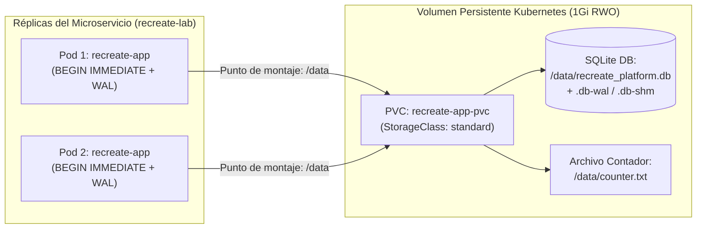

# SQLite 3 y Almacenamiento Persistente en PVC (RWO) — Documentación Técnica

El subsistema de persistencia de **CoreLedger** combina el motor relacional **SQLite 3** en modo **Write-Ahead Logging (`WAL`)** con un **PersistentVolumeClaim (`PVC`)** de Kubernetes aprovisionado dinámicamente en modo de acceso **`ReadWriteOnce` (`RWO`)**.

## Para qué sirve

Sirve para garantizar persistencia de datos durable, aislamiento transaccional ACID y supervivencia del estado contable ante la destrucción, reinicio o reprogramación de los pods de la aplicación.

**En qué se utilizó en el proyecto:**
- **Almacenamiento del Libro Contable Transaccional:** Se utilizó para persistir las operaciones financieras registradas a través de la API (`POST /api/transactions`) en el archivo `/data/recreate_platform.db` dentro del volumen persistente `recreate-app-pvc`.
- **Persistencia del Contador Monotónico:** Se utilizó el archivo `/data/counter.txt` para mantener el conteo acumulado de peticiones a través de múltiples ciclos de vida de pods.
- **Validación de Concurrencia con WAL:** Se utilizó `PRAGMA journal_mode=WAL` junto con `PRAGMA busy_timeout = 15000` para permitir que múltiples réplicas lean concurrentemente la base de datos sin bloquearse, canalizando las escrituras mediante una cola ordenada.
- **Comprobación de Integridad tras el Relevo Recreate:** Se utilizó para demostrar que tras terminar todas las réplicas `v1.0.0` y levantar `v2.0.0`, el 100% de las transacciones históricas permanecen intactas (`PRAGMA integrity_check = ok`) y son enriquecidas con las nuevas columnas del esquema migrado.

## Arquitectura

## Configuración

La configuración declarativa y el motor de persistencia se encuentran en:

- **Manifiesto de Reclamo de Volumen Persistente (PVC):** `k8s/pvc.yaml`
- **Montaje de Volumen en Despliegues:** `k8s/deployment-v1.yaml` y `k8s/deployment-v2.yaml`
- **Inicialización SQLite, WAL y Migración Serializada:** `app/src/main.py`
- **Respaldo Nativo Atómico (.backup):** `scripts/status.sh`

## Parámetros usados

| Parámetro / Configuración | Valor Configurado | Propósito |
| :--- | :--- | :--- |
| Modo de Acceso (`accessModes`) | `ReadWriteOnce` (`RWO`) | Permite el montaje de lectura y escritura por parte de los pods alojados en el nodo de Minikube. |
| Capacidad Solicitada | `1Gi` | Espacio asignado en disco para la base de datos contable y archivos de registro WAL. |
| Clase de Almacenamiento | `standard` | Aprovisionador dinámico `k8s.io/minikube-hostpath` nativo del clúster. |
| Modo de Diario (`journal_mode`) | `WAL` | Habilita Write-Ahead Logging para permitir lecturas concurrentes sin bloqueo durante escrituras. |
| Tiempo de Espera de Bloqueo | `15000` (15 segundos) | Tiempo máximo de espera en cola antes de arrojar error si otro proceso mantiene un bloqueo activo. |
| Sincronización en Disco | `NORMAL` | Equilibrio óptimo entre durabilidad en disco y latencia de entrada/salida en el volumen. |
| Nivel de Aislamiento | `BEGIN IMMEDIATE` | Adquiere bloqueo reservado desde el inicio de la transacción para evitar condiciones de carrera entre réplicas. |

## Beneficios

- **Persistencia comprobada tras el corte Recreate:** Cuando `v1.0.0` se apaga por completo, los registros en `/data/recreate_platform.db` permanecen intactos y son migrados automáticamente a `schema_v2_migrated` al iniciar `v2.0.0`.
- **Telemetría de entrada/salida integrada:** Cada operación (`schema_init`, `db_insert`, `db_select`, `write`) incrementa el contador Prometheus `app_pvc_storage_operations_total`.

## Riesgos

- **Condición de carrera al iniciar múltiples réplicas simultáneamente:** Si dos réplicas `v2.0.0` ejecutan `ALTER TABLE` al mismo milisegundo sin bloqueo previo, una fallaría con error de columna duplicada. Se eliminó encapsulando la inspección y alteración de columnas dentro de `BEGIN IMMEDIATE ... COMMIT`.

## Buenas prácticas

- Nunca realizar copias de seguridad copiando el archivo `.db` en caliente con comandos de copia tradicionales mientras está abierto; utilizar la función nativa `sqlite3.Connection.backup()` o la sentencia `VACUUM INTO`.
- Monitorear la métrica `app_pvc_storage_operations_total{status="error"}` mediante la regla `PersistentVolumeStorageErrors` en Alertmanager.
