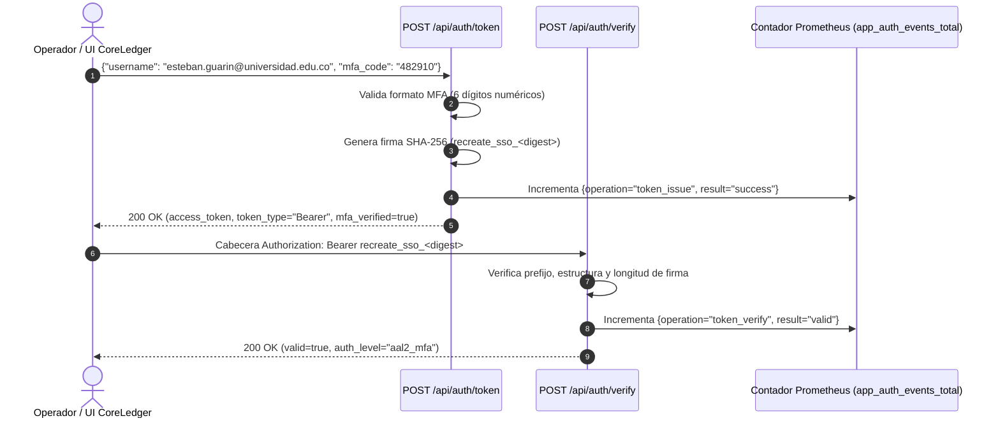

# Autenticación SSO / OIDC y Verificación MFA — Documentación Técnica

El módulo de **Identidad y Control de Acceso de CoreLedger** implementa un flujo de autenticación inspirado en los estándares **OpenID Connect (OIDC)** con validación obligatoria de **Factor Múltiple de Autenticación (`MFA / TOTP` de 6 dígitos)**, emisión de credenciales de sesión tipo **Bearer Token (`recreate_sso_<sha256>`)** y exportación de telemetría de eventos de seguridad hacia Prometheus.

## Para qué sirve

Sirve para autenticar a los operadores del sistema y clientes de la API antes de permitir operaciones contables, verificando tanto la identidad del usuario (`username`) como el código temporal de segundo factor (`mfa_code`), rechazando cualquier intento con credenciales incompletas o alteradas.

**En qué se utilizó en el proyecto:**
- **Control de Acceso al Libro Mayor:** Se utilizó para proteger los endpoints administrativos y de auditoría de CoreLedger mediante la emisión de tokens en `POST /api/auth/token` y su posterior validación en `POST /api/auth/verify`.
- **Validación de Segundo Factor (MFA):** Se utilizó para exigir un código numérico de 6 dígitos (por ejemplo `482910`), simulando el flujo de una aplicación de autenticación TOTP antes de otorgar el nivel de acceso `aal2_mfa`.
- **Botón Interactivo en el Dashboard Web:** Se utilizó para integrar una prueba interactiva en vivo en la interfaz de usuario (`http://localhost:8080`), permitiendo al usuario o evaluador presionar "Probar SSO / MFA" y observar la solicitud y respuesta JSON en tiempo real.
- **Auditoría y Detección de Intentos Fallidos:** Se utilizó la métrica `app_auth_events_total` etiquetada por operación (`token_issue`, `token_verify`) y resultado (`success`, `valid`, `invalid`) para monitorear intentos de acceso no autorizado en Prometheus y Grafana.

## Arquitectura

## Configuración

La implementación del módulo de identidad se encuentra en:

- **Controladores y Modelos de Datos:** `app/src/main.py` (modelos `TokenRequest` y rutas `/api/auth/token`, `/api/auth/verify`)
- **Acción Interactiva en la Interfaz Web:** `app/src/main.py` (función `verifySso()`)
- **Pruebas Automatizadas de Emisión y Rechazo:** `scripts/validate.sh` (Pruebas 7 y 8)

## Parámetros usados

| Parámetro / Endpoint | Valor Configurado | Descripción |
| :--- | :--- | :--- |
| `POST /api/auth/token` | `username` + `mfa_code` (6 dígitos) | Emite un token Bearer firmado con SHA-256 si el segundo factor MFA es válido. |
| `POST /api/auth/verify` | Cabecera `Authorization: Bearer <token>` | Valida la autenticidad e integridad del token emitido. |
| Nivel de Autenticación (`auth_level`) | `aal2_mfa` | Nivel de aseguramiento de autenticación multi-factor verificado. |
| Tiempo de Expiración (`expires_in`) | `3600` (1 hora) | Ventana de validez declarada para el token de sesión. |
| Métrica de Seguridad | `app_auth_events_total` | Contador Prometheus que audita intentos válidos, expirados o rechazados. |

## Beneficios

- **Seguridad reforzada con segundo factor (MFA):** Rechaza inmediatamente con código `HTTP 401 Unauthorized` cualquier solicitud cuyo código de segundo factor no cumpla la validación requerida.
- **Visibilidad de seguridad en tiempo real:** Todos los eventos de emisión y verificación quedan expuestos en `/metrics` para detección de intentos de fuerza bruta.

## Riesgos

- **Reutilización de tokens interceptados en tránsito sin cifrado:** Si el tráfico viaja en texto plano, un tercero podría capturar la cabecera `Bearer`; se mitiga en entornos productivos habilitando terminación TLS en el controlador Ingress NGINX.

## Buenas prácticas

- Exigir siempre el esquema `Bearer` en la cabecera `Authorization` y rechazar tokens truncados o con longitud de hash inválida.
- Auditar en Prometheus la relación entre intentos fallidos y exitosos en la métrica `app_auth_events_total`.
